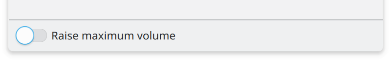
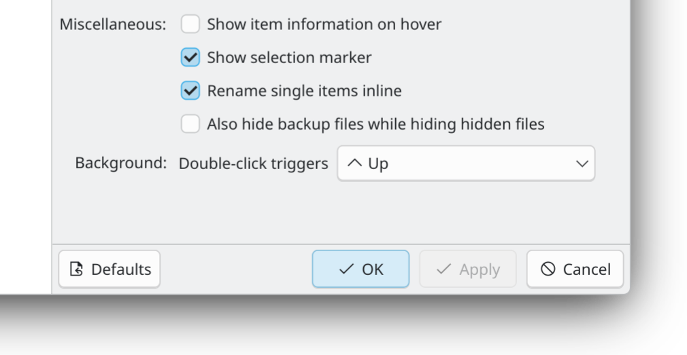
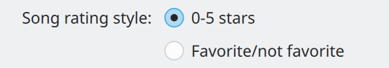
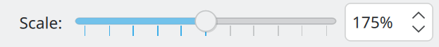

# Getting input

SonicDE applications mostly use standard input controls such as [buttons, menus, checkboxes, text fields, and sliders](../kirigami/controls.md). Here's how to handle various situations:

## Initiating actions

The [Button](https://doc.qt.io/qt-6/qml-qtquick-controls-button.html), [ToolButton](https://doc.qt.io/qt-6/qml-qtquick-controls-toolbutton.html), and [RoundButton](https://doc.qt.io/qt-6/qml-qtquick-controls-roundbutton.html) controls all initiate a one-time action when pressed. This is where and how to use them:

- Use a ToolButton on a toolbar in the header or footer position of a window, page, or scrollable view.
- Use a RoundButton overlaid in a fixed “floating” position over a scrollable content view, especially an image view. This kind of button never has text, so choose an icon that [conveys the button's action perfectly](icons/index.md#icons-only-buttons), with no ambiguity.
- For all other cases, use a Button.

Follow the [standard labeling guidelines](text-and-labels.md#mood-and-tone) for buttons with visible text.

## Choosing between 2 obvious states or settings

The [Switch](https://doc.qt.io/qt-6/qml-qtquick-controls-switch.html) and [CheckBox](https://doc.qt.io/qt-6/qml-qtquick-controls-checkbox.html) controls are both used for two-state settings where both states are obvious with a single label.

Don't change the label or icon when the state changes, and follow the [standard labeling guidelines](text-and-labels.md#mood-and-tone).

Use a Switch for “instant apply” controls that take effect immediately. Use a CheckBox for everything else, including for toggle-able list items.

Switches take effect the moment they're clicked.

CheckBoxes only take effect when the user clicks “OK” or “Apply”.

Avoid making buttons checkable (by setting their `checkable` property to `true`), as their checkability isn't obvious when unchecked (or even when checked, depending on the theme).

If this is unavoidable because the surrounding context dictates that a button is the right control, treat it as a checkbox that happens to look like a button, applying the above guidelines.

Alternatively, use a normal non-checkable button with text indicating what will happen when it's pressed, and change the text and icon when the state changes. When doing so, follow the standard guidelines for [labels](text-and-labels.md#mood-and-tone) and [icons](icons/index.md).

## Choosing between non-obvious states or settings

The [RadioButton](https://doc.qt.io/qt-6/qml-qtquick-controls-radiobutton.html) and [ComboBox](https://doc.qt.io/qt-6/qml-qtquick-controls-combobox.html) controls are both used to present a set of labeled, mutually-exclusive options.

Each option's opposite state is not obvious without explanation, so radio buttons are used.

- For 3 or fewer options with short text where vertical space is plentiful, use RadioButtons.
- For up to 10 items, or where vertical space is limited, use a ComboBox.
- For more than 10 options, use a scrollable [list view](displaying-content.md#lists-and-grids).

In all cases, arrange items in a logical order; if none exists, alphabetical is a good default.

## Gross and fine input

Use a [Slider](https://doc.qt.io/qt-6/qml-qtquick-controls-slider.html) for bounded input where fast interaction is more important than precision.

Use a [SpinBox](https://doc.qt.io/qt-6/qml-qtquick-controls-spinbox.html) where precision is more important than speed of interaction.

If both factors are important at different times, then use a Slider with a SpinBox trailing it:

The user can drag the Slider's handle for quick changes, or enter a precise value in the SpinBox for fine adjustments.

## Getting text input

Only ask for input using a text field when it's not possible to use a control that automatically validates input. For this reason, you must validate the input text yourself.

When the current text is invalid, indicate this using a [Kirigami.InlineMessage](../kirigami/inline-messages.md) and disable the ability to confirm or send the input.

If possible, implement an auto-complete feature to help the user enter valid input.

If possible, use one of the pre-made Kirigami text fields:

- Use [Kirigami.ActionTextField](/docs/api/kirigami/qml-org-kde-kirigami-actiontextfield) when you need to add inline actions in the trailing position (e.g. a clear button).
- Use [Kirigami.SearchField](/docs/api/kirigami/qml-org-kde-kirigami-searchfield) to implement a search field.
- Use [Kirigami.PasswordField](/docs/api/kirigami/qml-org-kde-kirigami-passwordfield) to display password prompts.

## Interrupting the user to ask for input

Dialog windows interrupt the user to ask for input or confirmation. Minimize their use, as they can be considered annoying; many users click through them without reading anything.

Only interrupt the user with a dialog window for one of two reasons:

- When the user must make an immediate decision before the application can continue working normally.
- To display progress information about a task that must complete before the application can continue working normally.

For all other purposes, don't use a dialog; request input or display information inline in a non-modal fashion.

For opening and saving files, use [QtQuick.Dialogs.FileDialog](https://doc.qt.io/qt-6/qml-qtquick-dialogs-filedialog.html) with the [fileMode](https://doc.qt.io/qt-6/qml-qtquick-dialogs-filedialog.html#fileMode-prop) set appropriately. Don't implement a custom file-choosing UI.

For getting other kinds of input, use one of the Kirigami dialog types:

- Use [Kirigami.PromptDialog](/docs/api/kirigami/qml-org-kde-kirigami-dialogs-promptdialog) for a “do it/don't do it” type of choice.
- Use [Kirigami.PromptDialog](/docs/api/kirigami/qml-org-kde-kirigami-dialogs-promptdialog) with a [QtQuick.Controls.TextField](https://doc.qt.io/qt-6/qml-qtquick-controls-textfield.html) inside it to get text input from the user.
- Use [Kirigami.MenuDialog](/docs/api/kirigami/qml-org-kde-kirigami-dialogs-menudialog) to let the user choose from among a set of actions.

Don't display more than one dialog at a time. Never use a dialog to create more dialogs.

## Signaling interactivity

Standard Silver styling for controls signals interactivity primarily through hover effects, typically by changing the background or outline color. Keep these guidelines in mind:

- Use standard controls as much as possible to automatically inherit this style of visual interactivity.
- When custom controls must be used, prefer to override the `contentItem` property of standard controls so that only the content is custom, and the interactivity and styling of the background effect are preserved.
- If even that is not possible, re-implement interactivity signaling using hover effects.
- To open URLs, use underlined web-style links, not buttons. Don't use links for internal navigation within your application.
- Only use the pointing finger cursor to signal interactivity for underlined web-style links.
