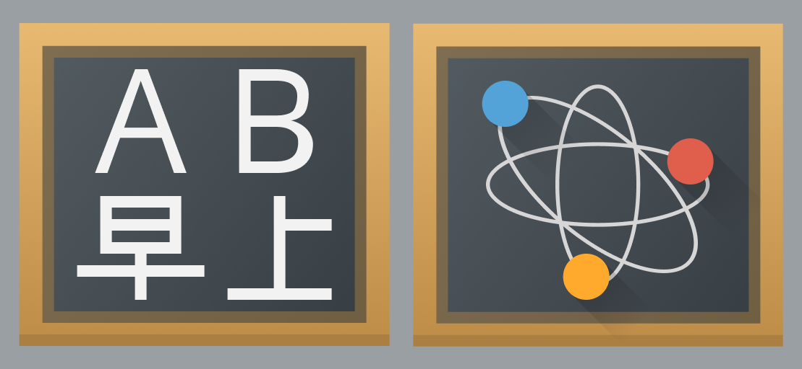

# Category and preferences icons

## Purpose

Category and preferences icons guide the user through an application. They appear in an application's navigation and configuration, guiding the user with icons to what they want to get to. While category and preferences icons should be distinct, all icons should be unified with the same design style.

## Design

Colorful category and preferences icons use the [colorful icon style](index.md) at 32 pixels. The theme also holds smaller versions of them.

When creating category and preferences icons, consider the following aspects of an icon:

### Metaphor

You should consider the metaphors being conveyed by your icon's design choices.

**Do:** Use symbols that evoke the metaphor of your icon's category.

**Don't:** Don't use icons just for the sake of having different visuals per category. Use meaningful metaphors that inform the user about their category.

### Recognizability

Category and preferences icons should be recognizable, yet connected.

**Do:** Keep icons unique, yet connected. This allows users to easily identify icons as unique members in a set.

**Don't:** Don't make icons too similar to each other. This impairs the ability of users to distinguish them.

> **Caution:** Be careful when making icons extremely unique from each other. They may not appear in contexts that inform users that they're related.
>
> 
