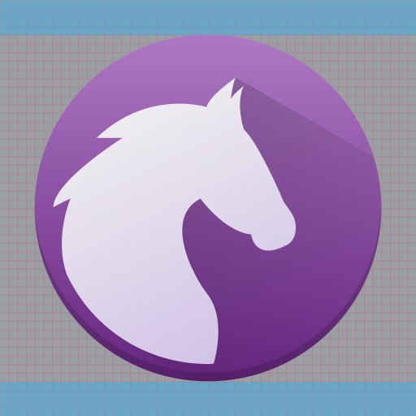
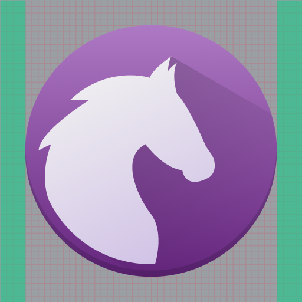
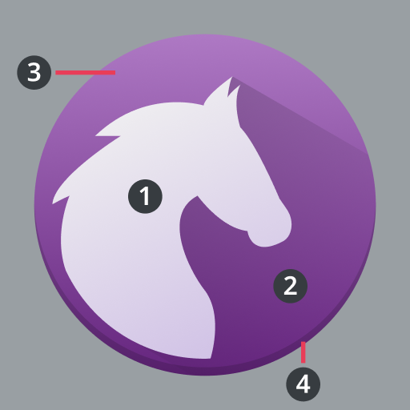
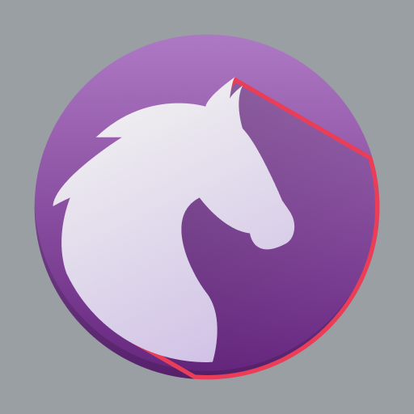
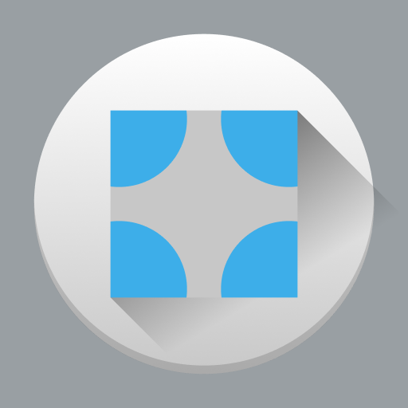
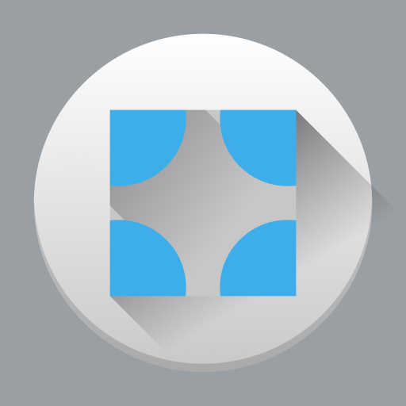
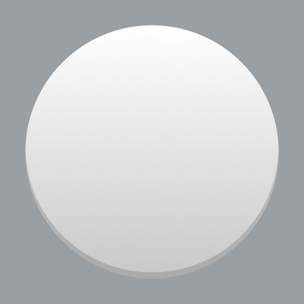
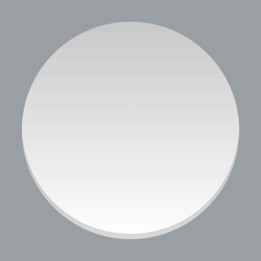
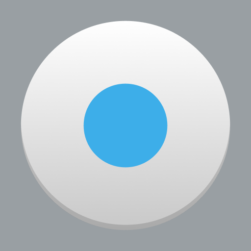

# Colorful icons

Colorful icons make full use of the Silver color palette. Colorful icons are not flat and incorporate elevation, shadows, and lighting.

**Do:** Use a variety of techniques to give your icon depth.

**Don't:** Don't make your icon flat. This makes it visually bland.

There are a variety of colorful icon types:

- 32px: [Category, Preferences](category-preferences.md), [MIME type](mimetype.md), and [Places](places.md) icons
- 48px: [Application](application.md) icons
- 64px: [MIME type](mimetype.md), [Places](places.md), Devices, and a few Status icons

## Margins

### Vertical

Colorful icons have a top and bottom margin of 4 pixels. Icons should not put any details here whatsoever.

### Horizontal

Colorful icons also have a left and right margin of 4 pixels. Minor details can extend here as necessary.

### 32px colorful icons

32px colorful icons have a 2px margin instead of 4px margins.

**Do:** Use 2px margins on 32px colorful icons.

**Don't:** Don't use 4px margins on 32px colorful icons; this reduces the canvas size too much.

## Anatomy

All colorful icons share the same basic anatomy.

1. Foreground
2. Foreground shadow
3. Base
4. Base shadow

The foreground of an icon is the distinctive part that conveys the most branding.

Foregrounds on a background have a 45° shadow to the bottom right that spans the entire background.

Icons can have a background to serve as a base for their foreground.

The foreground, or the background if there is one, has a 1px hard shadow on the bottom.

## Elements

### Color

Icons can have a variety of shapes, which when combined with color, produce numerous unique arrangements.

**Do:** Color can be used to add variety to an otherwise bland surface.

**Don't:** Don't give color shadows; color is not shape and should not be treated as such.

### Layers

Icons are composed of layers that cast shadows.

**Do:** Give icons at most two or three major layers.

**Don't:** Don't give icons too many layers.

### Lighting and shadows

#### Ambient lighting

Icon fills should reflect ambient lighting, going from a lighter top to a darker bottom.

**Do:** Have gradients behave like light is coming from above the icon.

**Don't:** Don't have gradients behave like light is coming from below the icon.

#### Hard shadow

Every icon should have a 1px solid hard shadow. A good baseline color to overlay is black (`#000000`) at 10% opacity.

**Do:** Add a 1px hard shadow to give your icon depth.

**Don't:** Don't forget to add a hard shadow; this makes your icon seem flat.

#### 45° shadows

Foregrounds should have a 45° shadow to the bottom right.

**Do:** Objects are solid, and block shadows from passing through.

**Don't:** Don't have shadows pass through objects; they are not glass.

**Do:** 45° shadows are bounded to their parent elements.

**Don't:** 45° shadows should not exceed the bounds of their parents.

**Do:** 45° shadows have a gradient that fades out before they hit an edge.

**Don't:** 45° shadows are not solid and do not extend to the edge of their parents.
