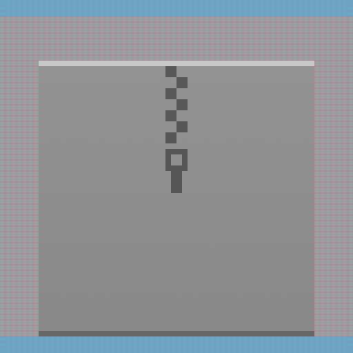
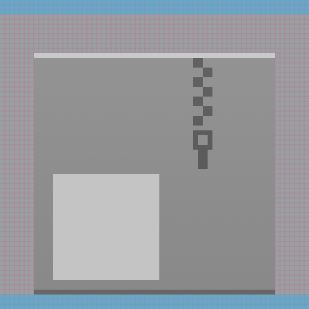
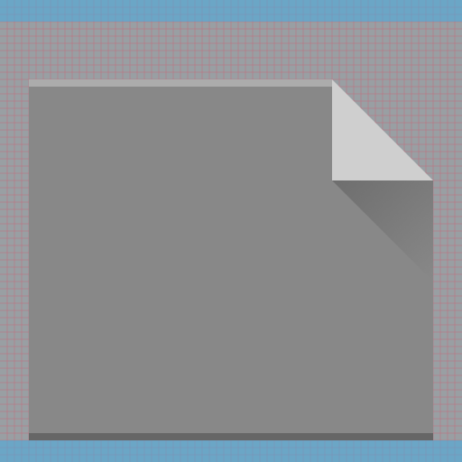
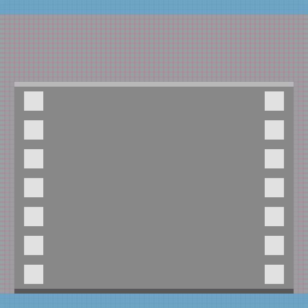
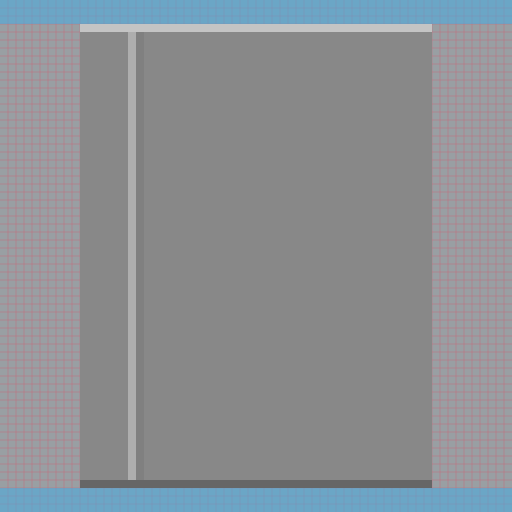
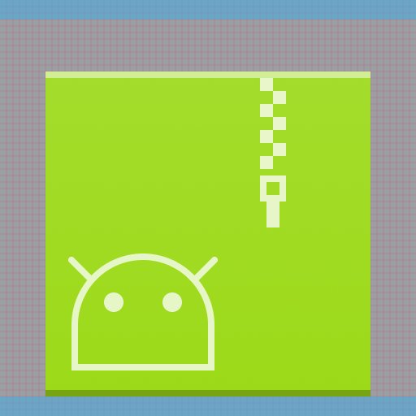

# Colorful MIME type icons

MIME type icons are used to depict documents and files. They come in four sizes: 16px, 22px, 32px, and 64px. MIME type icons use the [monochrome style](../monochrome/index.md) for 16px and 22px sizes, and the [colorful style](index.md) for 32px and 64px sizes.

## Purpose

MIME type icons allow a user to quickly recognize the types of their files without needing to look at a file's extension or contents. They primarily appear in file listings in large amounts, and their design reflects a sense of unity among files in a user's system.

## Design

### Margins

64px MIME type icons have a top and bottom margin of 3 pixels, and 32px MIME type icons have a top and bottom margin of 2 pixels.

64px icons should have a top and bottom margin of 3 pixels.

32px icons should have a top and bottom margin of 2 pixels.

### Anatomy

Colorful MIME type icons consist of two elements: the monochromatic counterpart of the colorful MIME type icon overlaid on a background relating to the icon's type.

1. Monochromatic foreground
2. Base

The foreground of a MIME type icon indicates the specific type of file it is.

The background of a MIME type icon indicates the general type of file it is.

### Base

The base of a MIME type icon serves to give files of a general type a shared and recognizable silhouette.

#### Archives

Archives, packages, compressed files, and disk images use a square with a zipper going halfway down.

For archive icons without a foreground, the zipper goes through the center.

For archive icons with a foreground, the zipper is offset to give the foreground some space.

#### Images

Images use a horizontal rectangle with the top right corner folded and casting a shadow.

#### Videos

Videos use a horizontal rectangle styled to look like a filmstrip.

#### Audio

Audio files use a CD sleeve with a partially visible CD sticking out.

#### Books

Book files use a vertical rectangle with a book spine.

#### Other

Documents and other icons use a rectangle with a fold in the top right corner casting a shadow.

### Foreground

The foreground of a MIME type icon serves to inform the user about the specific type of file an icon represents. The foreground should be the monochromatic icon of the MIME type.

**Do:** The foreground decoration of a MIME type icon does not cast a shadow.

**Don't:** Don't have the foreground decoration of a MIME type icon cast a shadow.

### Color

The color of a MIME type icon helps inform the user what kind of icon it is. Icons for MIME types associated with a brand identity should use the colors of that brand identity.

**Do:** The usage of Android brand colors helps users identify the icon as that of an Android package.

**Don't:** Don't use radically different brand colors. Users will not recognize the icon as one of a filetype from that brand.
