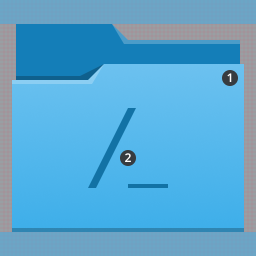
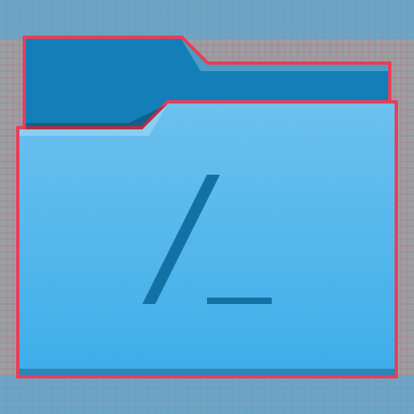
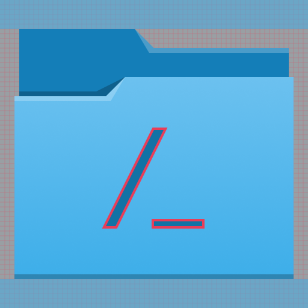

# Colorful places icons

Places icons are used to depict folders, network locations, and other places. They are mainly drawn at four sizes: 16px, 22px, 32px, and 64px. Places icons use the [monochrome style](../monochrome/index.md) for 16px and 22px sizes, and the [colorful style](index.md) for 32px and larger.

## Purpose

Places icons allow a user to quickly identify landmarks in their filesystems. They indicate places that a user will visit frequently, such as home, root, downloads, etc.

## Design

### Anatomy

Colorful places icons consist of two elements: the monochromatic counterpart of the colorful places icon overlaid on a folder background.

1. Folder
2. Monochromatic foreground

The base of a places icon indicates that it's a folder that can be navigated to.

The foreground of a places icon indicates the folder's landmark location.

### Base

The base of a places icon is always a folder. It's drawn with the `ColorScheme-Accent` style class so that it follows the user's accent color, which is blue in the examples here.

### Foreground

The foreground of a places icon indicates the landmark location an icon represents. Its color is a darker variant of the base's color. For 32px icons, its size is 10×10px. For 64px icons, its size is 20×20px. It is always centered within the folder, and does not cast a shadow.

**Do:** The foreground of a places icon does not cast a shadow.

**Don't:** Don't have the foreground of a places icon cast a shadow.

### Margins

64px places icons have a top and bottom margin of 6 pixels, and 32px places icons have a top and bottom margin of 3 pixels.

64px icons should have a top and bottom margin of 6 pixels.

32px icons should have a top and bottom margin of 3 pixels.
