# Icons

SonicDE applications respect the FreeDesktop [icon theme](https://specifications.freedesktop.org/icon-theme-spec/latest/) and [icon naming](https://specifications.freedesktop.org/icon-naming-spec/latest/) standards, and make extensive use of themable icons.

SonicDE's Silver icon theme complies with the above specifications and contains thousands of icons suitable for a wide range of applications. While the user can change the icon theme to something else, ensure your application looks perfect with Silver. Browse the library of Silver icons using Icon Explorer (`iconexplorer`), contained within `sonic-theme-sdk`.

If you find that your application needs a new icon not present in the Silver icon theme, request one in the [sonic-silver-icons issue tracker](https://github.com/Sonic-DE/sonic-silver-icons/issues).

Many considerations go into choosing the right icon for each button, menu item, and list item in your application:

## Universal or specific icons?

The Silver icon theme, as well as most others, includes icons consisting of just a base shape with a broad meaning, as well as icons consisting of multiple base shapes and/or emblems that narrow the icon's meaning to only a certain type of object or target. We call these *universal* and *specific* icons. For example:

| | | | |
| --- | --- | --- | --- |
| **Universal** | 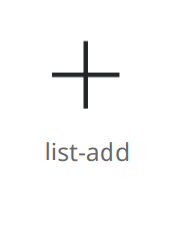 | 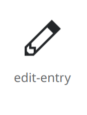 | 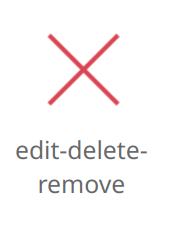 |
| **Specific** | 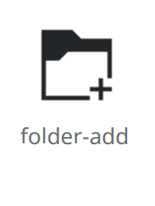 | 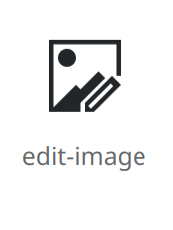 | 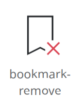 |

Prefer universal icons where possible, as their simplicity makes them faster to visually parse and understand. But in some cases, specific ones are more appropriate. Here are the rules for when to use each type:

| Usage | Type of icon to use |
| --- | --- |
| Icon is accompanied by a text label explaining its function | Universal |
| Even without a label, surrounding context or container makes the target or meaning of the icon obvious | Universal |
| Sharing a toolbar or menu with any other items that would have the same icon if they all used Universal icons | Specific |

Examples:

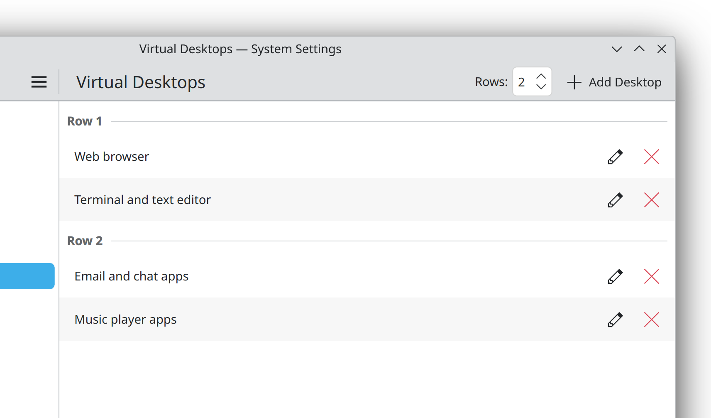

Icons-only buttons located inline on list items use universal icons because their target is obvious.

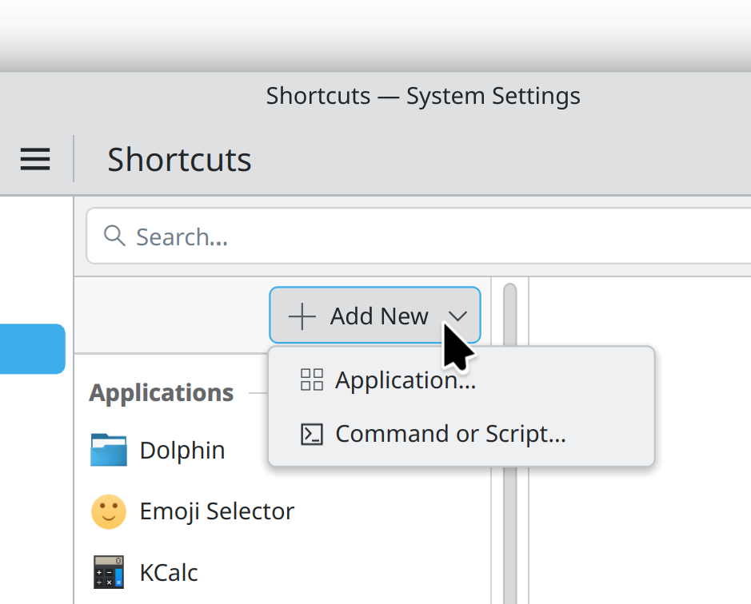

“Add New” button has a universal icon that applies to all child menu items, which then also use universal icons.

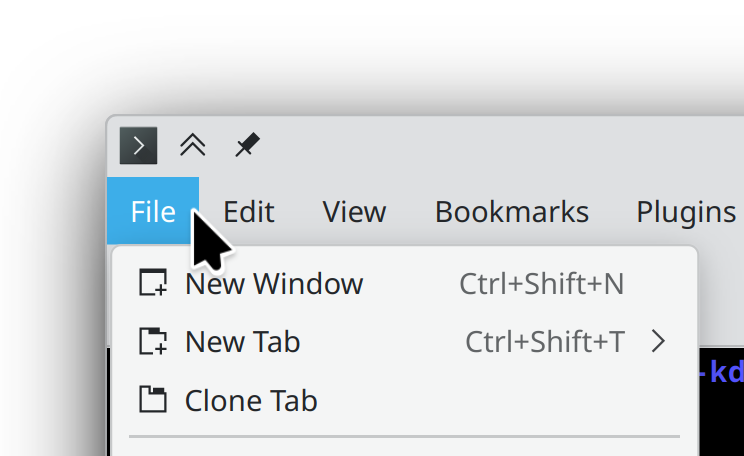

Multiple “New \[thing\]” menu items visually disambiguated with specific icons.

## Icons for destructive actions

Actions that destroy content must be consistently indicated as such using icons that are red or have red elements (in the Silver icon theme, at least):

- Use a red trash can via the `edit-delete` icon for actions that delete files or destroy content the user has created.
- Use a red X via the `edit-delete-remove` icon for actions that remove abstract or standard items in a way that's possible to restore later.
- Use one of the more specific deletion-style icons (e.g. `delete-comment`) only when appropriate according to the rules for universal vs specific icons.

Avoid the use of icons with red elements or X symbols for non-destructive actions.

“Move to trash” style actions are not destructive in and of themselves, so don't use a red icon for them. Instead, use a black trash can via the `trash-empty` icon. Give its button or menu item a label that includes the “move to trash” phrasing.

## Icons-only buttons

Most buttons should also include text. Only use an icons-only button in the following situations:

- When it's critical to save horizontal space for user content, text, or other actions.
- Where groups of related icons reveal each other's meaning by proximity (e.g. icons-only buttons to choose text justification in a word processing application).
- For actions not relevant to the application's core workflow where it's not a disaster if the user ignores them.

In all cases, only proceed with the plan to omit text if an icon can be found that uses instantly recognizable imagery common across all operating systems and applications. Examples include:

| | | | |
| --- | --- | --- | --- |
| 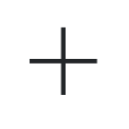 | `list-add` | 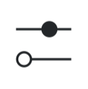 | `configure` |
| 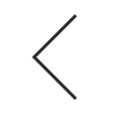 | `go-previous` |  | `document-print` |
|  | `go-home` | 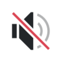 | `player-volume-muted` |
|  | `search` |  | `media-playback-start` |
|  | `edit-delete` |  | `documentinfo` |
|  | `edit-delete-remove` |  | `open-menu-symbolic` |

If in doubt, show the button's text. If the application has so many buttons visible at once that this looks overwhelming, rethink the UI. For example:

- Only show buttons relevant to the current context.
- Place buttons in a Contextual Toolview that can be hidden when not relevant.
- Group buttons by function in the tabs of a [Kirigami.NavigationTabBar](/docs/api/kirigami/qml-org-kde-kirigami-navigationtabbar).
- Put the buttons on a [Kirigami.ActionToolBar](../../kirigami/action-toolbars.md) so that buttons without sufficient space get moved into an overflow menu.
- Reduce the length of the buttons' labels.
- Condense related buttons into a single one that opens a menu of actions.

To make a button icons-only, hide the text using the [display](https://doc.qt.io/qt-6/qml-qtquick-controls-abstractbutton.html#display-prop) property. Always set the [text](https://doc.qt.io/qt-6/qml-qtquick-controls-abstractbutton.html#text-prop) property, so it can be read by screen readers.

## Icons for menu items and buttons with text

Set an icon on every button and menu item, making sure not to use the same icon for multiple visible buttons or menu items. Choose different icons, or use more specific ones to disambiguate.

For icons on parent menu items or buttons that open menus, use symbolism relevant to all child menu items.

## Icons for list items

For icons in the leading position, vary the icons between list items; don't use the same one for every item. If this is impossible, don't show any icons.

For inline action buttons in the trailing position, use icons-only buttons with simple universal icons for obvious actions (delete, edit, etc.). Keep the number of buttons to two at most, and prefer zero to one. If this is impossible because each list item has many possible actions or complex actions that cannot be expressed with simple icons, don't use inline actions. Instead, push a sub-page with a rich UI when the user clicks on the list item.

## Symbolic or full-color icons?

Once you've chosen an icon, determine whether it should be *symbolic* or *full-color* based on the size at which it will be displayed:

| Icon size | Style to use |
| --- | --- |
| `small` (16×16) | Symbolic |
| `smallMedium` (22×22) | Almost always symbolic, but in list views with very few items, full-color may be acceptable |
| `medium` (32×32) and larger | Full-color |

To express the preference for a symbolic icon, append `-symbolic` to the name of the icon you're asking the icon theme to provide. This causes the icon loader to provide a symbolic monochrome icon if the theme has both symbolic and full-color icons at the requested size.

Remember that because SonicDE applications support icon theming, all you can do is express a preference; ultimately the final choice of icon style is up to the icon theme.

## Overlaying emblems on top of content

When overlaying icons on top of user content or on top of other icons, only use overlay icons whose names begin with `emblem-`, as they are designed for this purpose.

## Implementation details

- Don't bundle custom icons with your application or specify pixmaps for your icons. Instead get them from the system's icon theme using [QIcon::fromTheme()](https://doc.qt.io/qt-6/qicon.html#fromTheme) in C++ code, or using the `icon.name` property for QML components that accept icons.
- Make the KIconThemes framework a build dependency for your application and call `KIconTheme::initTheme()` before creating the `QApplication`. See [more information here](../../kirigami/main-cpp.md).
- For standard actions, use [KStandardActions](/docs/api/kconfiggui/kstandardactions) so that it gets a standard icon, too.
- Use [standard icon sizes](/docs/api/kirigamiplatform/qml-org-kde-kirigami-platform-units#iconSizes-prop) in any context where the icon size is not automatically chosen for you.

## Designing your own icons

Every application needs a great icon. Learn how to make one in [Colorful icons](colorful/index.md).

Learn how to create symbolic action icons in [Monochromatic icons](monochrome/index.md).

Learn how to adapt icons to other languages in [Icon localization](localization.md).
