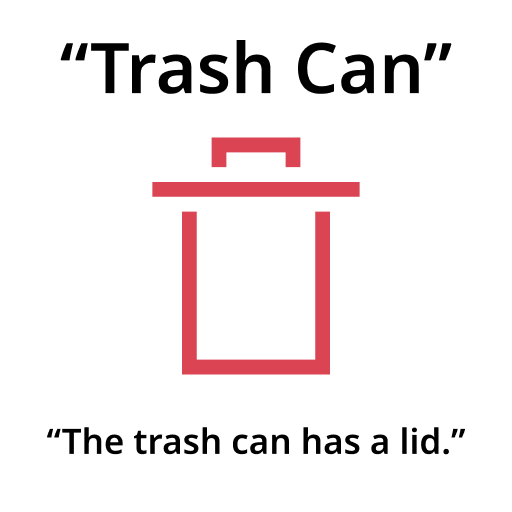

# Action icons

Action icons are used to depict actions. They are mainly drawn at two sizes, 16px and 22px, and always use the [monochrome style](index.md).

## Purpose

Action icons indicate actions that a user is able to take on on-screen elements. They allow a user to intuit the behavior of controls.

## Design

### Color

Action icons should use a base color of Shade Black. Additional colors can indicate information about an action to a user.

**Do:** Use Shade Black as your icon's base. This color is neutral and has the most contrast against a white background.

**Don't:** Don't use a bright color for your icon's base. This distracts the user without adding extra information to your icon.

**Do:** Use red to indicate destructive actions.

**Don't:** Don't use red to indicate other types of actions. This will confuse the user as to what the actions do.

Action icons are able to dynamically change their color based on context.

Implementation details can be found in the [Icon Workflow Tips](https://community.kde.org/Guidelines_and_HOWTOs/Icon_Workflow_Tips#Embedding_stylesheets_in_SVGs).

### Metaphor

Appropriate and consistent metaphors should be used to inform a user about the action an icon represents.

**Do:** Use appropriate metaphors to indicate what an action does.

**Don't:** Don't use inaccurate or conflicting metaphors. This will mislead your user and lead to frustration.

## Accessibility

When using action icons to indicate an action, a textual name and description of the action should be provided for accessibility purposes. Screen readers can take advantage of this information to allow more people to use your application. Your local jurisdiction may also require that your application meet accessibility standards. Care should also be taken to reinforce information conveyed by an icon in multiple ways, as not everyone is able to distinguish between all colors.

**Do:** Provide a name and description that describe what an icon's action does.

**Don't:** Don't describe the icon's appearance. This is useless information that will make your application harder to use.

**Do:** Reinforce information in multiple ways to allow users with conditions such as colorblindness to get the message.

**Don't:** Don't only rely on color to convey information. This makes it harder for users with colorblindness to distinguish two like icons apart.
