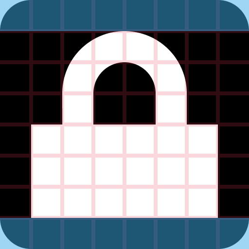
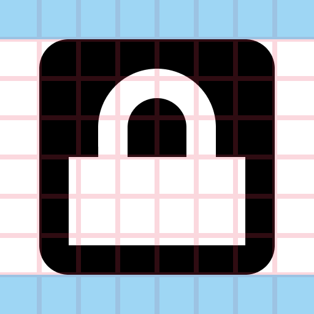

# Emblem icons

Emblem icons are used to indicate state. They come in three sizes: 8px, 16px, and 22px, and always use the [monochrome style](index.md). They are typically overlaid on icons. Unlike most monochromatic icons, emblem icons use bright colors to remain recognizable, even at small sizes.

## Purpose

Emblem icons are used alongside a base icon to form compound icons that convey additional information on top of the base icon, indicating its status, such as missing, deleted, etc.

## Design

### Anatomy

Emblem icons always use the entire canvas area. Pixel alignment is especially important for emblem icons as they are rendered at very small sizes, making the consequences of pixel misalignment more noticeable than at other sizes.

**Do:** Pixel-align your icon and use the entire canvas.

**Don't:** Don't misalign your icon or use margins.

16px and 22px emblem icons get a 60% opacity text color outline to ensure contrast against various backgrounds. 8px emblems do not receive an outline because of their limited canvas size.

16px and 22px emblem icons get an outline to increase visibility on various backgrounds.

8px emblem icons need to rely on bold shapes and bright colors for visibility, as they don't have room for an outline.
