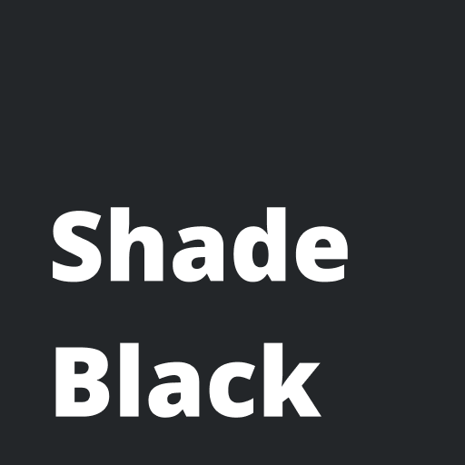
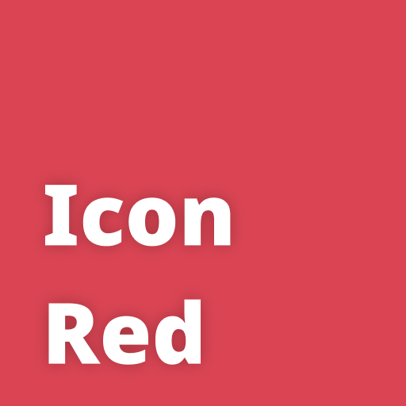
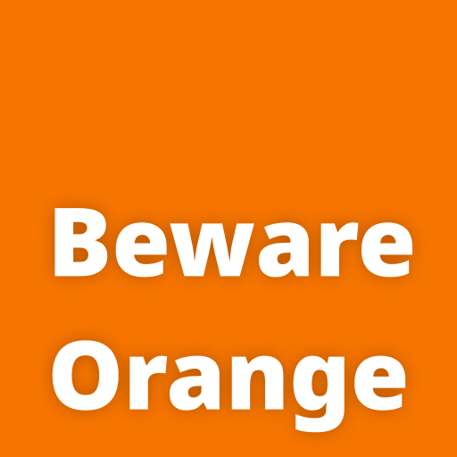
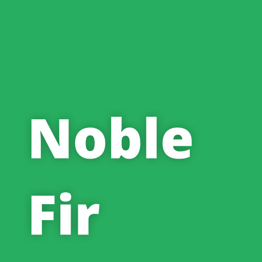
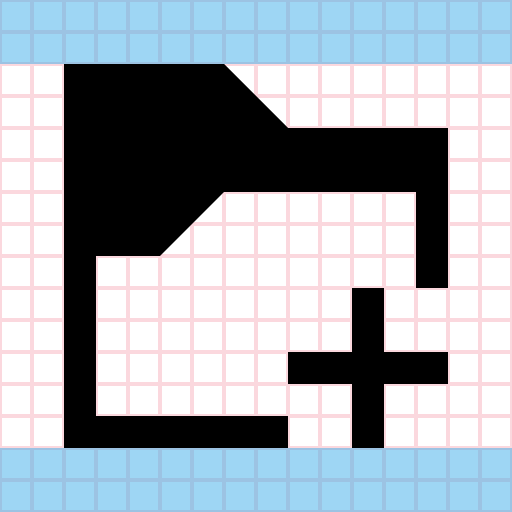
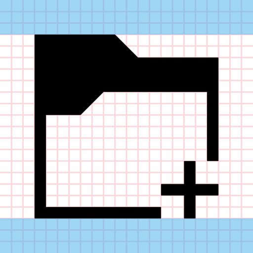
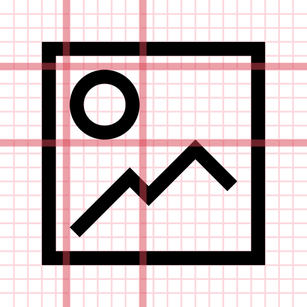
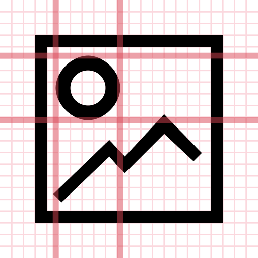
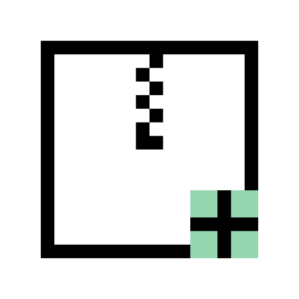
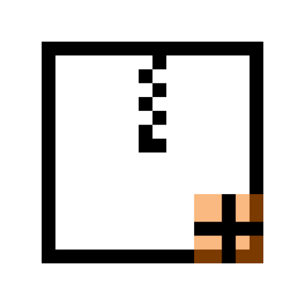

# Monochromatic icons

Monochrome icons come in two main sizes: 16px and 22px. 16px monochrome icons are commonly seen in menu items, tabs, and push buttons that have a raised, buttonlike appearance. 22px monochrome icons are used in ToolButtons. Monochrome icons at both sizes are used to represent small file types and entries in the Places panel in Ecco and file dialogs.

Don't use the monochrome style for larger icon sizes.

The monochrome style is used for [Action](action.md), [Status](status.md), small [Places](places.md), and small [MIME type](mimetype.md) icons.

## Colors

The monochrome style relies on distinct shapes and outlines instead of fine details and vibrant colors, and employs an intentionally limited color palette:

Shade Black (`#232629`): color for non-destructive actions and states: navigation, acceptance, etc.

Icon Red (`#da4453`): color for destructive actions and states: delete, remove, error, etc.

Beware Orange (`#f67400`): color for warning actions and states: warning, unsure, user interaction, etc.

Plasma Blue (`#3daee9`): color for manipulative actions and states: selection, insertion, focus feedback, etc.

Noble Fir (`#27ae60`): color for successful actions and states: completion, connection, security, etc.

## Margins and alignment

16px monochrome icons should not use the top or bottom 2 pixels, and 22px monochrome icons should not use the top or bottom 3 pixels:

2px margins for a 16px icon.

3px margins for a 22px icon.

It is recommended to keep monochrome icons perfectly square. For some types of icons described later (e.g. Places icons) this is a hard requirement.

Because monochrome icons are so small and simple, it is important that they be pixel-perfect, with their lines and objects aligned to a regular grid:

**Do:** Make sure your icon is aligned to the pixel grid. Use grids and guides to assist you when designing it.

**Don't:** Don't misalign your icon to the pixel grid. This makes it look blurry when scaled and can make it look wonky.

## Adding emblems to monochrome icons

Because monochrome icons usually depict actions, many include status or action emblems. These are always located in the bottom-right corner. The emblem should be a minimum of 5px wide and tall, and there must be 1px of blank space between the emblem and the rest of the icon.

**Do:** Clear out some space for your icon's emblem.

**Don't:** Don't overlay your icon's emblem on its corner.
