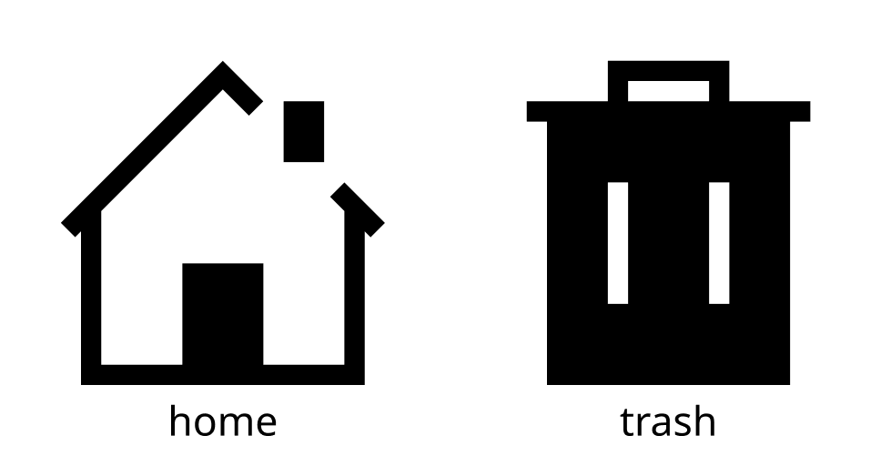
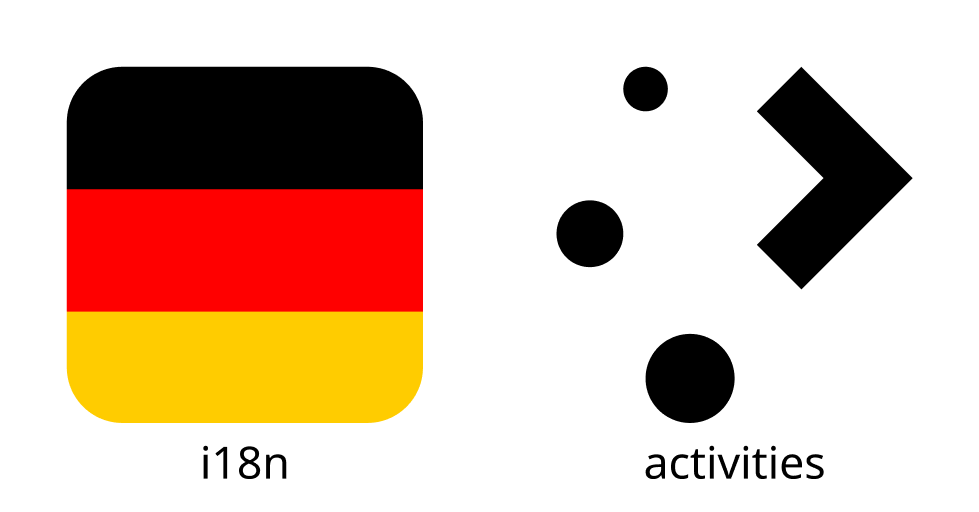

# Monochrome places icons

Places icons are used to depict folders, network locations, and other places. They are mainly drawn at four sizes: 16px, 22px, 32px, and 64px. Places icons use the [monochrome style](index.md) for 16px and 22px sizes, and the [colorful style](../colorful/index.md) for 32px and larger.

## Purpose

Places icons allow a user to quickly identify landmarks in their filesystems. They indicate places that a user will visit frequently, such as home, root, downloads, etc.

## Design

### Iconography

Places icons use bold and recognizable symbols that allow a user to determine the icon's corresponding location at a glance.

**Do:** Use a bold, descriptive, and metaphorically recognizable icon to identify a user's landmark and guide the user to their desired destination. International icons are used instead of regional icons to better serve the diverse array of users.

**Don't:** Don't use places icons based off of real locations or brands unless the landmark filesystem location is directly tied to that location or brand. More generic icons are meaningful for more users in more use cases.
