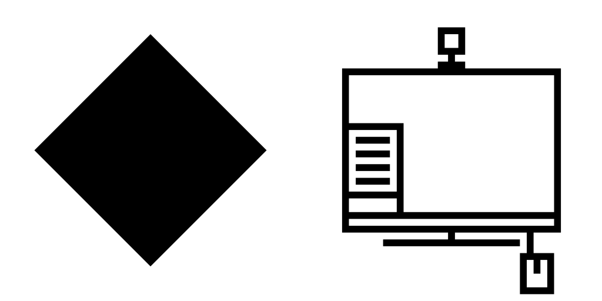

# Status icons

Status icons are used to indicate the status of hardware and software. They are mainly drawn at 16px and 22px, and use the [monochrome style](index.md). A few status icons also exist at 32px and 64px.

## Purpose

Status icons allow a user to discern the current state of hardware and software at a glance. They reassure users that software is functional, and warn them when hardware is dysfunctional.

## Design

### Anatomy

#### Base

The base of a status icon indicates to the user what item the state of the icon represents.

**Do:** Use a simple and recognizable icon base that leaves room for additions to indicate state.

**Don't:** Don't use an overly simple base. This makes it hard for the user to identify what an icon represents. Additionally, don't use more details than you need to make something recognizable. This doesn't leave you room for indicating states.

#### Overlay

The overlay of a status icon indicates to the user what status the item the icon represents is in.

**Do:** Use a simple and recognizable overlay with appropriately used color to clue in the user to an icon's status.

**Caution:** Some overlays can be hard to identify on their own. Provide appropriate context to allow a user to identify what a simple icon represents.

**Don't:** Don't exclusively rely on color to indicate state. This is an accessibility problem and makes it hard to discern state.

**Don't:** Don't use too-generic details to represent state. This makes it hard for a user to identify what an icon's state represents.
