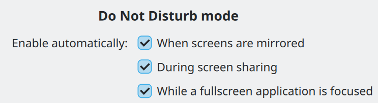
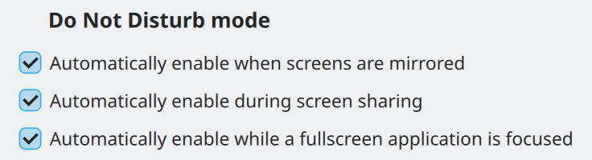

# Text and labels

Whenever writing text, start by following these guidelines:

- Make it as short as possible without losing meaning or precision.
- Keep it actionable.
- Front-load the most important information in longer text.
- Use plain language and minimize technical jargon. For example, prefer “folder” over “directory.”
- Adhere to common wording conventions.
- Use a neutral, informative tone: not informal, boring, exciting, or harsh.
- Use the word “Delete” for actions that remove files on disk.
- Don't overuse bold text and pull the user's attention in multiple directions at once.

And then keep in mind these implementation details:

- Use [QtQuick.Controls.Label](https://doc.qt.io/qt-6/qml-qtquick-controls-label.html) for normal-sized text, and [Kirigami.Heading](/docs/api/kirigami/qml-org-kde-kirigami-heading) (with a `level` suitable for the context) for larger header text. See [more information here](../kirigami/typography.md).
- Don't use [QtQuick.Text](https://doc.qt.io/qt-6/qml-qtquick-text.html) directly: unlike `Label`, it isn't styled and doesn't inherit its font from the controls around it.
- Manually assign [accelerator keys](https://doc.qt.io/qt-6/qabstractbutton.html#text-prop) (an `&` in the text) only for text in buttons, radio buttons, checkboxes, and switches (in other places, they are auto-generated).
- Assign text for icons-only buttons anyway, so it can be read by screen readers. Hide the text by setting the [AbstractButton.display](https://doc.qt.io/qt-6/qml-qtquick-controls-abstractbutton.html#display-prop) property to `IconOnly` and then manually add a [ToolTip](https://doc.qt.io/qt-6/qml-qtquick-controls-tooltip.html) for the benefit of mouse and touch users.
- For standard actions, use [KStandardActions](/docs/api/kconfiggui/kstandardactions) so that it gets standard text automatically.

## Capitalization and punctuation

All user interface text is written in either [sentence case](https://apastyle.apa.org/style-grammar-guidelines/capitalization/sentence-case) or [title case](https://apastyle.apa.org/style-grammar-guidelines/capitalization/title-case). Use sentence case when:

- The text ends with a period or colon.
- The text is clearly a sentence.
- The text is a subtitle, tooltip, transient status message, or placeholder label.
- The text is used as a label for a radio button, checkbox, combobox item, or placed in front of a control, for example using [Kirigami.FormData.label](/docs/api/kirigami/qml-org-kde-kirigami-layouts-formdata#label-attached-prop).

Otherwise, use title case.

Also use title case for specialized proper nouns such as “the Internet” or “Desktop Widgets”.

Use a [serial comma](https://apastyle.apa.org/style-grammar-guidelines/punctuation/serial-comma) (also known as an “Oxford comma”) when mentioning three or more list items in a sentence.

Put spaces around [em-dashes](https://www.merriam-webster.com/grammar/em-dash-en-dash-how-to-use).

## Mood and tone

Use the imperative mood when providing instructions or suggestions to the user, especially in the labels for buttons, menu items, checkboxes, and switches.

This means beginning the label with an action verb, and phrasing it as a command:

**Bad:** Yes

**Good:** Apply

**Bad:** Info

**Good:** Show Info

**Bad:** Maximum Volume Raising

**Good:** Raise Maximum Volume

Use positive phrasing; describe what controls will do when enabled, not what they won't do when disabled:

**Bad:** When disabled, prevent the system from going to sleep.

**Good:** Allow the system to go to sleep.

Phrase longer text impersonally. Avoid the word “you” in sentences that instruct the user to do something, as it sounds accusatory in English, particularly at the beginning of a sentence. This is less important for questions and descriptions, but try to minimize it anyway.

**Bad:** You are not authorized to access the file.

**Good:** Missing authorization to access the file.

**Bad:** Are you sure you want to permanently delete all items from the Trash?

**Good:** Permanently delete all items from the Trash?

## Word ordering and length

Front-load the most important words and minimize total length. Anything longer than “Configure Keyboard Shortcuts” in an interactive control is too long.

For multi-sentence text, try to limit line length to 85 characters or less, which improves readability. This generally works out to about 450px. However if this would cause excessive whitespace in wide windows, consider changing the layout to move elements to the right of the text area, or even move the long text into a [Kirigami.ContextualHelpButton](/docs/api/kirigami/qml-org-kde-kirigami-contextualhelpbutton) or [KContextualHelpButton](/docs/api/kwidgetsaddons/kcontextualhelpbutton), which enforces this length internally.

A strategy for minimizing length is to omit the subject when the context makes it clear. For example, an “Add New…” button next to a “Users” title doesn't need to say what it adds.

**Bad:** Re-Assign Key Binding to this Action

**Good:** Re-Assign Shortcut

Another strategy is to relocate the verb to the beginning of a shared introductory label if it would lead to shorter labels, less repetition, or a more natural formulation:



**Do:** Unique checkbox text, with the common part extracted into the introductory label.



**Don't:** Leading text repeated.

When shortening an interactive control's label like this, always set `Accessible.name` to the full text including the verb and subject, since screen reader users won't be able to see the context. Don't do this for a static label.

## Acronyms

Avoid the use of acronyms, as many users will not know what they mean. Only use an acronym when you have to display the same term multiple times and can explain the acronym the first time it's seen. Strive to use human-readable words instead of acronyms, even those you might assume are commonly understood, for example:

- PC → System, computer
- OS → Operating system
- URL → Link
- RAM → Memory

This guideline does not apply to common functionality only ever referred to via its acronym (e.g. “USB”), or in highly technical software where the user is expected to be familiar with common terminology. These are exceptions, not the rule.

When you do use an acronym, capitalize all the letters.

## Ellipses

End an action's label with an ellipsis if it always requires additional user input before it completes. This is common for actions that open a dialog prompting the user to make a further choice.

**Bad:** Save As

**Good:** Save As…

Use the real “…” ellipsis character (`U+2026` in Unicode), not three periods. For labeled buttons that directly open a pop-up menu, use a downward-pointing arrow to indicate this instead of an ellipsis.

## Window titles

Give every window a distinctive title briefly describing its visible content. This text is shown in multiple places where space may be limited, so keep it as short as possible while retaining distinctiveness. Don't include the application's vendor or version number.

**Bad:** AppName 5.3.9 Professional Edition, by SquidSoft™

**Bad:** Main Window

**Good:** Inbox — `someone@example.org`

**Good:** Stairway To Heaven, by Led Zeppelin

Avoid showing file paths, which can be long and hard to parse. In a tab-based application that can have multiple files open, disambiguate identically-named files only by their parent folder names, like this:

```text
CMakeLists.txt — library
CMakeLists.txt — app
```

For dialog titles, describe the action being performed starting with an imperative mood verb, just like button and menu item labels. If the dialog was opened from a button or menu item, echo its label in the dialog title.

**Bad:** Load… → Open File

**Bad:** About \[app name\] → Details

**Good:** Save… → Save File

**Good:** Properties → Properties for \[file name\]

## Placeholders

Placeholder text is used in empty text fields and empty views. Both share a common purpose: to tell users how to get content into it.

For placeholder messages in empty views, use [Kirigami.PlaceholderMessage](/docs/api/kirigami/qml-org-kde-kirigami-placeholdermessage).

In empty text fields, use the following rules:

- If the text field has an explanatory label to the left of it, write the placeholder text as an example of the sort of text the user is expected to type into it. Placeholder text can be omitted if this is not relevant.
- Otherwise, write the placeholder text as a very short sentence starting with an imperative mood verb that describes what the user should do: “Search”, “Enter file name”, etc.
- Don't end with an ellipsis character, as it would contradict the meaning of the character in the context of buttons and menu items.

For search fields, use [Kirigami.SearchField](/docs/api/kirigami/qml-org-kde-kirigami-searchfield) which includes standard placeholder text.

## Translation

Many or even most users won't be using your software in English, so keep translatability in mind:

- Leave enough room for strings to become 50% longer or more when translated into languages with longer text than English.
- Respect system-wide locale settings for units, date and time formats, etc.
- Use the [KI18n programmer's guide](https://github.com/Sonic-DE/sonic-frameworks-internationalization/blob/master/docs/programmers-guide.md) to write localization-friendly English text.
- Use the [i18nc()](https://github.com/Sonic-DE/sonic-frameworks-internationalization/blob/master/docs/programmers-guide.md#writing-good-contexts) function to provide translation context to your strings, and use [semantic markup (KUIT)](https://github.com/Sonic-DE/sonic-frameworks-internationalization/blob/master/docs/programmers-guide.md#semantic-markup) instead of HTML.
- Use the [i18ncp()](https://github.com/Sonic-DE/sonic-frameworks-internationalization/blob/master/docs/programmers-guide.md#general-messages) function for any text that refers to a number, as plurals are handled differently in different languages.
- Test your application in right-to-left mode by running it with Qt's `-reverse` option. Make sure everything has reversed properly and there's enough room for the text.
- Don't use internet memes or culture-specific colloquialisms, expressions, and references.

## Brand names

Each application's name is automatically a brand name; craft it carefully!

- Choose something catchy, easy to remember, and fun-sounding. Avoid negative language.
- Use only a single word, preferably one related to the application's purpose, even just tangentially.
- Don't simply add a letter or prefix onto the beginning of an existing word.
- Don't use common words like “Files” or “Photos.” If your brand name is too generic, its identity will be diluted and users will have a hard time finding it in web searches or describing it to others. It will also be difficult to distinguish from applications of other desktops that have similar generic names.

Describe desktop features with user-friendly descriptive terminology, not their internal codenames.

**Bad:** Powerdevil

**Good:** Power Management

**Bad:** SonicWin Scripts

**Good:** Window Management Plug-Ins

## Symbols

Use appropriate Unicode symbols rather than handmade approximations. This makes the text of your application look nicer and more professional, easier to translate, and more comprehensible when read by a screen reader. For example:

- `…` (`U+2026`) instead of `...` anywhere ellipses are used
- `→` (`U+2192`) instead of `->`
- `÷` (`U+00F7`), `×` (`U+00D7`), and `−` (`U+2212`) instead of `/`, `x`, and `-` in mathematical expressions; e.g. `−1`, `2×`, `2×2`, `10÷5` etc. (applicable for other mathematical operators as well)
- ` × ` (`U+00D7`) instead of `x` for dimensions; e.g. `1920 × 1080`, instead of `1920x1080`
- `’` (`U+2019`) instead of `'` for apostrophes
- `‘` (`U+2018`) and `’` (`U+2019`) instead of `'` for single quotation marks
- `“` (`U+201C`) and `”` (`U+201D`) instead of `"` for double quotation marks
- `–` (`U+2013`) instead of `-` for [date ranges](https://www.merriam-webster.com/grammar/em-dash-en-dash-how-to-use); e.g. `2020–2024`
- ` — ` (`U+2014`) instead of `-`, ` - `, or `--` for [interjections](https://www.merriam-webster.com/grammar/em-dash-en-dash-how-to-use)
- `‒` (`U+2012`) instead of `-` for [separating number values](https://en.wikipedia.org/wiki/Dash#Figure_dash) like dates or telephone numbers
- `&` (`U+0026`) instead of the word “and” to join sets of exactly two items, e.g. “Input & Output”
- `©` (`U+00A9`), `™` (`U+2122`), and `®` (`U+00AE`) instead of `(C)`, `TM`, and `(R)`

If you suspect there might be a dedicated Unicode symbol for the expression you want to include (which there probably is), please look it up first!

## Units

Prefer whole words when writing out units, unless space is extremely limited (e.g. graph legends, table views). In this case, use internationally-accepted abbreviations.

**Bad:** 200msec

**Good:** 200 ms

**Better:** 200 milliseconds

See also the lists of accepted abbreviations for [SI units](https://en.wikipedia.org/wiki/International_System_of_Units) and [US customary](https://en.wikipedia.org/wiki/United_States_customary_units) units.
