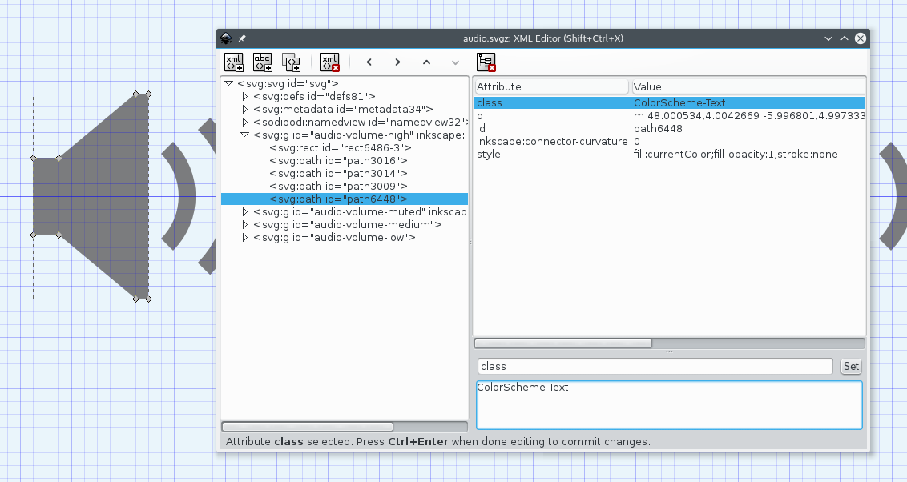

# System and accent colors


##  Using system colors {#system-colors}

It is possible to apply colors from the color scheme to an SVG. The desktop theme designer needs to do two things: **not** ship a `colors` file, and edit the SVG file to use CSS.



The SVG must have a `<style>` element with `id="current-color-scheme"` usually at the beginning of the file and inside a `<defs>` element. Do not confuse this with the `style=` attribute. You might see something similar to this:

```xml
<svg>
    <defs>
        <style
            id="current-color-scheme"
            type="text/css">

            <!-- Some CSS class here... -->

        </style>
    </defs>

    <!-- SVG elements that have the above class here... -->

</svg>
```

Before the SVG is rendered by Plasma, if the CSS classes used inside the `<style>` element match a given name, the `color:` attribute is set to the corresponding system color. The following CSS classes can be used:

* ColorScheme-Text
* ColorScheme-Background
* ColorScheme-Highlight
* ColorScheme-ViewText
* ColorScheme-ViewBackground
* ColorScheme-ViewHover
* ColorScheme-ViewFocus
* ColorScheme-ButtonText
* ColorScheme-ButtonBackground
* ColorScheme-ButtonHover
* ColorScheme-ButtonFocus

The `ColorScheme-Highlight` class is special, as it is used for defining which element will follow the [user-selected accent color](#accent-colors)

In order to apply a color from a class to an element, its `fill=` or `stroke=` attribute must be equal to `currentColor`, and the name of the wanted class has to be in the `class=` attribute.

* `<path class="ColorScheme-Text" fill="currentColor">`
* `<path class="ColorScheme-Text" stroke="currentColor">`
* `<path class="ColorScheme-Text" style="fill:currentColor">`
* `<path class="ColorScheme-Text" style="stroke:currentColor">`

Special attention is needed for gradients, as neither the `<gradient>` or the `<stop>` elements accept classes. To still get the wanted result one can put a `<g>` around them and apply the class to it. Something like this:

```xml
<svg>
    <defs>
        <style
            id="current-color-scheme"
            type="text/css">

            <!-- Here we define the class to be used -->
            .ColorScheme-Text
            {
                color:#232629;
            }

        </style>
    </defs>

    <!-- And here we use the class -->
    <g class="ColorScheme-Text" fill="currentColor">
        <lineargradient>
            <stop/>
            <stop/>
        </lineargradient>
    </g>

    <rect class="ColorScheme-Text" fill="currentColor"/>
</svg>
```

For visual elements like the above `<rect>`, it is possible to use Inkscape for adding the `style=` attribute with the required CSS attributes. Simply select the element you want to set a color to, then go to `Object -> Selectors and CSS...` and change the `stroke:` and `fill:` CSS attributes.

The [`sonic-frameworks-svg` source repository](https://github.com/Sonic-DE/sonic-frameworks-svg) has two useful tools:
* [`currentColorFillFix.sh`](https://github.com/Sonic-DE/sonic-frameworks-svg/blob/master/src/tools/currentColorFillFix.sh): fixes an error in the file format that Inkscape often uses that would break the correct application of the stylesheet
* [`apply-stylesheet.sh`](https://github.com/Sonic-DE/sonic-frameworks-svg/blob/master/src/tools/apply-stylesheet.sh): looks into the SVG file for certain colors (by default from the Breeze palette) and replaces them with the corresponding stylesheet class, automating a potentially long and tedious job

## Using the user-selected accent color {#accent-colors}

Accent colors are used to give a tinted effect to multiple elements on the screen at the same time, resulting in a consistent colorful look. They are only used if the user has selected it in System Settings, otherwise the highlight is ignored and the color scheme's own highlight color is used instead.

For a certain SVG to make use of accent colors, three conditions need to be met:

* An SVG-wide `<style>` element must exist containing the `ColorScheme-Highlight` CSS class
* The selected element must have `class=ColorScheme-Highlight`
* The selected element must have either the right CSS attribute set to `currentColor`, be it `stroke` or `fill`

When copying and editing an existing theme, it can sometimes be difficult to identify the right element that needs to be changed to use accent colors, especially when elements are grouped together.

You can use the "Layers and Objects" pane in Inkscape to identify the right element, moving elements aside by pressing Alt and dragging with the mouse to find the right element to change in case it is part of a group, then exiting Inkscape without saving.

After finding the right element ID, it should be simple to edit the SVG file directly with a plain text or XML editor.

It should end up looking similarly to this:

```xml
<svg>
    <defs>
        <style
            id="current-color-scheme"
            type="text/css">

            .ColorScheme-Highlight
            {
                color:#232629;
            }

        </style>
    </defs>

    <rect class="ColorScheme-Highlight" fill="currentColor"/>
</svg>
```
