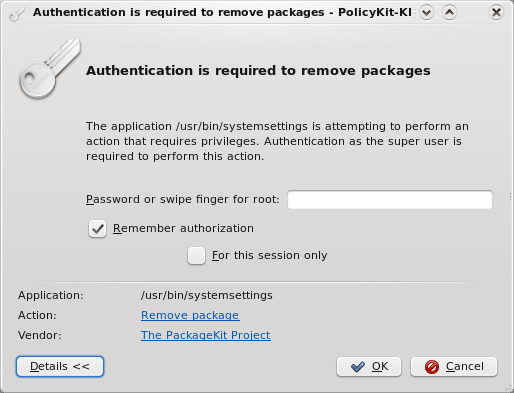
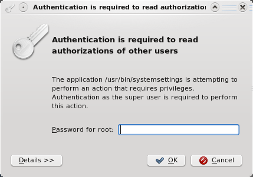
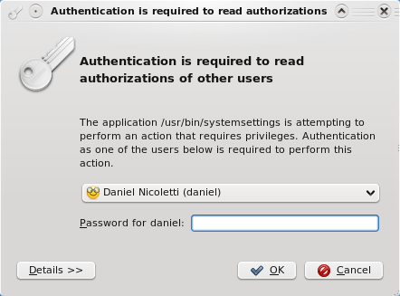
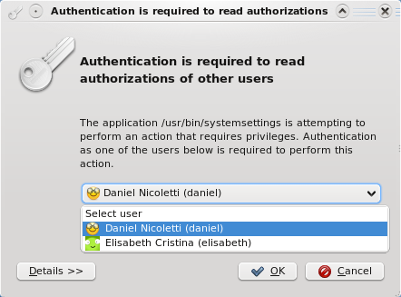
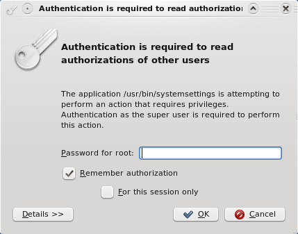
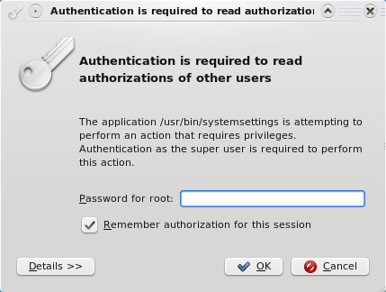

# Authentication agent

The authentication agent is SonicDE's polkit agent. Polkit gives applications an easy and secure way to ask their users for a password. Each application defines a set of actions its program can carry out. The application asks polkit whether the user can perform an action, and if authentication is needed, the agent shows a dialog where the user can enter their password, the root password, the password of a user in a given group, or even swipe a finger.

The agent is started automatically with your session, so there's nothing to run yourself.

For more about how polkit works, see the [polkit reference manual](https://www.freedesktop.org/software/polkit/docs/latest/).

## How it works

### The problem

In graphical applications, the common way to gain root privileges is to start the application as root. This has several security risks, and it can't map actions well: there's no way to separate actions like installing a package from upgrading the system, and everyone who wants to use it must have the root password. Another common approach is `sudo`, but an application started with `sudo` has all the rights of the root user. If it has a dialog for selecting files, for example, that dialog runs as root, so the user might be able to delete any file on the machine or copy other users' files.

### The solution

Polkit solves this. The application separates its privileged code into another program, often called a helper, which has no graphical interface, and lists the actions in a `.policy` file. Polkit loads this file, and can then authenticate applications to use those actions. A helper activated over D-Bus is the usual way to run a helper with root privileges.

The graphical application calls an action of the helper over D-Bus, which starts the helper with root privileges and tells it which action was requested and by which application. The helper then asks polkit whether that application can perform the action. If authentication is needed, polkit starts the available agent. After a successful authentication, the action goes ahead.

## The authentication dialog

The agent is called whenever a user needs to obtain an authorization.

The dialog's appearance depends on the result from polkit, and on how administrator authentication is defined on your system, such as authenticating as the root user or as a user from a UNIX group like `wheel`. The screenshots here are from an older version of the dialog, and some come from a system set up to use a fingerprint PAM module.

The text in the dialog comes from the polkit `.policy` XML files, usually in `/usr/share/polkit-1/actions`, and is read by the authentication daemon. So what you see isn't under the application's control, which rules out a class of attacks where an application tries to fool you into giving it a privilege.

The dialog has these parts:

- **Authenticating as** shows the user you're authenticating as. If you can choose more than one, **Switch…** lets you pick another.
- **Password…** is where you type the password.
- **Details** shows the **Action**, its **ID** and its **Vendor**.
- **OK** and **Cancel** continue or stop. If the password is wrong, the dialog says **Authentication failure, please try again.**

Authenticating as root using the password or a fingerprint, with the details shown:

Authenticating as an administrative user, where polkit is set up to use the root password:

Authenticating as an administrative user, where polkit is set up to use a group:

The same dialog, choosing the user:

An action where the privilege can be kept indefinitely:

An action where the privilege can be kept for the rest of the desktop session:

