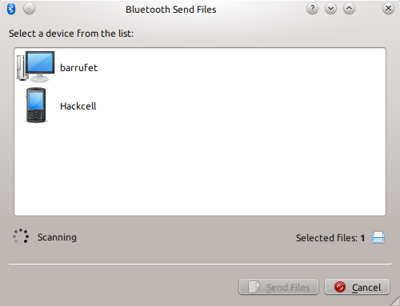
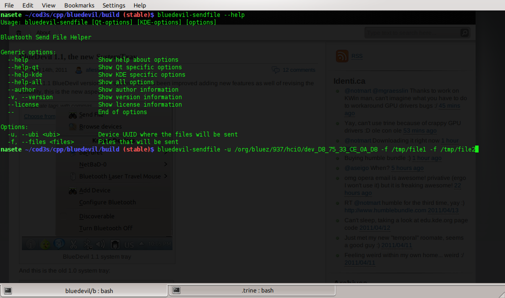
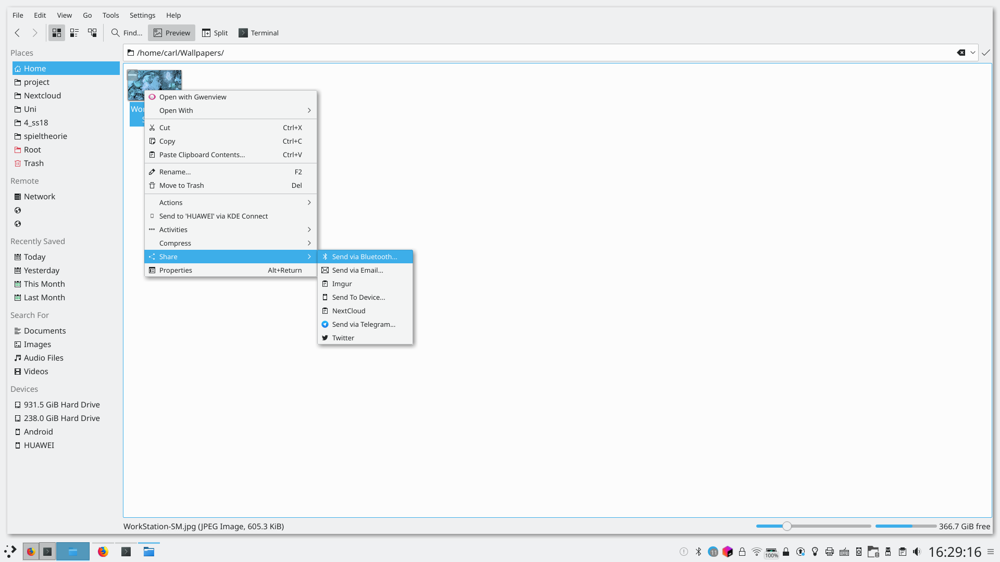

# Bluetooth overview

SonicDE's Bluetooth support integrates your Bluetooth devices with your desktop. These screenshots are older, and the screens look different now.

## Features

- Connects your Bluetooth devices to SonicDE.
- Performs file actions on your Bluetooth devices as though they were local folders.
- Has a System Settings module, [Bluetooth](../settings/bluetooth.md), to help you configure it.
- Sends files from a terminal, using `bluedevil-sendfile`, or from the **Share** menu in applications that offer one.

