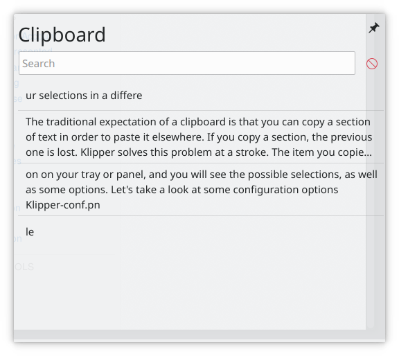
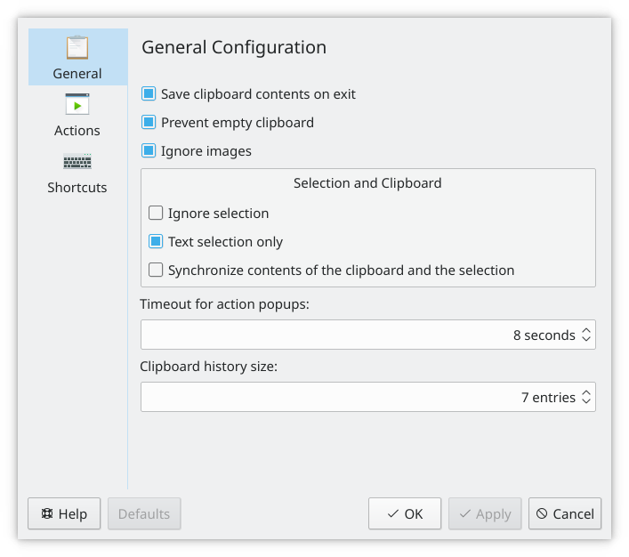
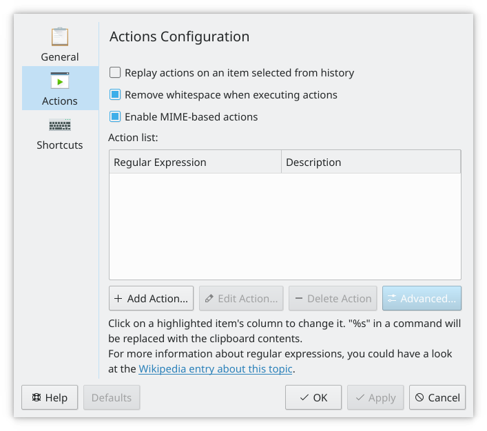
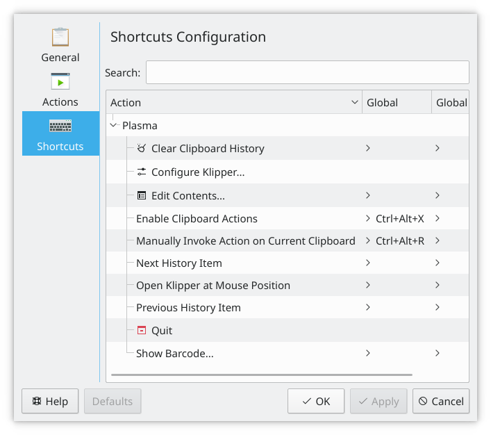

# Clipboard overview

The traditional expectation of a clipboard is that you copy some text in order to paste it elsewhere, and when you copy something else, the previous item is lost. SonicDE's Clipboard solves this. The item you copied last is still the default one to paste, but earlier ones stay in a history, so you can paste your selections in a different order. You can also configure how many items the history holds. Click the Clipboard's icon in the system tray to see the items and some options. The [Clipboard](clipboard.md) page describes all of its settings.

> **Note:** There are two different buffers. One is the *clipboard* and the other is the *selection*. The clipboard buffer is filled when you press Ctrl+X or Ctrl+C and pasted with Ctrl+V. The selection buffer is filled by simply marking some text, and pasted by pressing the middle mouse button. The Clipboard can be configured to hold both.

## Settings

Probably the two most important items on the **General** page are whether the history is kept across sessions and whether the clipboard and selection are kept the same.

If you write scripts or do programming, the **Actions Configuration** page is for you. Actions based on [regular expressions](https://en.wikipedia.org/wiki/Regular_expression) can be set here.

The **Shortcuts** page customizes the existing shortcuts.

## Tutorial

- [Sending clips to a pastebin](clipboard-pastebin.md)

## From the command line

Tools such as `xclip`, if you have it installed, can reach the clipboard from the command line. To copy to the Ctrl+C and Ctrl+V buffer, use `xclip -selection clipboard`.
