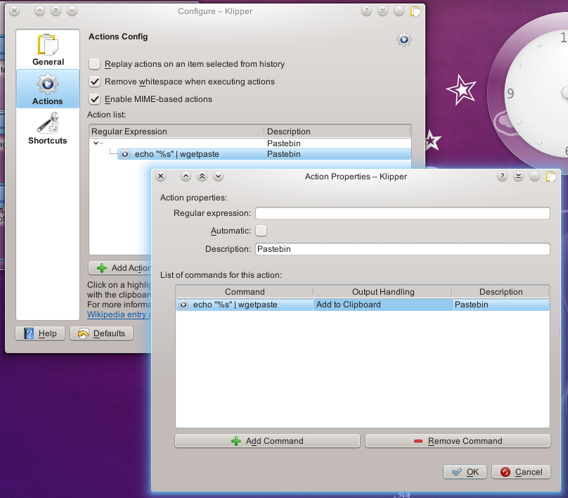

# Sending clips to a pastebin

Dion Moult wrote this tip in [a blog post](http://thinkmoult.com/2011/11/26/tech-tip-9-use-klipper-to-automatically-post-to-a-pastebin/) on 26 November 2011.

Pastebins are a really useful way to share snippets of text. However, it's sometimes a bit cumbersome to open a browser window, type in the URL, paste the text, click submit, then copy the URL to share with your friend. That's why tools like `wgetpaste` exist: small command-line utilities that automate this and return the URL. `wgetpaste` isn't part of SonicDE, so install it first, or use a similar tool.

The [Clipboard](clipboard.md) adds whatever you copy, through the right-click **Copy** or Ctrl+C, to its history. It lets you paste something you copied a while back, set up custom items to paste, or automatically perform an action on what you copied. The most common use is to open a link in a browser when you copy one.

Here, we'll get the Clipboard to post our item to a pastebin and return the URL to us. Set it up on the **Actions Configuration** page as shown below:

Then give **Manually Invoke Action on Current Clipboard** a key on the **Shortcuts** page, since it has none by default. Ctrl+Alt+R is a good choice.

And you're done! Copy something, press that shortcut to open the actions menu and click **Pastebin**. The URL of the pasted item is now in your clipboard, ready to paste to your friend with Ctrl+V.
