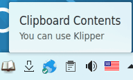
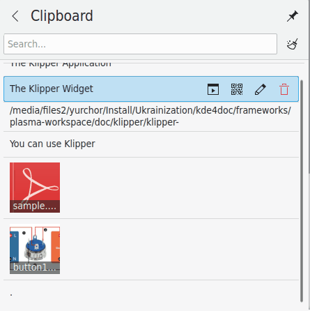

# Clipboard

The Clipboard stores your clipboard history, and lets you link clipboard contents to application actions. It runs as a widget in the System Tray. Its technical name is Klipper, which you may see in places such as its D-Bus interface.

Please report problems and feature requests in the [sonic-workspace issue tracker](https://github.com/Sonic-DE/sonic-workspace/issues).

## Basic usage

The Clipboard's icon in the System Tray shows the last item of the history when you hover over it:

The widget is hidden if the clipboard is empty.

To display the clipboard history, click the icon. You can also press Meta+V to show the clipboard items at the mouse position.

Hover over an entry with the mouse pointer and buttons appear for it:

- **Invoke action** shows the [actions](#actions) for the entry.
- **Show QR code** shows the entry as a QR code (text entries only).
- **Edit contents** lets you change the entry (text entries only).
- **Remove from history** deletes the entry.
- **Star** marks the entry as a favorite. On a starred entry, the button reads **Remove Star**.

Once at least one entry is starred, two tabs appear under the search field: **All History** shows every entry, and **Starred Only** shows only the starred ones.

On the QR code page, **Change the QR code type** switches between **QR Code**, **Data Matrix**, **Aztec**, **Code 39**, **Code 93** and **Code 128**. **Copy** puts an image of the code on the clipboard, so you can paste it into another application. **Return to Clipboard** takes you back to the history.

You can search through the history by opening it and typing your query. The results update as you type. To clear the history, click the icon at the right of the search field.

**Configure Clipboard…** in the context menu opens the [settings dialog](#settings).

## Actions

The Clipboard can perform actions on its contents, based on whether they match a particular regular expression. For example, any clipboard contents starting with `http://` can be passed to a web browser to open. In addition, if the contents match a path, similar actions can be performed according to the file's type: if the path to a PDF file is copied to the clipboard, the file can be opened in a PDF viewer.

The automatic action menu is off by default. Turn it on with **Show action popup menu** on the [Action Menu](#action-menu) page. Then select a URL or path. If there's a matching regular expression, a menu appears showing the programs for your selection. Use the mouse or cursor keys to select a program, and it runs with the address in the selection.

You can change how long the menu remains in the same place. You can separately disable the file path part with **Include MIME actions**.

Clipboard contents which match a regular expression can also be edited before performing an action on them. Select the edit icon at the right of the clipboard entry, change the contents in the dialog which appears, and click **OK** to run the appropriate action.

These actions can be given global shortcuts on the [Shortcuts](#shortcuts) page. None of them has one by default:

- **Toggle Automatic Popping Up of Action Menu** turns the automatic menu on and off.
- **Manually Invoke Action on Current Clipboard** shows the pop-up menu for the current contents.

## Clipboard and selection

There are two separate clipboard buffers, the *selection* and the *clipboard*:

- Text is placed in the selection buffer by simply selecting it, and can be pasted with the middle mouse button.
- To place text in the clipboard buffer, select it and press Ctrl+X or Ctrl+C. Text from the clipboard buffer is pasted with Ctrl+V or by selecting **Paste** in a context menu.

To change how they work together, select **Configure Clipboard…** from the context menu and go to the General page. See [Keep the selection and clipboard the same](#general).

## Settings

### General

- **Clipboard history:** **Save history across desktop sessions** retains the history so it's available the next time you log in.
- **History size:** Sets the number of items stored in the history.
- **Selection and Clipboard:** **Keep the selection and clipboard the same** makes any selection immediately available to paste by any means, with either the middle mouse button or Ctrl+V, and similarly for text in the clipboard buffer. If it's off, the selection can only be pasted using the middle mouse button.
- **Include in history:**
  - **Text selected with the pointer or keyboard** saves selections to the history even if they weren't explicitly copied. Text copied explicitly is always saved unless it's marked as a password.
  - **Image data copied explicitly** stores images in the history, for example layers and selections copied in image editors.

### Action Menu

- **Show action popup menu:**
  - **Immediately on selection** shows the menu of applicable actions as soon as a selection is made.
  - **For an item chosen from history** shows it when an entry is chosen from the history.

  If the automatic menu is off, or isn't shown for an excluded window, it can be shown with the **Manually Invoke Action on Current Clipboard** shortcut.
- **Automatic action menu time:** How long the menu remains if you do nothing with it, 8 seconds by default.
- **Trim whitespace from selection:** Removes any white space (spaces, tabs, etc.) at the beginning and end of selected text before performing an action. This is useful, for example, if the clipboard contains a URL with spaces which would cause an error in a web browser.
- **Include MIME actions:** If a file name or URL is selected, includes applications that can accept its MIME type in the menu.

### Actions Configuration

When a match pattern matches the clipboard contents, its commands appear in the popup menu and can be executed.

- **To edit an expression or action:** Double-click it or select it and press **Edit Action...**.
- **To add one:** Click **Add Action...** to add a regular expression to match. The Clipboard uses Qt's [`QRegularExpression`](https://doc.qt.io/qt-6/qregularexpression.html#details), which uses Perl Compatible Regular Expressions.
- **To delete one:** Select it and press **Delete Action**. After you confirm, the action and all of its commands are removed.

The **Action Properties** dialog has these settings:

- **Match pattern:** The regular expression to match against the clipboard.
- **Description:** A description of the expression, such as “HTTP URL”.
- **Include in automatic popup:** The commands for this match are included in the automatic action pop-up, if it's turned on on the [Action Menu](#action-menu) page. When this is off, they still appear when you open the menu with the **Manually Invoke Action on Current Clipboard** shortcut.
- The list of commands, managed with **Add Command...**, **Edit Command...** and **Delete Command**. Its **Output** column shows **Ignore**, **Replace Clipboard** or **Add to Clipboard** for each command.

The **Command Properties** dialog sets up one command:

- **Command:** The command and its arguments.
- **Description:** A description of the command.
- **Output from command:** What happens to the command's standard output: **Ignore**, **Replace current clipboard** or **Append to clipboard**.
- **Icon:** The icon shown next to the command in the action menu. A button next to it resets the icon to the default for the command.

`%s` in the command line is replaced with the clipboard contents. For example, if your command is `xdg-open %s` and your clipboard contents are `/home/phil/textfile`, the command `xdg-open /home/phil/textfile` is run. To include `%s` itself in the command line, escape it with a backslash: `\%s`.

`%0` through `%9` are replaced by the corresponding captured texts from the match pattern.

### Shortcuts

This page changes the keyboard shortcuts for the Clipboard's functions. **Show Clipboard Items at Mouse Position** opens the menu at the mouse cursor instead of the panel, and is Meta+V by default. The others are unassigned by default: **Toggle Automatic Popping Up of Action Menu**, **Clear Clipboard History**, **Manually Invoke Action on Current Clipboard**, **Edit Contents…**, **Show Barcode…**, **Next History Item** and **Previous History Item**.
