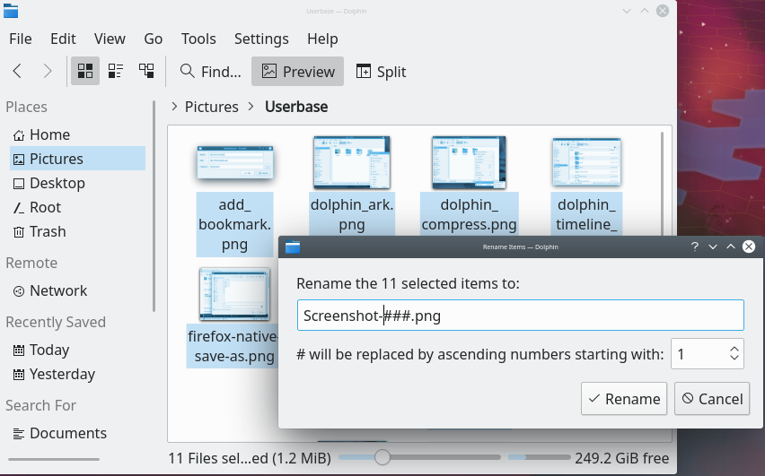

# Renaming several files in Ecco

Ecco can rename several files by numbering them. One useful application is renaming a set of photos.

Select the files you want to rename, then right-click one of them and choose **Rename…**, or press F2. A dialog opens where you can specify what the files should be called.

The `#` symbol anywhere in the name is replaced with a number, starting with 1 for the first file and going up for each file after that. **# will be replaced by ascending numbers starting with** lets you choose a different first number. Using several `#` symbols adds leading zeroes to the numbers:

- `#` is replaced by 1, 2, 3, 30, 150 and so on
- `####` is replaced by 0001, 0002, 0003, 0030, 0150 and so on

The dialog also lets you choose whether the new name replaces the filename or goes before or after it. See [Renaming a batch of files](ecco.md#renaming-a-batch-of-files) for more.
