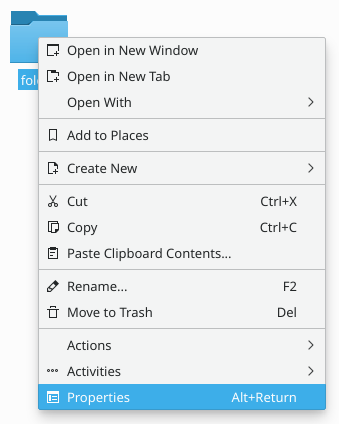
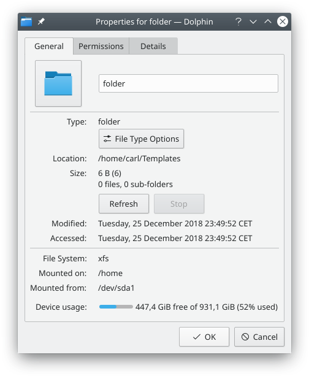
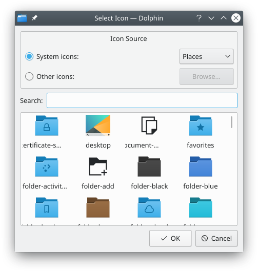
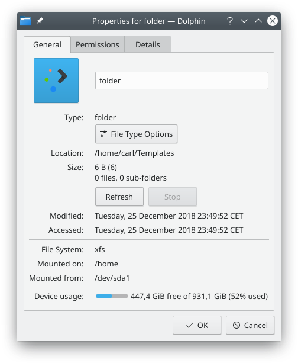
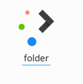

# Customizing a folder's icon in Ecco

Giving a folder its own icon makes it easier to find your way around, since you don't depend only on its name to identify it. It's usually easier to spot a file or folder by its icon than by its name. Ecco makes it easy to change the icon of any folder.

The screenshots are older, and the icon dialog now looks different from the one shown.

First, right-click the folder and choose **Properties**.

Then go to the **General** tab and click the icon in the top left corner.

A dialog window opens.

There, you can:

- **Browse system icons**: Choose an icon category in the list at the top, such as Places. The list below reloads with the system icons of that category.
- **Browse other icons**: Choose **Other** in the same list. The list below reloads with icons that aren't part of your icon theme, for example the icons of installed applications.
- **Use a custom icon**: Click **Browse…** and find the image file you want to use as the folder's icon.
- **Search**: Type in the search field at the top to narrow down the icons shown.

Once you've found the icon you want, click it. You return to the **Properties** dialog, where your choice has replaced the old icon.

Now click **OK** to apply the change. Your folder now uses the icon of your choice.

