# Getting around Ecco

This is a guided tour of Ecco, SonicDE's file manager. It shows how to use Ecco for common tasks and how to adapt it to your needs. For a full list of commands and settings, see the [Ecco file manager](ecco.md) page. The screenshots are older and may differ from what you see.

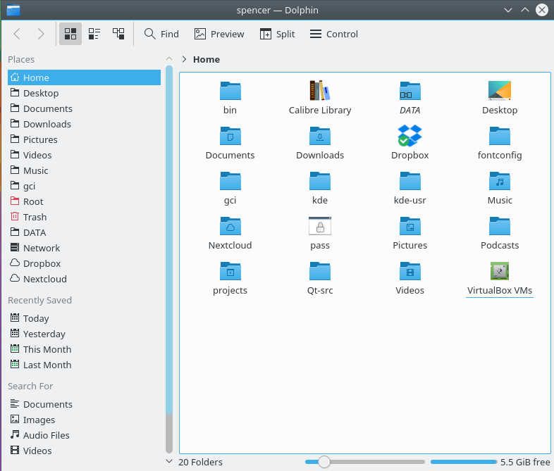

When you open Ecco from the application launcher, it shows your [Home folder](../glossary.md) unless you've chosen another location in its settings.

To open a file or go to a folder, double-click it. To open them with a single click instead, change the **Clicking files or folders** option in the [General Behavior](../settings/general-behavior.md) module.

To select or deselect files and folders, you can also hover the mouse pointer over an icon and click the plus sign that appears. Click the minus sign to deselect it. The **Show selection marker** option in Ecco's view settings turns these signs on and off.

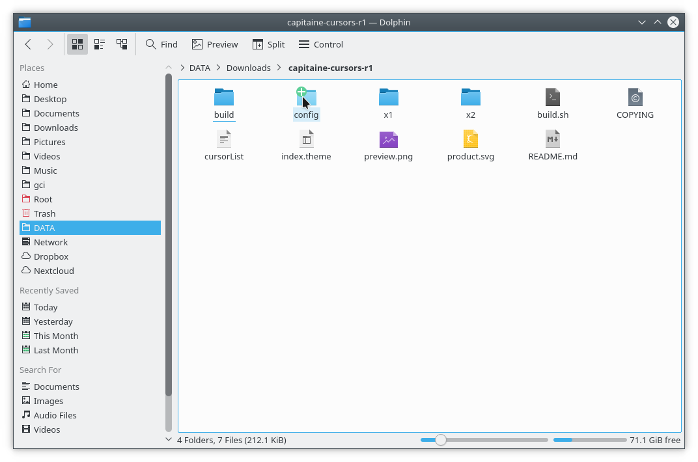

You can select several files this way. You can also drag a rectangle around them, sometimes called the "rubber band" method, use Ctrl+click to select one at a time, or use Shift+click for a consecutive range.

Several selected files look like this:

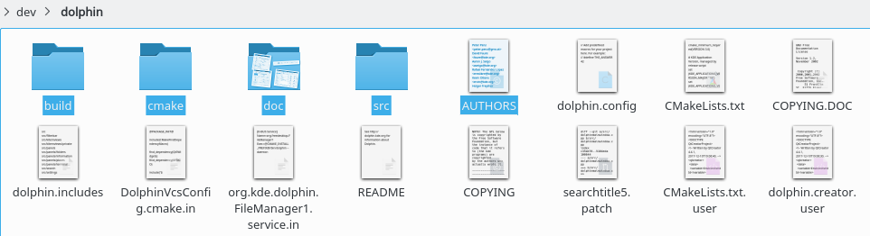

**Creating a new folder**: Use **Create New** in the context menu (right-click), or press F10.

**Tabs**: Ecco supports tabs. Open a new one from **File > New Tab** if the menu bar is shown, with Ctrl+T, or by clicking a folder icon or a navigation button with the middle mouse button.

The menu bar is hidden by default. To show it, choose **Show Menubar** or press Ctrl+M. While it's hidden, its actions are available from the menu button at the right of the toolbar.

Ecco opens by default when you click a folder elsewhere on the desktop.

## The interface

### Location bar

The location bar uses a breadcrumb design. Instead of the complete path, it shows the navigation points starting from one of your Places as buttons. Clicking a button goes directly to that folder, so you can reach a parent folder quickly.

Between the folder buttons is a small arrow, which is also a button. Clicking it lists all the subfolders at that level, for a quick change of folder.

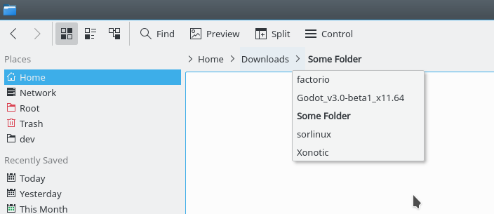

There is also a classic location bar that displays the complete path. To make the location bar editable, press F6, press Ctrl+L to select the location so it can be replaced, or use **View > Location Bar > Editable Location**. You can also click the free space next to the last folder in the breadcrumb. In editable mode, a checkmark at the end of the location bar changes back to the breadcrumb style.

### Split view

Ecco can split the current folder view so that two folder views appear next to each other. This is a comfortable way to copy or move files from one folder to another.

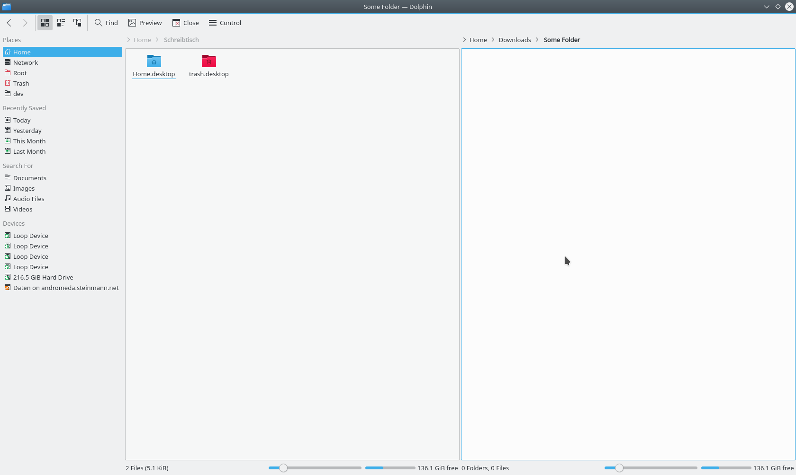

To split the view, click **Split** in the toolbar, use **View > Split**, or press F3. To change back to one view, click **Close** or press F3 again. The icon shows which view will be closed: the minus sign appears in the left or right part of the symbol, and the active view is the one that closes. This matters if you use the keyboard shortcut.

Each view has its own location bar and can use a different view mode.

### Sorting files

By default, the files in the current folder are sorted in ascending alphabetical order. To change this, use **View > Sort By**, or the **Sort By** button in the toolbar.

Files can be sorted by attributes including:

- Name
- Size
- Date
- Permissions
- Owner
- Group
- Type
- Link Destination
- Path

The same menu changes the sort order and lets you choose **Folders First** and **Hidden Files Last**.

### View modes

Ecco has three folder view modes:

- **Icons** shows each file or folder as an icon with its name.
- **Compact** is the same as Icons in a more compact form, so more folders and files fit at once.
- **Details** presents a list of files and folders with information on each, such as size and date.

To change the mode, use **View > View Mode**, the icons in the toolbar, or the keyboard:

- Ctrl+1 switches to Icons.
- Ctrl+2 switches to Compact.
- Ctrl+3 switches to Details.

#### View as icons

In this mode, each file and folder is represented by an icon. A preview of the file can be shown instead. Turn this on and off with **View > Show Previews**, the **Show Previews** toolbar button, or F12.

Additional information can appear below the icons. Turn it on and off with **View > Show Additional Information**.

To get a better overview, group the icons with **View > Group By**. The groups are divided by a horizontal line with the name of the group as a caption.

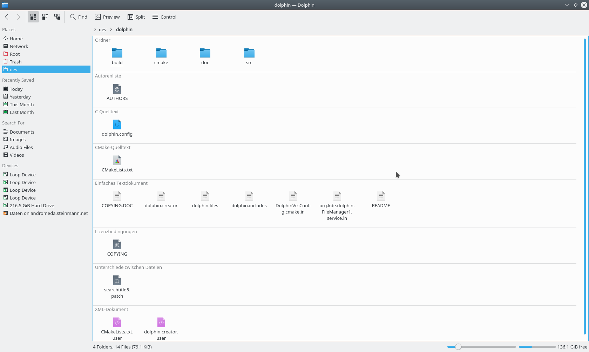

#### Details

In Details mode, all files are listed in a table, with additional information shown by default. The context menu of the table header adds more columns, including:

- Size
- Date
- Permissions
- Owner
- Group
- Type
- Link Destination
- Path

The Name column is always shown. Clicking a column's header sorts the table by that column, and clicking the same header again reverses the order.

Folders can be displayed as a tree. A small arrow appears next to each folder, and clicking it expands the folder, showing the subfolders and files inside it in the same table. Clicking it again closes the folder. To turn this off, go to **Settings > Configure Ecco > View**, open the Details tab and clear **Folders: Expandable**.

### Setting defaults for all folders

**View > Adjust View Display Style…** can make any of these attributes the default for all folders. See [the View Display Style dialog](ecco.md#the-view-display-style-dialog).

## Panels

Ecco has several panels, which you can turn on in **View > Show Panels**. A panel can sit in the left or right docking area. To move one, make sure the panels are unlocked (right-click a panel and choose **Unlock Panels**), then drag the panel's header to where you want it. The new location is highlighted as you move the pointer. Dropping a panel on top of another combines them into tabs.

A panel's header also has a button that undocks the panel so it floats above Ecco, and another that closes it. A floating panel stays part of Ecco and can't be shown without it.

### File operations in the background

When you move, copy or delete files or folders, the operation carries on in the background and its progress appears in a notification, which you can also find through the system tray.

> **Warning:** This catches out new and experienced users alike. If you are moving, copying or deleting large folders, watch the progress. If you act on the files before the operation has finished, you may be working on an incomplete file structure, which can leave you with corrupted files.

### Places

The Places panel (F9) holds your bookmarked locations. Turn it on with **View > Show Panels > Places**.

Clicking a place opens it in the current folder view. The context menu lets you edit, hide or remove places.

To add a folder to the panel, use **Add to Places** in the folder's context menu, or drag the folder onto the panel.

The panel also lists connected removable devices such as USB sticks or CDs. The context menu can unmount them.

Places are the starting points of the breadcrumb location bar. Each address is shown relative to the nearest parent folder that is one of your places.

### Information

The Information panel (F11) shows a preview or icon of the selected file or folder, or of the one under the mouse pointer, along with details such as its modification date and size. Turn it on with **View > Show Panels > Information**.

When file indexing is available, the panel also lets you rate a file, add a comment or tag it. You can then search by those tags.

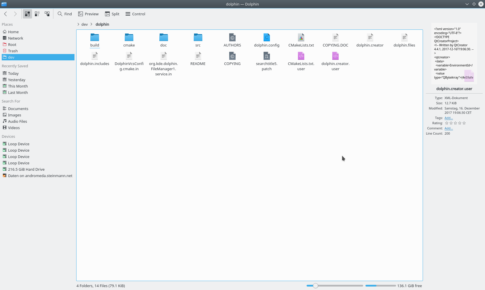

> **Tip:** If MP3 tags such as title or length are missing for some files, the files probably lack ID3 version 2 tags. A tag editor can add them.

### Folders

The Folders panel (F7) shows a tree of the file system. Turn it on with **View > Show Panels > Folders**. Click the arrows to expand or collapse subfolders, and click a folder to show its contents in the current view.

### Terminal

[Terminal](terminal.md) can be displayed directly in Ecco with **View > Show Panels > Terminal** (F4), so you can use shell commands right there. It opens in the folder shown in the current view. Shift+F4 opens Terminal in a new window.

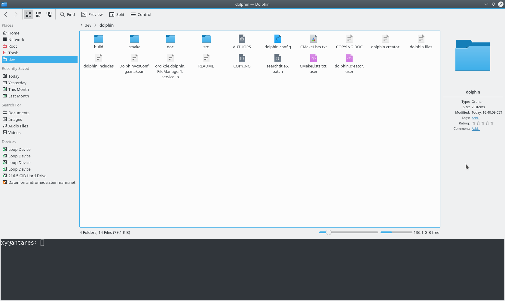

## Bookmarks and Places

SonicDE has two different systems of user-made links to locations in the file system: Places and Bookmarks. They live in different files and do different jobs, so it's worth learning the difference. Both are available to all applications that use the standard file dialog, as well as to Ecco.

### Places in applications

#### Places for system-wide navigation

There is a default set of places:

- Home
- Desktop
- Documents
- Downloads
- Network
- Trash

Music, Pictures and Videos may also appear. You can add others. In Ecco, right-click a folder and choose **Add to Places**, or drag a folder onto the panel.

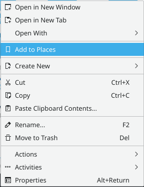

By default, the new place appears in all applications. To keep it in Ecco only, right-click its name in the Places list, choose **Edit…** and tick **Only show when using this application (Ecco)**.

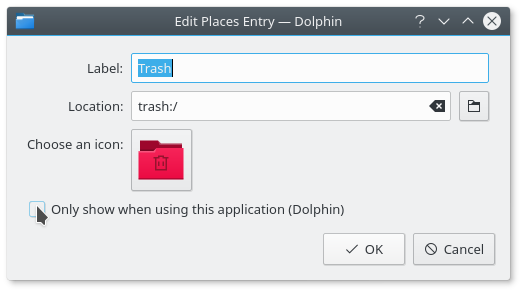

Places are stored in `~/.local/share/user-places.xbel`, where you can see the result of that option.

Some applications also offer a command for adding a folder to Places, and which features are available varies between applications. The important thing to remember is that places are available by default to all applications in the **File > Open** dialog.

#### Constraining to one application

If you open the place's **Edit…** dialog from a file dialog in another application, the same option names that application.

If you need to limit a place to an application that doesn't let you do this, edit `~/.local/share/user-places.xbel` directly. Inside the entry's `<metadata>` element, add the line:

```xml
<OnlyInApp>appname</OnlyInApp>
```

### Bookmarks in applications

Bookmarks are the second kind of user-made link to the file system. The toolbar of the **File > Open** and **File > Save** dialogs has a **Bookmarks** button that opens the bookmark menu, where you can add, edit or select a bookmark.

This button used to have to be turned on from the dialog's **Options** menu, as this older screenshot shows. It's now always there.

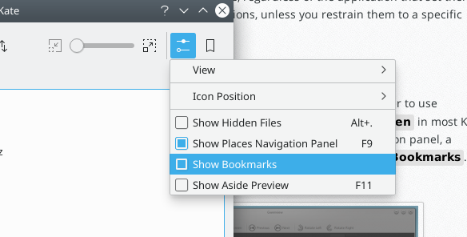

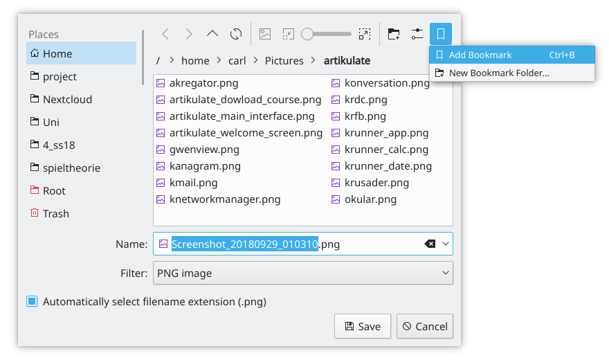

Bookmarks defined here appear in the same menu in any application. They are stored in one file, `~/.local/share/kfile/bookmarks.xml`, which is used by all applications with that menu.

## More useful actions

### Change a file association on the fly

Have you ever opened a file, only to find it's [associated](../settings/file-associations.md) with an application you didn't want?

You can change this in System Settings' [File Associations](../settings/file-associations.md) module, which is the same as running `kcmshell6 kcm_filetypes` in a terminal.

If you want to change many associations quickly, you can edit an application's `.desktop` file directly. For example, an application in `/usr/share/applications` may associate itself with a great number of file types, which you may not want. Its `MimeType=` line can be shortened, or commented out with `#`. Lines such as these may also help keep your previous default application, with this one only a second or third option:

```ini
InitialPreference=2
X-KDE-InitialPreference=3
```

Edits to system files are lost when the package is updated, so copy the file to `~/.local/share/applications` first if you want them to stay.

Ecco also offers a quick way to change a **single** association. Right-click the file and choose **Properties**. On the **Type** line there is a **Change…** button. Click it to add or change an association.

The same works on a folder, for instance to choose a different file manager or add another image viewer to the possible associations.

### The Actions submenu

The **Actions** submenu opens up more things you can do from Ecco. Some actions only appear when they apply to the selected file. An application's `.desktop` file in `/usr/share/applications` defines which actions apply to a type of file, and extra ones can be added in Ecco's [Context Menu settings](ecco.md#context-menu). Which actions you see depends on the software you have installed.

### Show your recent files at startup

You can open a view of recently modified files with file indexing running. Go to `timeline:/today/` by pasting it into the location bar, or use it as the home location under **Show on startup** in Ecco's settings.

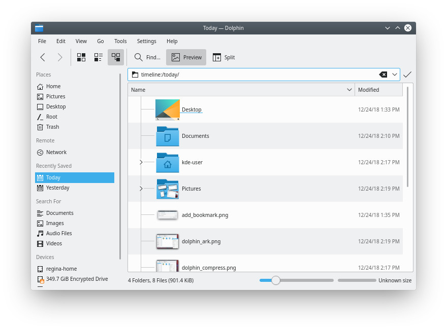
