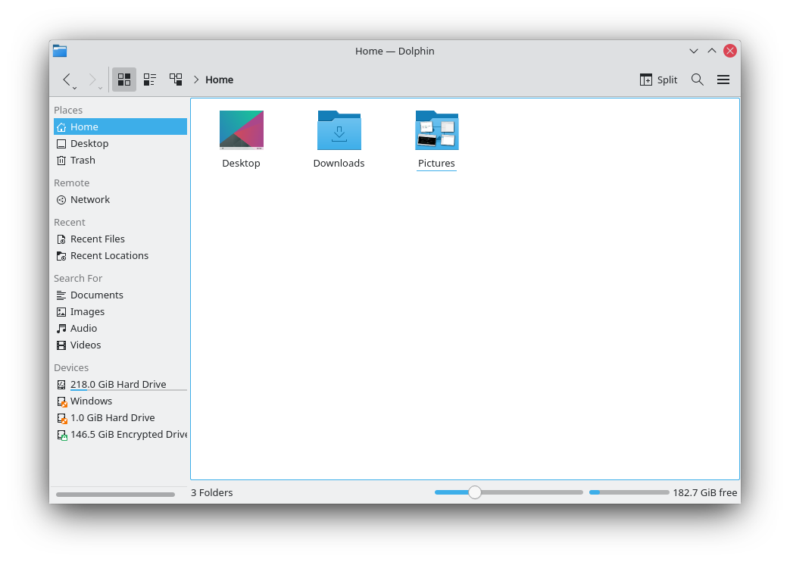

# Ecco overview and troubleshooting



Ecco is a lightweight file manager designed with ease of use and simplicity in mind, while still allowing flexibility and customization. You can manage your files exactly the way you want to.

The [guided tour](ecco-guide.md) explains how to use it, and the [Ecco file manager](ecco.md) page describes every command and setting.

## Features

- A simple, dedicated file manager with a focus on usability
- A breadcrumb location bar
- Optional panels for convenient navigation and information
- Remote and special file systems through [network and file protocols](../protocols/index.md)
- Tag files and folders, and find files by content, using [file search](../settings/file-search.md)
- Split view, to see and use two folders at the same time
- View settings that can be remembered independently for each folder
- Tabs
- An optional Information panel
- Essential information about files shown right in the view
- One click to change to an editable location bar
- A Folders panel for traditional navigation
- A terminal in the folder you are browsing
- Many functions controlled by keyboard shortcuts

## Tutorials

- [Getting around Ecco](ecco-guide.md)
- [Customize the icon of a folder](ecco-folder-icon.md)
- [Rename several files at the same time](ecco-batch-rename.md)

## Hints, tips and troubleshooting

**Problem:** When I choose the application that opens a file type, it seems to affect other file types too. It's as if Ecco can't tell the two file types apart.

**Solution:** The system probably doesn't know about one of the two file types, so it treats it as a different, known one. This is common with XML-based file types. Even with a file extension of their own, such as `.xliff` or `.graphml`, they are treated as any other XML file if the type isn't known, and open with the default application for XML files. To solve this, use the [File Associations](../settings/file-associations.md) module to create an entry for the unrecognized file type.

**Problem:** Searching in Ecco doesn't find files you know are on your computer.

**Solution:** Update the file index. Ecco uses the file indexer to search for files, and it needs an up-to-date index to work. In a [terminal](terminal.md), type:

```sh
balooctl6 check
```

**Problem:** There is no file transfer dialog.

**Solution:** Jobs such as file transfers are handled by default in the central notification system, and they also show in the task manager. To get a separate file transfer dialog, go to System Settings' [Notifications](../settings/notifications.md) module, clear **Show in notifications** and **Show in task manager** under **Application progress**, then log out and back in.
