# Ecco file manager

Ecco is SonicDE's default file manager. It concentrates on one task, managing files, and its interface is designed around it. The application launcher lists it as **Dolphin** (File Manager), and its window and settings use the name Dolphin too; its command is `dolphin`.

Please report problems and feature requests in the [Ecco issue tracker](https://github.com/Sonic-DE/sonic-ecco/issues).

## The user interface

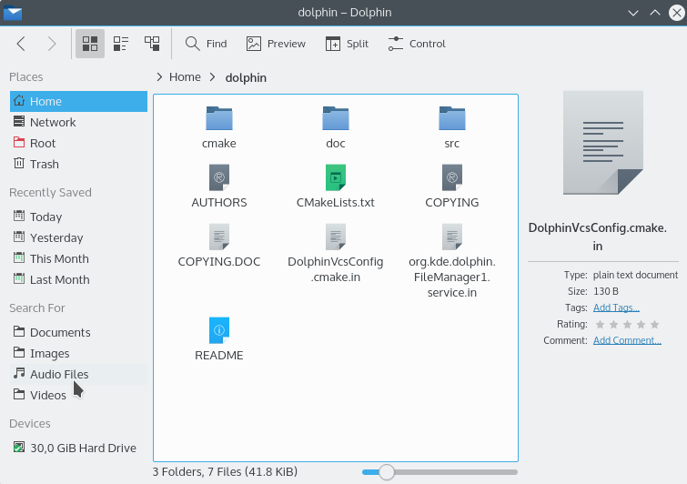

The elements of the default user interface are:

- **The toolbar**, for quick access to frequently used actions. To customize it, click it with the right mouse button and choose **Configure Toolbars…**, or use **Configure Toolbars…** from the menu button at the right of the toolbar. See [Shortcuts and toolbars in applications](../dialogs/shortcuts-and-toolbars.md).

  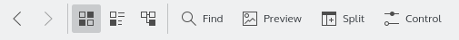

- **The location bar**, which always displays the path to the current folder. See [Location bar](#location-bar).
- **The view**, which shows all files and folders in the current folder. See [The view](#the-view).
- **The Places panel**, which provides quick access to bookmarked locations and disks or other media. If file indexing is enabled in System Settings' File Search module, the panel also offers recent items and searches for documents, images, audio files and videos.
- **The status bar**, which displays the name, size and type of the file under the mouse, or the number and size of the selected files. At the right is a zoom slider that adjusts the size of the icons in the view.
- **The menu bar**, hidden by default, which provides access to all commands and configuration options. See the [command reference](#command-reference). Toggle it with **Show Menubar** (Ctrl+M). While it's hidden, its actions are available from the menu button on the toolbar.
- **The Information, Folders and Terminal panels**, hidden by default. See [Panels](#panels).

## The view

### Using the view

The view displays all files and folders in the current folder. These items can be accessed or manipulated in different ways:

- A file or folder is opened by double-clicking it with the left mouse button, or by a single click if **Clicking files or folders** is set to **Opens them** in System Settings' General Behavior module.
- Clicking any item or the empty area around the items with the right mouse button opens a context menu with many frequently used actions for the item or the current folder.
- If the left mouse button is pressed on an item but not immediately released, the item can be dragged to another folder in the current view or to another Ecco view (in another window, or in the same window if the view is split) to move or copy it or to create a symbolic link. Items can even be dropped in another application to open them there.

Ecco remembers the history of visited folders. To navigate backward or forward in the history, use the buttons in the toolbar:

Clicking an item in the history with the middle mouse button opens it in a new tab, which keeps the current tab with its content.

### Appearance of the view

The toolbar contains buttons to control the appearance of the view:

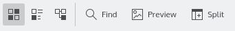

All the settings below and other options, such as the sorting of the files in the current folder, can also be changed in the View menu and in the [View Display Style dialog](#the-view-display-style-dialog). By default, all folders share these settings. To have each folder remember its own, use the [View](#view) section of the settings.

#### View modes

- **Icons** is the default. Files are represented by an icon that visualizes the file type, and subfolders by a folder icon. The names and the items enabled in **View > Show Additional Information** are displayed below the icons.
- **Compact** shows the folder contents as icons with the name beside them, and the items enabled in **View > Show Additional Information** below the name. The items are grouped in columns.
- **Details** displays the folder contents as a detailed list with the name, size and last modification time of each item. Add more columns by clicking a column header with the right mouse button.

  In the context menu of the header line, you can add or remove side padding and choose between a custom or automatic column width. Automatic width adjusts the width of all columns once to display the longest item in the column completely, except for the Name column.

  The order of columns can be changed by dragging column headers, except for the Name header, which is always the first column in this view.

  If [expandable folders](#icons-compact-and-details) are enabled, this view shows the current folder in a tree-like fashion: each subfolder can be expanded or collapsed by clicking the icon next to it.

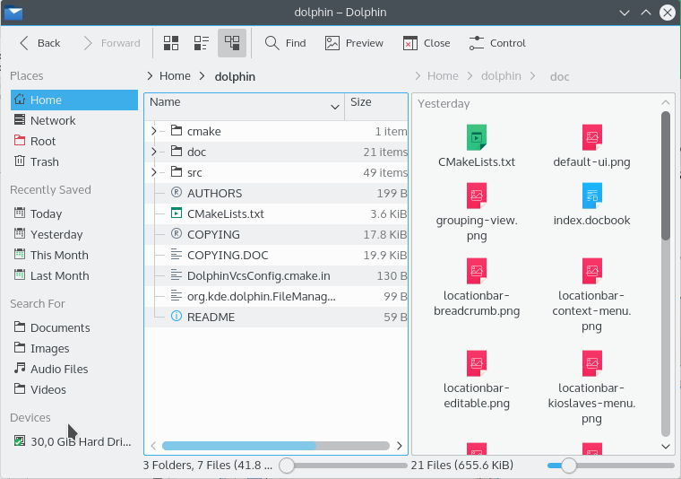

#### Information in the view {#information-in-the-view}

In all view modes Ecco shows at least an icon and a name for each item. Using **Show Additional Information** in the View menu, or the context menu of the header in Details mode, you can select more information for each item, such as size, date, type, rating, tags or comment.

Depending on the file type, more criteria can be selected, for example the number of words and lines of documents, the size and orientation of images, or the artist, album, duration and track of audio files.

The **Other** submenu lets you select path, link destination, copied from, permissions, owner or user group.

#### Preview

If **Show Previews** (F12) is enabled, the icons are based on the actual file or folder contents; for example, images show a scaled down preview.

#### Split

**Split** (F3) shows two views, which can display the contents of different folders. This can be convenient for moving or copying files.

### Selecting items in the view

There are several ways to select items in the view. Once a group of items is selected, all actions, such as **Cut**, **Copy**, **Move to Trash** and drag and drop, affect all selected items.

#### Selecting items using the mouse

- Press the left mouse button somewhere in the view and draw a rectangle around a group of items before releasing the button. This selects all items in the rectangle and clears the previous selection. If the Shift key is pressed during the selection, the previous selection is kept.
- If the Ctrl key is pressed while an item is clicked with the left mouse button, the selection state of this item is toggled. If the Ctrl key is pressed while a rectangle is drawn around a group of items, the selection state of all items in the rectangle is toggled.
- If the Shift key is pressed while an item is clicked with the left mouse button, all items between the previous current item and the clicked item are selected.
- If **Show selection marker** is enabled in the [View](#view) section of the settings, a small + or − button appears in the top left corner of the item under the mouse. Clicking it selects or deselects the item.
- **Edit > Select Files and Folders** turns on selection mode, in which clicking an item selects it.

#### Selecting items using the keyboard

- If an arrow key, Page Up, Page Down, Home or End is pressed, the new current item is selected, and the previous selection is cleared.
- If the Ctrl key is held while one of the above keys is pressed, the selection remains unchanged.
- If the Shift key is held while one of the above keys is pressed, all items between the previous current item and the new current item are selected.
- Ctrl+Space toggles the selection state of the current item.
- Space turns selection mode on and off.
- Ctrl+A selects all items in the view.
- Ctrl+Shift+A toggles the selection state of all items in the view.
- Typing the first few letters of an item's name selects the first matching item. To clear the selection and cancel the keyboard search press Esc or wait longer than 1 second.

## Location bar

The location bar, above the view, displays the path to the current folder. It has two modes.

### Bread crumb mode

In this mode, which is the default, each folder name in the path to the current folder is a button which can be clicked to quickly open that folder. Clicking the “>” sign to the right of a folder opens a menu which lets you quickly open a subfolder of that folder.

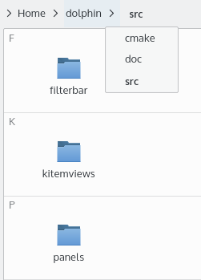

### Editable mode

Clicking in the empty area to the right of the path switches the location bar to editable mode, in which the path can be edited using the keyboard. F6 also switches modes, and Ctrl+L selects the location so you can replace it quickly. To switch back to bread crumb mode, click the check mark at the right of the location bar.

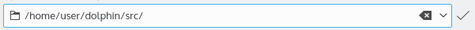

#### Using network and file protocols

If the location bar is empty in editable mode, a drop down box appears in front of it listing all available protocols. These add support for many different kinds of locations to Ecco and other applications.

For example, with the `fish` protocol, Ecco can manage files and folders on a remote host that is accessible via SSH: type `fish://username@remotehost` into the location bar. Similar remote file management can be done on remote hosts accessible via the FTP, NFS, SFTP, SMB (CIFS) or WebDAV protocols.

The drop down box also gives access to fonts, the trash, other programs and devices attached to your computer. See the box for the full list on your system.

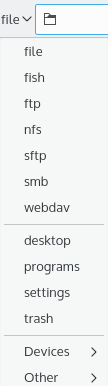

### Places and context

If the Places panel is hidden, both modes display an additional icon in front of the path. Click it to open a menu with quick access to places and storage media. See [Places](#places).

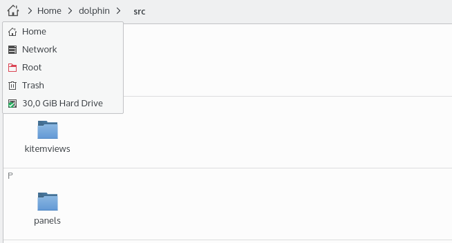

The context menu of the location bar offers actions to switch between the modes and to copy and paste the path using the clipboard. The last option in this menu chooses whether the path starts at the root folder of the file system or at the current places entry.

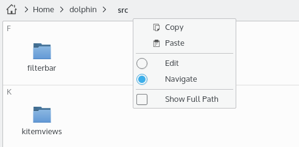

## Panels

Ecco allows a number of panels to be placed next to the view. Enable them in **View > Show Panels**. By unlocking the panels and dragging a panel title, the panel can be moved to a different position, even outside the window.

### Places

The Places panel (F9) is at the left of the window by default. It shows any locations you have bookmarked and any disk or media attached to the computer, and with file indexing it also shows recently accessed items and lets you search for certain types of files. The order of these entries can be changed by dragging them.

The easiest way to add a folder is to drag it to the panel. You can also click inside the panel with the right mouse button and choose **Add Entry…**. A dialog opens where label, location and icon can be edited and the entry can be limited to Ecco.

The context menu also edits, hides or removes entries, changes the icon size, locks or unlocks the panels, opens an entry in a new tab, and unmounts devices.

### Information

The Information panel (F11) shows extended information about the selected items, the current folder or the file under the mouse, including size, type and date of last modification. It also features a large preview of the selected item and lets you assign a rating, tags and comments to it.

### Folders

The Folders panel (F7) shows a tree view of the file system. It only shows folders. Clicking a folder with the left mouse button opens it in the view.

Use **Limit to Home Directory** in the context menu to hide all folders from the tree view except your Home.

### Terminal

This panel (F4) contains a terminal, which opens at the folder currently shown in the view. Changing the folder in the active view updates the working folder of the terminal, and changing the directory in the terminal updates the view. The terminal only works with local media.

## Quick tips

### Quick bookmarking

To quickly add the current folder to the Places panel, click the empty area of the view with the right mouse button and choose **Add to Places**.

> **Note:** The visibility of this menu item can be changed in the [Context Menu](#context-menu) section of the settings.

### Filtering files

Ecco can show only those items in the view whose name contains a given text. For example, to show only the MP3 files within a folder, filter for “.mp3”.

Enable the filter bar by pressing Ctrl+I or `/`, or via **Edit > Filter…**, then enter the text. Disable it by pressing Esc or by clicking the button to hide the filter bar.

### Finding files and searching in files

Press Ctrl+F or use **Edit > Search…** to open the search bar, set up to search within the current folder and any subfolders. Start typing and the search starts immediately.

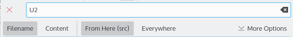

The search is case insensitive and doesn't require surrounding wildcards (`*foo*` and `foo` are equivalent), but you can use wildcards inside the search term: `*` matches zero or more characters, and `?` matches one single character.

The search bar's options choose:

- **Search in:** **Here** limits the search to the current folder and its subfolders. **Everywhere** searches all indexed locations with file indexing, and all directories from the root up with simple search.
- **Search using:** **File Indexing** or **Simple search**. File indexing is set up in System Settings' File Search module.
- Whether to search file names, file contents, or both.
- With file indexing, filters for **File Type**, **Modified since**, **Rating** and **Tags**. You can also search for a tag by typing `tag:foo`.

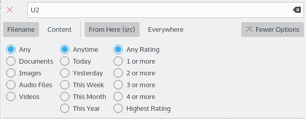

Use the save button to save a search to the Places panel so you can quickly access it again.

For more advanced searches, use **Tools > Open Preferred Search Tool** (Ctrl+Shift+F) to open another search tool such as KFind.

### Mounting storage media

Click a device in the Places panel to mount it and open it in Ecco.

### Undo actions

Ecco can undo changes you've made to files. For example, if you moved a file to the trash, Ecco can move it back to its original location. Press Ctrl+Z or select **Edit > Undo: (action name)**. After undoing, **Redo** (Ctrl+Shift+Z) does the action again; it's in the Edit menu and in the menu button.

### Renaming a batch of files

Ecco can rename several files at the same time. Each file gets the name you specify, including a number, for example Image1.jpg, Image2.jpg, Image3.jpg. This can be useful for pictures taken with a digital camera.

Select the files, then press F2 or use **File > Rename…**. The **Rename Items** window opens. **How to rename:** offers **Enumerate**, **Replace text** and **Add text**, and remembers the one you used last. With **Enumerate**, enter the name you want: each `#` in it is replaced by a different consecutive number for each file. When the name replaces the whole filename (**Replace filename**), it must contain a `#`.

If all file extensions in your selection are different, the name of all files can be changed without using a `#` placeholder while preserving the file extensions. This is useful, for example, to rename a video file and all associated subtitle files, which have the same file name but different extensions.

See [Renaming several items at once](../dialogs/file-operations.md#renaming-several-items-at-once) for all the options.

### Comparing a selection of files or folders

If the Kompare application is installed, you can use it to see the differences between two files or folders. Select the two, then use **Tools > Compare Files**.

## Configuring Ecco

Ecco distinguishes two kinds of settings:

- Settings which affect its general behavior, configured in the [settings dialog](#the-settings-dialog).
- Settings which determine how the contents of a folder are displayed, called [display styles](#folder-display-style). They are controlled with toolbar buttons, the View menu and the View Display Style dialog.

### The settings dialog

Open it with **Settings > Configure Dolphin…**, or the same item in the menu button. The settings are divided into groups which are listed on the left of the dialog.

#### Interface

This group has five tabs.

**Folders & Tabs:**

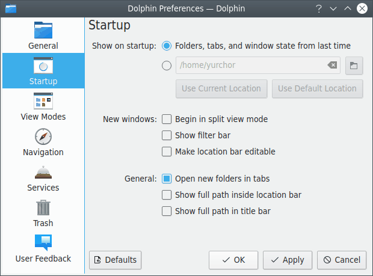

- **Show on startup** chooses what opens at startup: **Folders, tabs, and window state from last time**, or a home location that you can type, choose in a dialog, or set with **Use Current Location** or **Use Default Location**. When restoring the last session:
  - Launching Ecco without any locations restores the session.
  - Rebooting with Ecco open restores the session when the system comes back.
  - Launching Ecco with locations shows those locations instead.
  - If Ecco is already running and a new window is opened, the new window shows a single tab with the location that was visible in the existing window.
- **Keep a single Dolphin window, opening new folders in tabs** controls whether a folder opened from another application opens in a new tab of the running window or in a new window.
- **Show full path in title bar** makes it easy to distinguish folders with the same name.
- **Show filter bar** controls whether the [filter bar](#filtering-files) is shown at startup.
- **Always show tab bar** and **Show close button on tabs** control the tab bar.
- **Tab width** chooses between tabs that adapt to the folder name, tabs with the same fixed width, and tabs that span the available width.
- **Open new tabs** chooses between after the current tab and at the end of the tab bar.
- **When closing a split view** chooses which pane closes: the active, the inactive or the right pane.
- **Open new windows in split view mode** makes new windows start split.

**Previews:** Choose the file types previews are shown for, and the maximum size of files on local and remote storage to generate previews for. With **Show previews for folders**, previews of some files in a folder are shown inside the folder's icon.

**Confirmations:** Choose the warning dialogs shown before potentially harmful actions.

- These apply to all applications using the same file operations: moving files or folders to trash, emptying the trash, and deleting files or folders.
- These apply to Ecco: closing windows with multiple tabs, closing windows with a program running in the Terminal panel, opening many folders at once, opening many terminals at once, switching to act as an administrator, and renaming a file in a way that changes its type.
- **When opening an executable file** chooses between **Always ask**, **Open in application** and **Run script**.

**Panels:** Choose whether the Information panel shows previews, auto-plays media files and shows the item under the mouse, and whether it uses long or condensed dates. Other panel settings are in the panels' context menus.

**Status & Location bars:**

- **Status Bar** chooses between **Small**, **Full width** and **Disabled**. **Show zoom slider** switches the slider on and off.
- **Make location bar editable** starts the location bar in editable mode instead of bread crumb mode.
- **Show full path inside location bar** shows the full path of the current location in bread crumb mode. Otherwise, a shortened path is shown if it begins with the path of one of the places in the Places panel.

#### View {#view}

This group has five tabs.

**General:**

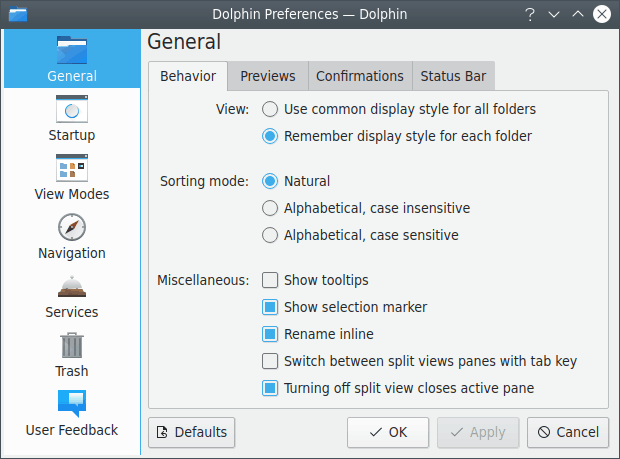

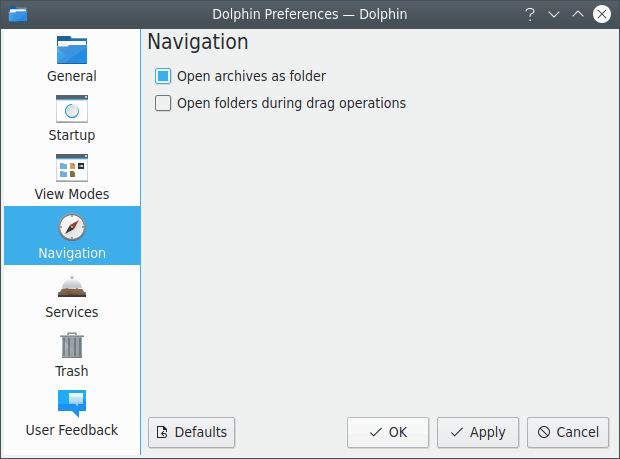

- **Display style** chooses between **Use common display style for all folders** and **Remember display style for each folder**. Some special views such as search, recent files and the trash still use a custom style. You can also have locations which mostly contain media files use the icons view mode.
- **Browse compressed files as folders** opens archives inside Ecco instead of in an external application.
- **Open folders during drag operations** opens a folder when you drag an item and hover over it for a short time, which lets you move or copy items quickly to folders several levels down.
- **Show item information on hover** shows a small window with information about the item under the mouse.
- **Show selection marker** shows a small + or − button above an item's icon when the mouse is over it.
- **Rename single items inline** renames one selected item directly in the view. Renaming several items always uses a dialog.
- **Also hide backup files while hiding hidden files** hides backup files together with hidden files.
- **Double-click triggers** chooses what double-clicking the view's background does: nothing, one of the listed actions, or a custom command.

**Content Display:**

- **Sorting mode** chooses between **Natural**, **Alphabetical, case insensitive** and **Alphabetical, case sensitive**. Natural sorting orders three example files as File1, File2, File10; alphabetical sorting orders them as File1, File10, File2.
- **Folder size** chooses between **Show number of items**, **Show size of contents** up to a chosen depth, which limits unneeded work in deep folder structures or on slow file systems, and **Show no size**, which might improve performance in rare cases but affects features like sorting.
- **Date style** chooses between relative dates such as “Yesterday, 3:00 PM” and absolute dates such as “2020-12-23 15:00”.
- **Permissions style** chooses between symbolic (`drwxr-xr-x`), numeric (`755`) and combined.
- **Long file names** chooses whether the file name is shortened in the middle or at the end.

##### Icons, Compact and Details {#icons-compact-and-details}

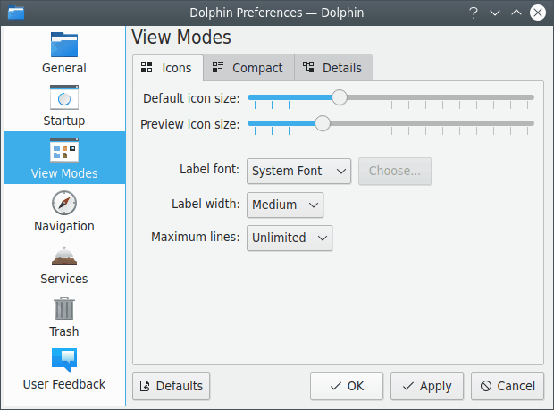

All three tabs have:

- Sliders for the **Default icon size** and **Preview icon size**, used when previews are off and on respectively. The icon size can also be changed with the zoom slider in the status bar.
- **Label font**: the system font or a custom font.

Each tab then has its own settings:

- **Icons:** **Label width** sets the width reserved for the text of an item, and **Maximum lines** sets the number of text lines below the icon.
- **Compact:** **Maximum width** sets the maximum width reserved for the text of an item.
- **Details:** **Expandable** folders are displayed in a tree view where items can be expanded and collapsed. **Open files and folders** chooses between clicking anywhere on the row and clicking on the icon or name.

The option to open items with a single or double click is a system-wide setting in System Settings' General Behavior module.

#### Context Menu {#context-menu}

This group chooses what is shown in the context menu that appears when clicking a file or folder with the right mouse button. Type in the **Search…** field to filter the list. Use **Download Services…** to fetch additional services, and **Shortcuts…** to open the keyboard shortcut editor, where you can give context menu services a shortcut.

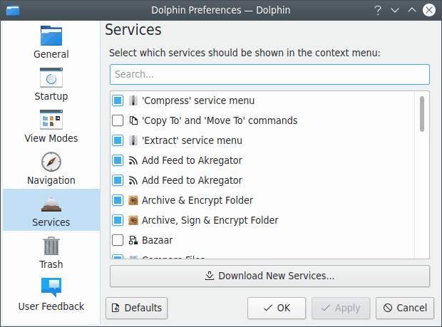

If you have installed Ecco's plugins for Bazaar, Mercurial, Git or Subversion, they are shown in this list. When they are enabled and you enter a folder under version control, the version state (locally changed, up to date, and so on) is indicated by icons and the context menu has additional entries such as commit, update, add and remove.

The list also chooses whether commands such as Delete, Copy To and Move To, Add to Places, Sort By, View Mode, Open in New Tab, Open in New Window, Open in Split View, Copy Location, Duplicate Here, Open Terminal, and copying or moving to the other split view are shown.

Ecco has to be restarted to activate the changes for some of these settings.

#### Trash

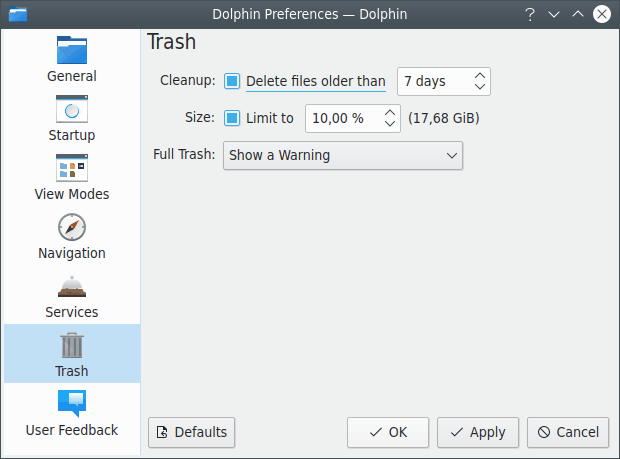

- Files which are older than a configurable number of days can be deleted automatically.
- The size of the trash can be limited to a configurable percentage of the disk size. If this limit is reached, a warning can be issued, or the oldest or largest files can be deleted automatically.

#### User Feedback

When Ecco is built with feedback support, this group lets you choose whether and how much information on your use of Ecco is contributed to its developers.

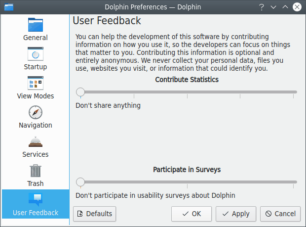

### Folder display style

The following settings control how the contents of a folder are displayed:

- The view mode (Icons, Compact, Details)
- The sorting of items, determined by the sort order and the attribute (such as name or size) that items are sorted by
- Whether folders are shown first, and whether hidden files are shown last
- Whether previews are shown instead of icons
- Whether items are shown in groups
- Whether hidden files are shown
- What additional information, besides the name, is shown

The display style can be configured in the View menu, and some of it (such as the view mode) with toolbar buttons.

#### The View Display Style dialog {#the-view-display-style-dialog}

This dialog, opened with **View > Adjust View Display Style…**, quickly modifies the display styles for many folders at once: the current folder, the current folder including all subfolders, or all folders, depending on your choice in the **Apply to** section.

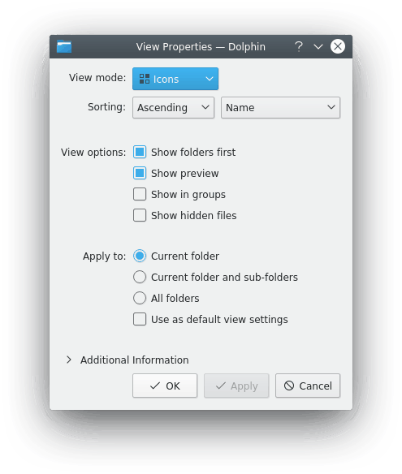

If **Use as default view settings** is enabled, the chosen properties are also used for all folders which don't have customized properties yet.

## Command reference

By default the menu bar is not shown. All actions described here are available from toolbar buttons or the toolbar's menu button.

### The File menu

**Create New**: Creates a new object (such as a folder or a text file) in the current folder.

> **Note:** You can add your own items to this menu. Put a `.desktop` file, based on the ones in the [`sonic-frameworks-io` templates](https://github.com/Sonic-DE/sonic-frameworks-io/tree/master/src/new_file_templates), into `~/.local/share/templates`, then restart Ecco.

**New Window**: Opens a new Ecco window.

**New Tab** (Ctrl+T): Opens a new tab.

**Close Tab**: Closes the current tab.

**Undo close tab** (Ctrl+Shift+T): Reopens the last closed tab.

**Add to Places**: Adds the current folder to the Places panel.

**Rename** (F2): Renames one selected item inline. Opens the [batch rename dialog](#renaming-a-batch-of-files) if several items are selected.

**Duplicate Here** (Ctrl+D): Creates duplicates of the selected items, appending a copy marker to their names.

**Move to Trash**: Moves the selected items to the trash.

**Delete**: Permanently deletes the selected items. They aren't moved to the trash and cannot be restored.

**Show Target**: Highlights a link target in a new Ecco window.

**Properties** (Alt+Return): Shows the properties dialog for the selected items.

**Quit**: Exits Ecco.

### The Edit menu

**Undo**: Undoes the last action performed by Ecco.

**Redo**: Does an undone action again.

**Cut**: Cuts the selected items.

**Copy**: Copies the selected items.

**Copy Location** (Ctrl+Alt+C): Copies the path of the selected item.

**Paste**: Pastes the copied or cut items into the current folder. If the clipboard doesn't contain files or folders, its contents (such as text or image data) are pasted into a new file, whose name you enter in a dialog.

**Filter…** (Ctrl+I or `/`): Enables and disables the [filter bar](#filtering-files).

**Search…** (Ctrl+F): Opens the [search bar](#finding-files-and-searching-in-files).

**Select Files and Folders** (Space): Turns selection mode on and off.

**Copy to Other View** (Shift+F5): Copies the selected items from the active split view to the inactive one.

**Move to Other View** (Shift+F6): Moves the selected items from the active split view to the inactive one. Disabled if you don't have write permission on the selected items.

**Select All** (Ctrl+A): Selects all files and folders in the current folder.

**Invert Selection** (Ctrl+Shift+A): Selects all unselected items and deselects all selected items in the current folder.

### The View menu

**Zoom In**, **Reset Zoom Level** (Ctrl+0), **Zoom Out**: Change the size of icons in the view.

**Sort By**: Changes the attribute that items are sorted by, the sort order, and whether folders come first and hidden files last.

**Group By**: Displays the current folder's contents in groups: none, the same as the sorting, or another attribute.

**View Mode**: Changes the view mode to Icons (Ctrl+1), Compact (Ctrl+2) or Details (Ctrl+3).

**Show Additional Information**: Displays the information described in [Information in the view](#information-in-the-view).

**Show Previews** (F12): Displays a preview of the file contents.

**Show Hidden Files** (Ctrl+H): Shows all hidden files and subfolders within the current folder.

**Act as Administrator**: Lets you act on files as an administrator after you confirm it.

**Restore to Defaults**: Restores the current folder's display style to the defaults.

**Adjust View Display Style…**: Opens the [View Display Style dialog](#the-view-display-style-dialog).

**Split** (F3), **Pop out Left View** or **Pop out Right View** (Shift+F3), **Focus Other View** (Ctrl+F3): Enable and disable the split view, move the active pane to a new window, and move the focus to the other pane.

**Stash** (Ctrl+S): Opens the stash virtual directory in a split view. Only available when the stash service is running.

**Reload**: Reloads the current folder.

**Stop**: Stops loading the contents of the current folder.

**Show Panels**: Enables and disables the [panels](#panels): Places (F9), Information (F11), Folders (F7) and Terminal (F4). **Lock Panels** hides each panel's header to save space and makes them immutable. **Unlock Panels** shows the header so that panels can be moved to the right or left or even outside the main window.

**Location Bar > Editable Location** (F6): Changes the location bar between [bread crumb](#bread-crumb-mode) and [editable](#editable-mode) mode.

**Location Bar > Replace Location** (Ctrl+L): Switches the location bar to editable mode, if necessary, and selects the location so it can be replaced quickly.

### The Go menu

**Up**, **Back**, **Forward**: Change to the folder above the current one, the previously viewed folder, or undo a Back action.

**Home**: Changes to your home folder.

**Bookmarks**: Opens your bookmarked locations.

**Recently Closed Tabs**: Shows a list of recently closed tabs which can be reopened.

### The Tools menu

**Open Preferred Search Tool** (Ctrl+Shift+F): Opens the preferred search tool in the current folder.

**Open Terminal** (Shift+F4): Opens a terminal in the current folder.

**Open Terminal Here** (Shift+Alt+F4): Opens a terminal in the selected folders.

**Manage Disk Space Usage**: Opens a menu of tools for seeing what uses your disk space.

**Compare Files**: Compares the selected files or folders with Kompare. Only shown if Kompare is installed, and enabled if two files or folders are selected.

**Select Remote Charset**: Lets you choose the charset used by a remote connection manually.

### The Settings and Help menus

Ecco has the usual Settings and Help menu items, for configuring shortcuts and toolbars, opening its settings, reporting bugs and showing information about the application. **Window Color Scheme**, in the Settings menu and in the menu button's Configure submenu, picks a color scheme for Ecco's windows only.
