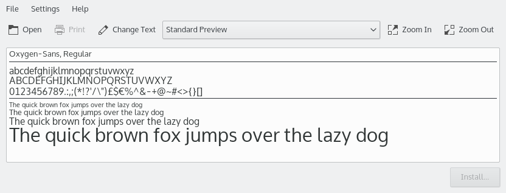

# Font Viewer

Font Viewer (`kfontview`) is an application to view and install different types of fonts:

- TrueType (`.ttf`)
- OpenType (`.otf`, `.ttf`)
- PostScript type 1 (`.pfb` and `.pfm` on Windows and OS/2, `.pfa` and `.afm` on UNIX and Linux)
- BDF (Bitmap Distribution Format, `.bdf`)
- PCF (Portable Compiled Format, `.pcf`)

You can use it as a standalone program to preview and install a font downloaded from the Internet. In the preview, you can check that the font has all the characters you need.

You can also start it from the [Font Management](../settings/font-management.md) module to use its extended preview. That module can also install, remove, preview and manage all the fonts on your system.

The Standard Preview displays your font in several sizes using a pangram, a sentence that uses every letter of the alphabet at least once, so you get a good idea of what it looks like. The **Preview Type** box in the toolbar offers more types:

- **All Characters:** Displays all the characters the font provides, in one size.
- **Unicode Block:** The Unicode standard arranges groups of characters together in blocks.
- **Unicode Script:** In Unicode, a script is a collection of letters and other written signs used to represent textual information in one or more writing systems.

**Change Text…** opens the Preview String dialog, where you can enter your own text. This lets you check that a font supports the characters you need.

You can use the zoom buttons or the mouse wheel to change the font size in all preview types.

In Unicode Block and Unicode Script preview, hovering over a character shows a tooltip with its Unicode category and its value in UCS-4, UTF-16, UTF-8 and as an XML decimal entity.

If a font file has several faces, **Show Face** chooses which one to preview.

## Installing a font

To install a font you downloaded from the Internet, click **Install…** in the lower-right corner.

You can install it for personal use, available only to you, or system-wide, available to all users, which requires administrator privileges.

Fonts are often provided in an archive format like `zip`. To use Font Viewer's preview, extract the fonts and open them here.

Applications need to be restarted to use newly installed fonts.
