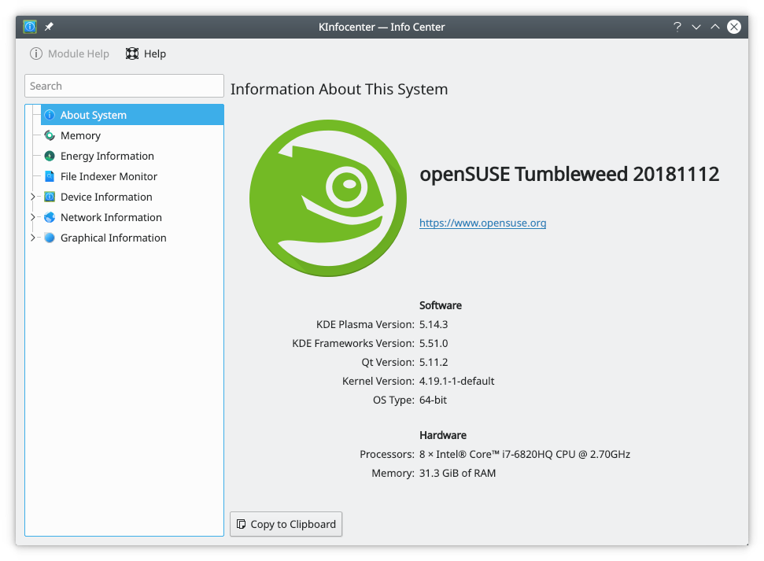
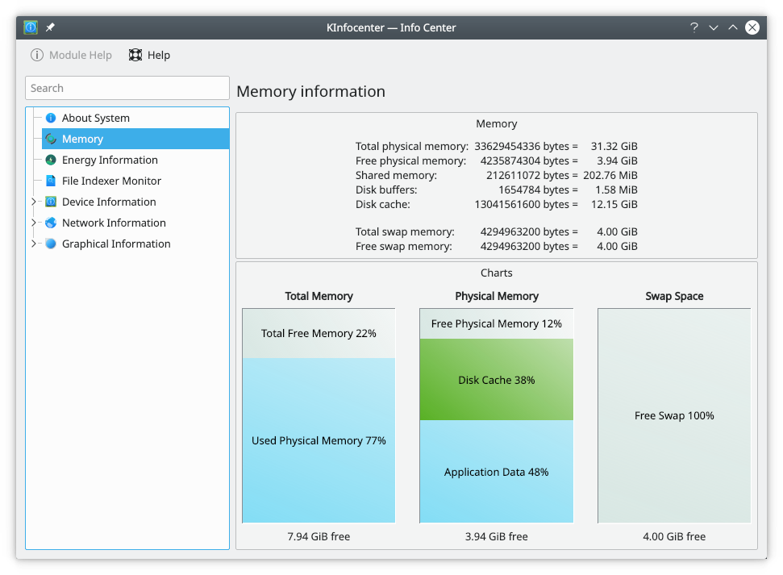
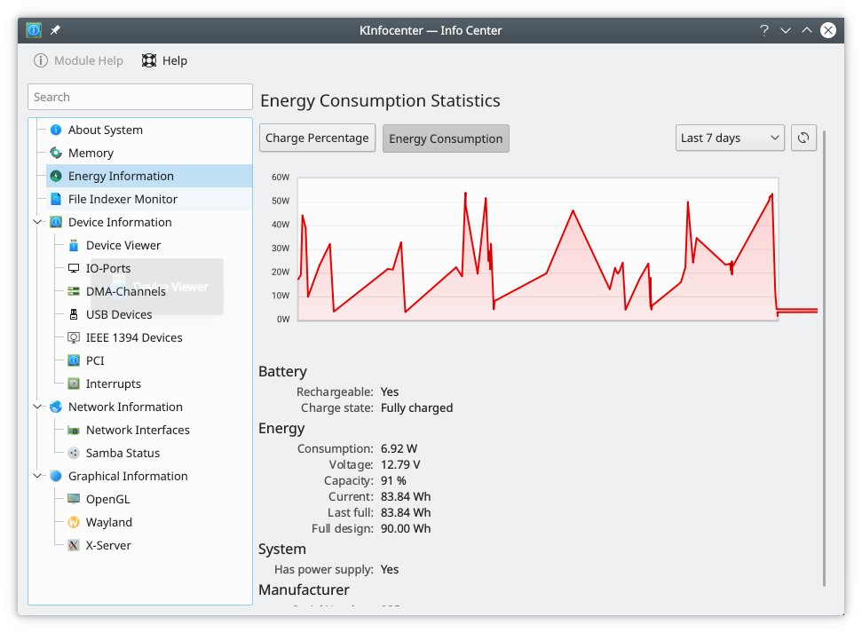

# Info Center overview

Info Center gives you a host of information about your hardware and its capabilities. These screenshots are older, and the pages look different now. The [Info Center](info-center.md) page describes the current ones.

## Features

Areas of particular interest might be:

As well as:

- The status of any Samba shares
- Processor information
- Sound capabilities
- Your X server and video capabilities

And much, much more.

## Hints and tips

If you have trouble moving through the list of pages with the keyboard, these keys are the ones to use:

- Left arrow: collapse
- Right arrow: expand
- Up arrow: up
- Down arrow: down
- Enter: select an item that doesn't expand
