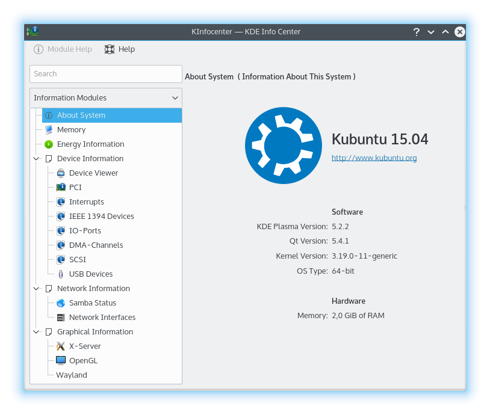

# Info Center

Info Center gives you a central overview of your system and desktop environment. It's made up of multiple pages, each showing one kind of information, which you can read but not change here.

Please report problems and feature requests in the [sonic-system-info issue tracker](https://github.com/Sonic-DE/sonic-system-info/issues).

## Starting Info Center

You can start Info Center in three ways:

1. Select it from the application launcher.
2. Press Alt+F2 or Alt+Space to bring up KRunner, type `kinfocenter`, and press Enter.
3. Type `kinfocenter &` at any command prompt.

All three do the same thing. To quit, press Ctrl+Q or close the window.

## The window

The side of the window lists the pages, grouped into the categories below, with a search field to find them. Select a page to show it in the main area.

### Pages that show a tool's output

Most pages run a command-line tool and show what it prints. They share these actions:

- **Copy to Clipboard** copies all the text.
- **Filter** opens a bar that limits the page to text matching what you type.
- **Pause Refreshing** and **Resume Refreshing** appear on pages that update by themselves.

If the tool isn't installed, the page says “Could not load page content” and names the tool. You may be able to install it using your package manager. The message also suggests reporting it to your distribution, since it's a packaging issue.

## Basic Information

### About this System

A brief summary of your system: the operating system, the versions of SonicDE, its Frameworks, Qt and the kernel, and the graphics platform. The hardware section shows the processors, memory and graphics processors, and the manufacturer, product name and system version where available. The serial number stays hidden until you click **Show**.

**Copy Details** copies this information, in the current language or in English. Use it if you ask for help in support channels or report a bug.

### Energy

Shows the charge history and power consumption of your batteries, and details about them. If your computer has no battery or other power information, the page says so.

- **The graph** shows **Charge Percentage** or **Energy Consumption** over a period you choose, from the last hour to the last 7 days.
- **Battery:** whether it's rechargeable, its charge state and current charge, its health and charge cycles, its vendor, model and serial number, and its technology.
- **Energy:** consumption, voltage, remaining energy, last full charge and original charge capacity.
- **Environment:** temperature.

Each of these only appears if the battery reports it.

## Devices

### Audio

Your sound devices, as listed by `pactl list`.

### Block Devices

Your disks and their partitions, as listed by `lsblk`.

### CPU

Detailed processor information from `lscpu`.

### Firmware Security

The security state of your computer's firmware, from `fwupdmgr`.

### Interrupts

The interrupt request lines (IRQs) in use and the devices using them. An IRQ is how a device signals the processor that it's ready to send or accept data. On Linux, this page shows `/proc/interrupts`, with a column for each IRQ, the number of interrupts received per processor since boot, the type of interrupt, and the device assigned to it.

### Memory

Details of your installed memory modules, from `dmidecode`. Reading these needs administrator privileges, through a helper program. If it doesn't succeed the page says “No data available”.

### PCI

The PCI bus and the cards and other devices on it, from `lspci -v`. Each entry begins with a bus, device and function number.

### Sensors

Your hardware's sensor readings, such as temperatures and fan speeds, from `sensors`. The page refreshes every second, and uses Fahrenheit if your locale does.

### USB Devices

The devices attached to your USB buses in a tree. Select one to see its details. The list refreshes by itself.

## Network

### Network Interfaces

The network interfaces in your computer and their addresses and statistics, from `ip`.

### Samba Status

Two lists for Samba (SMB) sharing, a protocol for sharing printers and folders on a network, including with machines running Microsoft Windows:

- **User-Created Shares:** the folders you've shared, each with its path and the address it's shared at. Its button opens the folder's properties, where you can change the sharing settings.
- **Remote Share Mounts:** the Samba shares from other machines that are mounted on your system.

## Graphics

The information on these pages varies with your setup, and some setups can't report all of it.

### EDID

The Extended Display Identification Data of your displays, the description each one gives of itself, decoded by `di-edid-decode`.

### OpenCL

Your OpenCL platforms and devices, from `clinfo`.

### OpenGL (EGL)

Information about your OpenGL implementation through EGL, from `eglinfo`.

### OpenGL (GLX)

Information about your OpenGL implementation through GLX, the binding of OpenGL to the X Window System, from `glxinfo`. OpenGL (Open Graphics Library) is a cross-platform, hardware-independent interface for 3D graphics.

### Video Acceleration (VA-API)

What your graphics hardware can accelerate for video, from `vainfo`.

### Vulkan

Your Vulkan devices and their capabilities, from `vulkaninfo`.

### Window Manager

SonicWin's support information, including its compositing setup. It's useful to include when reporting a SonicWin problem.

### X-Server

Specific information about your X Server and the current X session, from `xdpyinfo`.
