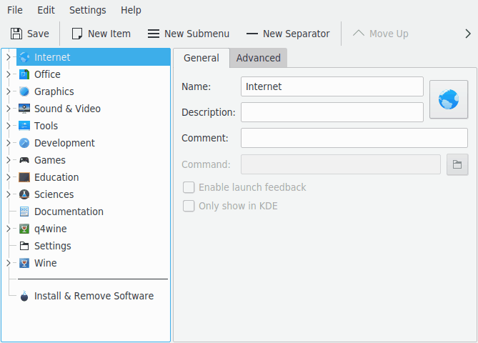
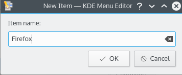
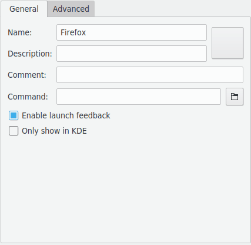
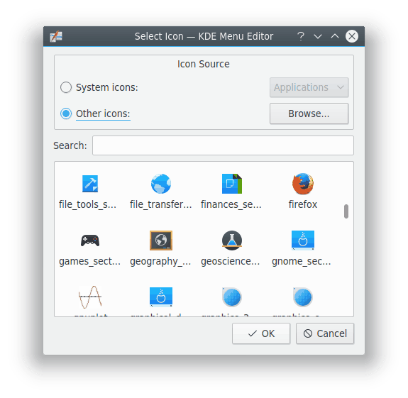
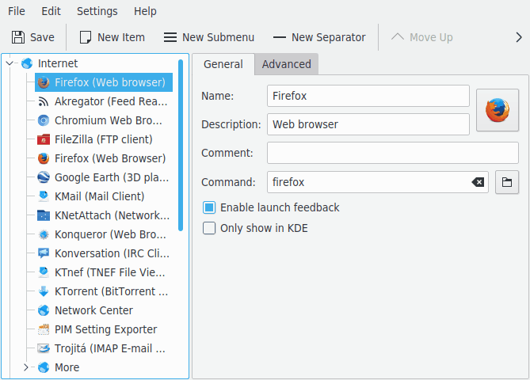

# Menu Editor

Menu Editor lets you edit the menu of your application launchers. Start it by right-clicking the application launcher button on the panel and choosing **Edit Applications…**, or by typing `kmenuedit` in KRunner.

With it you can:

- View and edit the menu used by the current application launcher.
- Cut, copy and paste submenus and items.
- Create and delete submenus and items.
- Change the order of submenus and items.
- Hide items and add new submenus and items.

By default, all applications installed on the computer appear in the application launchers of all users. Applications may appear more than once, in different menus. Empty submenu categories defined in the desktop menu specification show up here as well, but aren't visible in application launchers unless you install applications belonging to them.

The tree view has two types of entry:

- **Submenu:** Only the name, comment and description fields and the button to select an icon are enabled, and the Advanced tab is disabled. A submenu can hold more submenus and items.
- **Items:** The data for an application. See [Using Menu Editor](#using-menu-editor).

The tree view has two modes, normal and with hidden entries. To see the latter, enable **Show hidden entries** on the **General options** page of the settings.

Many more entries appear with hidden entries shown. Several seem to be duplicates but have different command options. You should usually leave these alone, or you risk breaking some functionality of the system.

With hidden entries shown, there's a special submenu at the top level, `.hidden [Hidden]`, which can't be edited. All deleted items are shown in it the next time you start Menu Editor. Entries in this submenu can't be deleted, and they reappear at the next start.

## Use cases

### Reordering items

Do this with hidden entries not shown, so that only the submenus and items visible in the application launcher are displayed.

By default, the menu is sorted alphabetically using the English names or descriptions. In other languages, some submenus and items therefore appear out of order.

Use the options in **Edit > Sort** to sort by name or description. If you use the classic application launcher, select the matching format in its settings. In the default launcher, enable **Show applications by name** if you sort them by name here.

Grouping your frequently used submenus or items, for example at the top of the menu, makes selecting them easier. To change the order of items or submenus, use **Move Up** and **Move Down** in the toolbar or the menu.

All application launchers use the order of submenus defined in Menu Editor.

### Removing items from the menu view

Showing every installed application can be confusing for some users, so you may want to hide less used items or submenus. There are two ways to do that:

- With hidden entries not shown, delete items. They move to the `.hidden [Hidden]` submenu, and you can move them back into the tree to have them in the menu again.

  If you delete a submenu, it's really deleted, with all its submenus and items. To recreate them you can use **Edit > Restore to System Menu**, but this removes all your custom submenus and items and deletes their `.desktop` files. You can't undo this.

- The preferred way is to enable **Hidden entry** on the General tab, with hidden entries shown. It's then easy to revert your changes without destroying the menu structure. The only drawback is that you have to hide every entry in a submenu by hand to hide the whole submenu.

### Adding custom items

To add a submenu or item, use the actions in the menu or toolbar. Items need a name and a program. Without a program, the item isn't saved and your addition is lost.

A new entry is inserted below the highlighted position in the tree. To make it a top level entry, drag it with the mouse or use **Move Down** to take it to the bottom of the tree.

### Transferring launcher settings

There's no way to transfer menu settings with the interface, so copy these files to the target user by hand:

- The menu hierarchy is in `menus/applications-kmenuedit.menu`, in the folder given by `qtpaths --paths GenericConfigLocation`.
- `desktop-directories`, in the folder given by `qtpaths --paths GenericDataLocation`, contains desktop files for the submenus you created.
- `applications/`, in the same folder, contains the desktop files for the custom items you created.

Each application's shortcut is stored in `kglobalshortcutsrc`, in the folder given by `qtpaths --paths GenericConfigLocation`. Exporting and importing doesn't work, because the UUIDs of the shortcuts don't match between systems, even though the `.desktop` files are the same. You have to assign all the shortcuts again by hand.

## Adding a menu entry

This example adds Firefox to the Internet submenu.

1. Right-click the application launcher and click **Edit Applications…**. In Menu Editor, select **Internet**.

   

2. Click **File > New Item…** to open the New Item dialog. Type the name of the program you want to add, in this case `firefox`.

   

3. Press Enter, and the new item is shown in the main window.

   

4. Fill in the **Generic name**, in this case `Web Browser`.

   > [!NOTE]
   > How the generic name and name are displayed depends on the settings in the application launcher, for example “Web Browser (Firefox)” or “Firefox (Web Browser)”.

5. Fill in the **Program** field, in this case `firefox`. The program has to be in your `PATH` variable, or you have to specify the full path to the executable. If you don't know the executable name of an application, use the `locate` command to search for its desktop file, and enter the string from its Exec line.

6. For a more creative icon, click the generic icon next to **Name**, or the area to the right of the name field if the default icon is blank. The Select Icon dialog lets you choose a new one. Choose the Firefox icon from the list and press Enter.

   

   

7. Change the place of the new item with **Move Up** and **Move Down** in the toolbar, or by dragging it with the mouse. **Edit > Sort** sorts the submenu's items.

8. Click **File > Save**, and you should find Firefox in the application launcher's Internet submenu.

**Command-line arguments** can have placeholders, which are replaced with actual values when the program runs:

- `%f`: a single file name
- `%F`: a list of files, for applications that can open several local files at once
- `%u`: a single URL
- `%U`: a list of URLs
- `%d`: the folder of the file to open
- `%D`: a list of folders
- `%i`: the icon
- `%m`: the mini-icon
- `%c`: the caption

For example, to have Firefox start at `www.example.org`, use `%u www.example.org` as the arguments.

Most applications accept additional options, such as a profile name in Terminal. To see all the options for an application, run `applicationname --help` in Terminal.

## Using Menu Editor

The left panel shows the application launcher's structure, with a search field above it. When you browse items there, the right panel shows detailed information for the highlighted item.

### General tab

- **Name:** The name of your program as it appears in the application launcher. It can be different from the real executable name. For instance, the name of the `mc` executable is “Midnight Commander”.
- **Generic name:** Displayed together with the name in the application launcher. This is entirely optional.
- **Comment:** Describes the program in greater detail. This is entirely optional.
- **Environment variables:** Variables to set when the program runs.
- **Program:** The name of the executable program. Make sure you have permission to run it.
- **Command-line arguments:** Arguments for the program, with the [placeholders](#adding-a-menu-entry) above.
- **Enable launch feedback:** Displays feedback when the application starts.
- **Only show when logged into a SonicDE session:** The entry is only visible in SonicDE's application launchers, not in other desktop environments.
- **Hidden entry:** Removes the entry from the menu view in the application launcher.

### Advanced tab

- **Work path:** The current path when the program launches. It doesn't need to be the same as the executable's location.
- **Run in terminal:** Enable this if your program needs a terminal emulator to run. This mainly applies to [console applications](#console-applications).
- **Terminal options:** Options for the terminal.
- **Run as a different user:** Runs the program as a different user. Provide the name in the **Username** field.
- **Run using dedicated graphics card:** Runs the program on the dedicated graphics card.
- **Current shortcut key:** Assigns a keyboard shortcut to launch your program. Click the button next to it, and press the key combination you want. The button next to that resets it.

Don't forget to save with the **Save** toolbar button or **File > Save**.

## Menu reference

Most actions in the menu bar are also in the context menu that opens when you right-click an item in the tree view.

- **File > New Item…:** Adds a new menu item.
- **File > New Submenu…:** Adds a new submenu.
- **File > New Separator:** Adds a separator.
- **File > Save:** Saves the menu.
- **File > File Actions:** **Copy Location**, **Open Containing Folder** and **Properties** for the selected entry.
- **File > Quit:** Quits Menu Editor.
- **Edit > Move Up** and **Edit > Move Down:** Move the selected item within its submenu.
- **Edit > Cut:** Cuts the current item to the clipboard. To move an item, cut it, go to the destination in the left panel, and paste it.
- **Edit > Copy:** Copies the current item to the clipboard. You can paste the same item many times.
- **Edit > Paste:** Pastes the item from the clipboard to the selected place in the menu.
- **Edit > Delete:** Deletes the selected item.
- **Edit > Sort:** **Sort Selection by Name**, **Sort Selection by Description**, **Sort All by Name** and **Sort All by Description**.
- **Edit > Restore to System Menu:** Restores the application launcher's default and removes all your custom settings. A message box asks whether you really want to do that.

The menu button and the Settings and Help menus have the usual items. **Configure** has the **General options** and **Spell Checking** pages.

## Console applications

Console applications were originally written for a non-graphical, text-oriented environment. They run fine on the desktop, but they must run in a terminal emulator such as [Terminal](terminal.md). They aren't warned automatically when you end your session, so don't forget to save open documents before logging out.

To copy from a console application, select the text with your mouse, switch to the other application and press Ctrl+V. To copy into one, select the text, press Ctrl+C, switch to the console application and press the middle mouse button. If your mouse has no middle button, press the left and right buttons at the same time, which your operating system must support.
