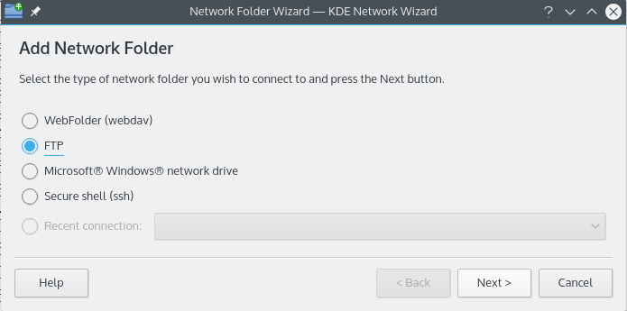
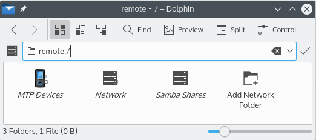
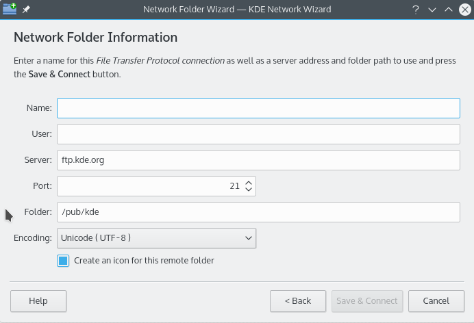
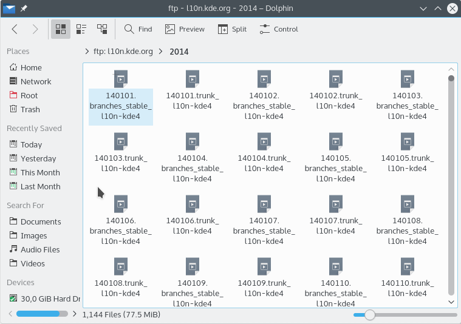
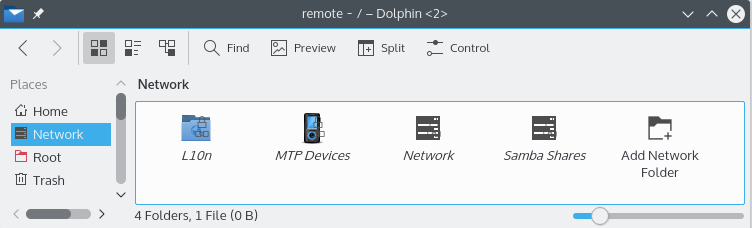

# Network Folder Wizard

The Network Folder Wizard (`knetattach`) makes it easy to add network folders and integrate them with your desktop.

It can add four types of network folder: WebDAV, FTP, Microsoft Windows (Samba) network drives and secure shell. You can also select a recent connection from the list.

## Adding network folders

Network folders show up in a special location in [Ecco](ecco.md) called a *virtual folder*. To open it, type `remote:/` in the location bar or select **Network** in the Places panel. You can see any folders you've added there, and use the wizard to add new ones.

First choose the type of network folder you'd like to access. On the next page, fill in the requested information. If your server requires a username and password, you're asked for them when you connect.

These are the details the wizard can ask for. An option that isn't shown for a type of folder doesn't have to be entered.

- **Name:** A name for the network connection.
- **User:** The username used to establish the connection. Not shown for WebDAV.
- **Server:** The address of the server, as an IP address or domain name.
- **Port:** The port number to connect to. The defaults are usually fine. Not shown for Microsoft Windows folders.
- **Protocol:** Chooses the protocol for secure shell connections.
- **Folder:** The path to the folder you want to connect to.
- **Encoding:** The encoding for FTP and secure shell connections.
- **Create an icon for this remote folder:** Creates an icon in the `remote:/` virtual folder. Otherwise you can still connect, but it isn't available from `remote:/`.
- **Use encryption:** Makes a secure connection. Only available for WebDAV folders.

> [!NOTE]
> **Recent connection** lets you reconnect to a network folder you connected to using the wizard, whether or not an icon was created.

## Walkthrough

This walkthrough uses FTP, which has most of the options you'll see in the wizard.

1. On the main page, choose **FTP** and press **Next**.

   

2. Fill in the details of your FTP server and press **Save & Connect**. If your server needs validation of some kind, you're prompted before you connect.

   

3. You're now connected and can browse the folder.

   

4. To get back to your network folders, type `remote:/` in Ecco's location bar or select **Network** in the Places panel.

   

You can add more folders from the same place with **Add Network Folder**.
