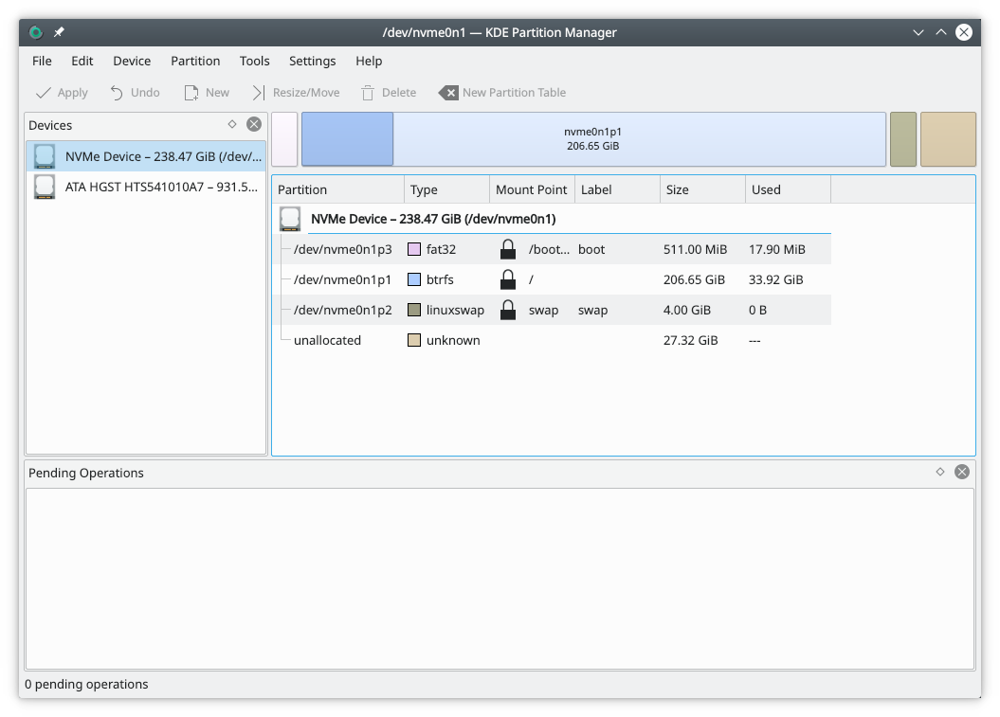

# Partition Manager overview

Partition Manager helps you manage the disk devices, partitions and file systems on your computer.

It lets you easily create new partitions, create file systems on new or existing partitions, copy, move or delete partitions, and change a partition's size without losing the data on it.

## User interface

Besides the main view, which shows the selected device both as a graph and as a tree, Partition Manager uses panels to display information and let you make selections. The screenshot above gives an overview.

## External tools

To get its job done, Partition Manager uses external tools that support a long list of file systems. If you use a mainstream Linux distribution, you probably already have the tools for the file systems on your computer.

The [Partition Manager](partition-manager.md) page describes the application in full.

## More information

- [Disk partitioning on Wikipedia](https://en.wikipedia.org/wiki/Disk_partitioning)
- [Partitioning on the Arch Linux wiki](https://wiki.archlinux.org/title/Partitioning)
