# Partition Manager

Partition Manager helps you manage the disk devices, partitions and file systems on your computer.

It lets you [create new partitions](#how-to-installing-a-new-operating-system), create file systems on new or existing partitions, [copy](#how-to-copying-a-partition), move or delete partitions, and [change a partition's size](#how-to-resizing-a-partition) without losing the data on it. Its command is `partitionmanager`.

To get its job done, Partition Manager uses external tools to support a long list of file systems. You'll probably have the tools for the file systems on your computer installed already.

> [!WARNING]
> Partition Manager has been designed and written with an emphasis on data integrity. There's still always some danger when modifying a device's partition table or its partitions: there might be a bug, an unexpected power failure or a problem with the computer's hardware.
>
> For those reasons you should *always have a backup of your important data* before making any changes with a tool like this.
>
> The program's authors take no responsibility if you lose any data while using Partition Manager.

Partition Manager uses operations, jobs and commands to divide up its work. See the [glossary](#glossary) for details.

Please report problems and feature requests in the [sonic-partition-manager issue tracker](https://github.com/Sonic-DE/sonic-partition-manager/issues).

## Starting Partition Manager

Partition Manager needs administrator privileges to work with your disks, so it asks you to authenticate when it starts. If you decline, it shows a message and stays empty. Choose **Device > Refresh Devices** to be asked again.

To work on a single device or partition, start it with the `--device` option, for example `partitionmanager --device /dev/sdb1`. The other devices aren't offered in that mode. The **Reformat or Edit with Partition Manager** device action uses the same option.

## The main window

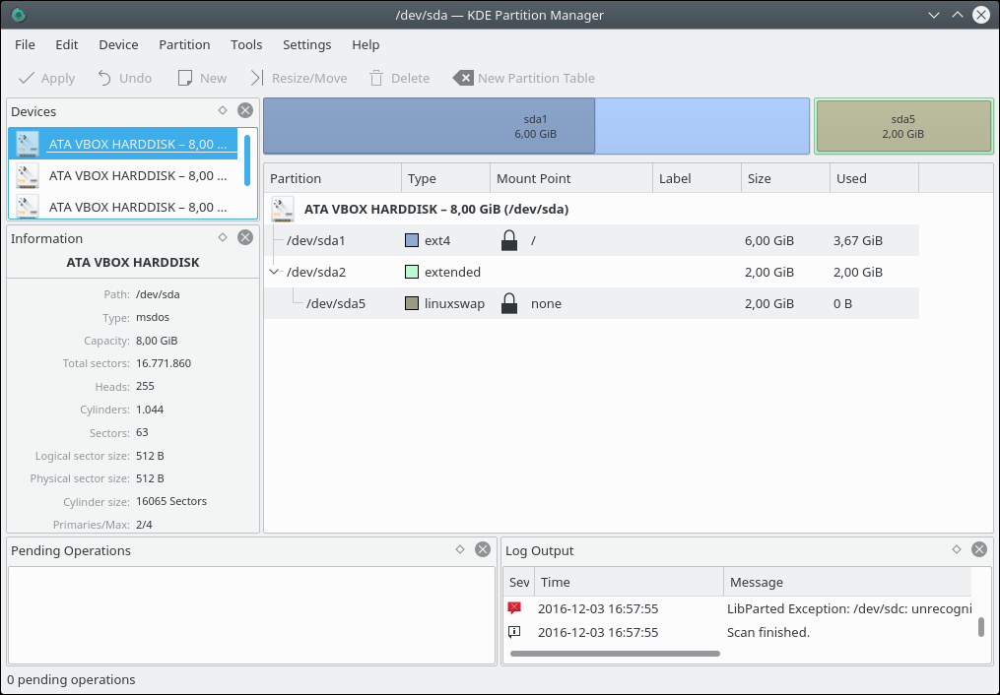

Besides the main view, which shows the selected device in a graphical and a tree view, Partition Manager uses panels to display information and allow selections.

- **Menu bar:** All commands are described in the [command reference](#command-reference).
- **Toolbar:** A standard toolbar that can be customized. See [The Settings and Help menus](#the-settings-and-help-menus).
- **Devices panel:** Lists all devices found on your computer that Partition Manager can handle. Select a device here to view or change it in the graphical and tree views.
- **Graphical device view:** Shows a graphical representation of the selected device. Each partition has its own box with its device node name (such as “sda1”) and usage information, shown as a darker area. Extended partitions have an extra border around them. Click a partition to select it. Double-click it to open [its properties dialog](#the-partition-menu). Right-click it for the partition context menu.
- **Tree device view:** Shows extended information about each partition on the selected device, with the selected partition highlighted. Double-click and right-click work as in the graphical view.
- **Information panel:** Shows details about the selected device or partition. It's hidden the first time you run Partition Manager.
- **Pending Operations panel:** Lists all operations that will run once you choose [Edit > Apply](#the-edit-menu).
- **Status bar:** Shows how many operations are pending.
- **Log Output panel:** Shows log information, which mostly matters to advanced users. It's hidden the first time you run Partition Manager. Right-click it for **Clear Log**, which empties the panel, and **Save Log**, which saves its contents to a file.

## How-to: resizing a partition

This how-to resizes a partition that's becoming too full. Here's the situation before resizing:

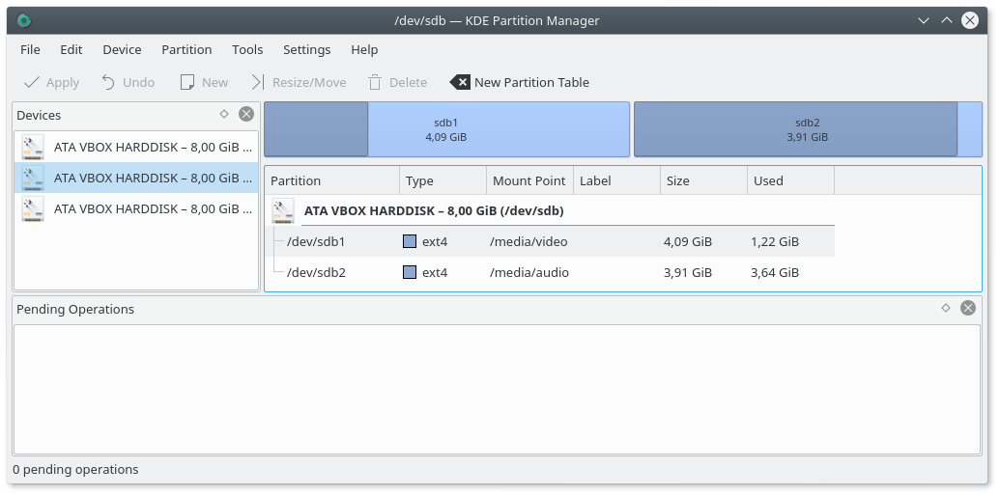

On device “/dev/sdb”, partition “sdb2” has little free space left while the other partition, “sdb1”, is far from full. So it makes sense to make the first partition smaller and grow “sdb2” so it has more free space available.

> [!NOTE]
> In the screenshot above neither partition is mounted. If one or both of them were mounted, you'd have to unmount them first using [Partition > Unmount](#the-partition-menu), because this how-to shrinks one partition and moves the other. See [the Resize/Move command](#the-partition-menu) for what's possible while mounted.

First, make room for the partition to grow by shrinking “sdb1”. Click the partition and choose [Partition > Resize/Move](#the-partition-menu). This dialog comes up:

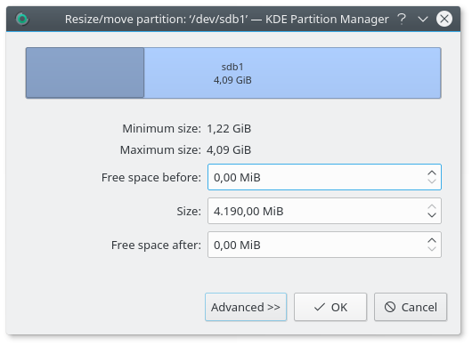

You can resize the partition in several ways. Drag the right handle to the left until the partition has the size you want, enter the size in the **Size** field, or click the small arrows next to the field, which is a little tedious for larger changes.

Whichever way you prefer, the dialog should now look like this:

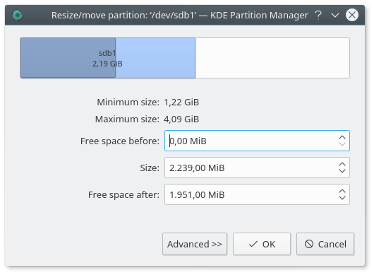

After you click **OK**, a new operation is added to the pending operations list, and the graphical and tree views update to show the new situation:

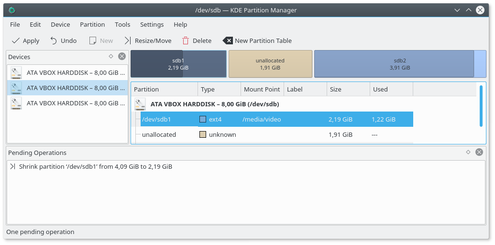

> [!NOTE]
> The main window shows the device as it will be after applying the operation, but the operation hasn't been applied yet. While operations are pending you can still undo them, one by one with [Edit > Undo](#the-edit-menu) or all at once with [Edit > Clear](#the-edit-menu), or quit Partition Manager, and nothing will have been changed.

Now that there's free space between the two partitions, you can move and grow “sdb2”. Click “sdb2” and choose [Partition > Resize/Move](#the-partition-menu) again. The dialog comes up once more, this time for the second partition. Drag its left handle all the way to the left so that the dialog looks like this:

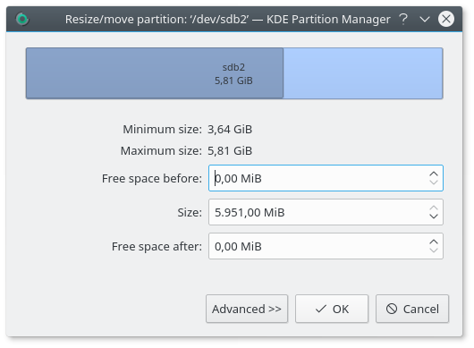

Make sure the **Free space before** field really does show “0 MiB”, because otherwise a little free space is left between the partitions and wasted.

Click **OK** again. The main window now looks like this:

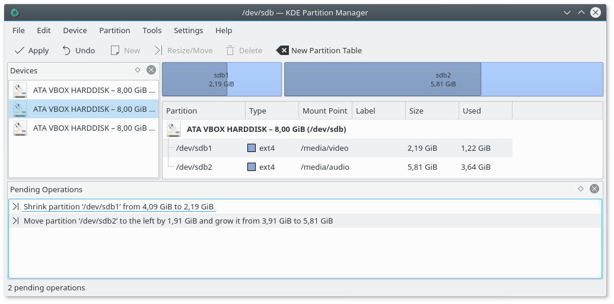

This is what you wanted, so choose [Edit > Apply](#the-edit-menu). A dialog lists the pending operations and asks if you really want to apply them. Confirm it and Partition Manager begins running the operations:

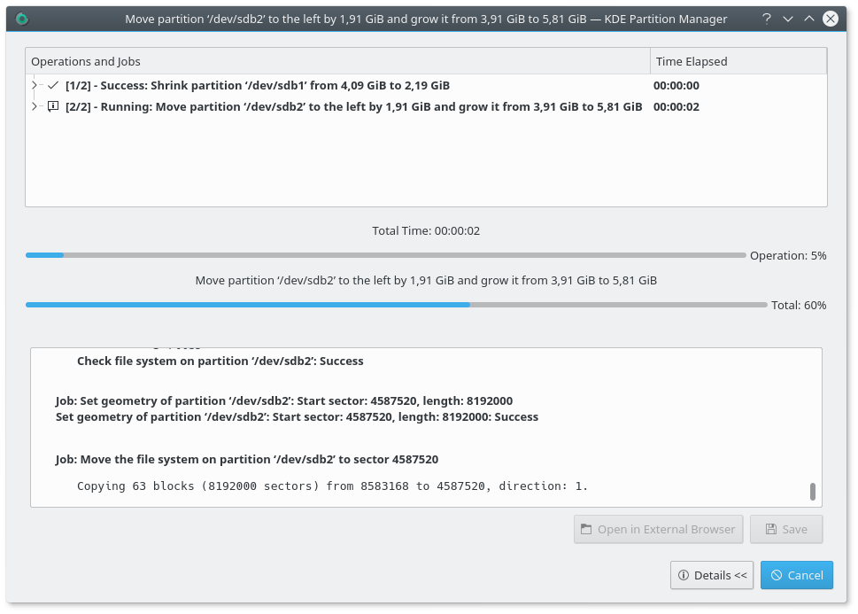

While operations are running you can click the arrow next to each one in the list to see the jobs it's made of and which job is running.

Resizing a partition the way you resized “/dev/sdb2” always means moving it to the left first and then growing it, because partitions can never be grown to the left directly. Moving such a large partition takes some time. It isn't unusual for an operation like this to take several minutes or more.

Finally, all operations will have completed:

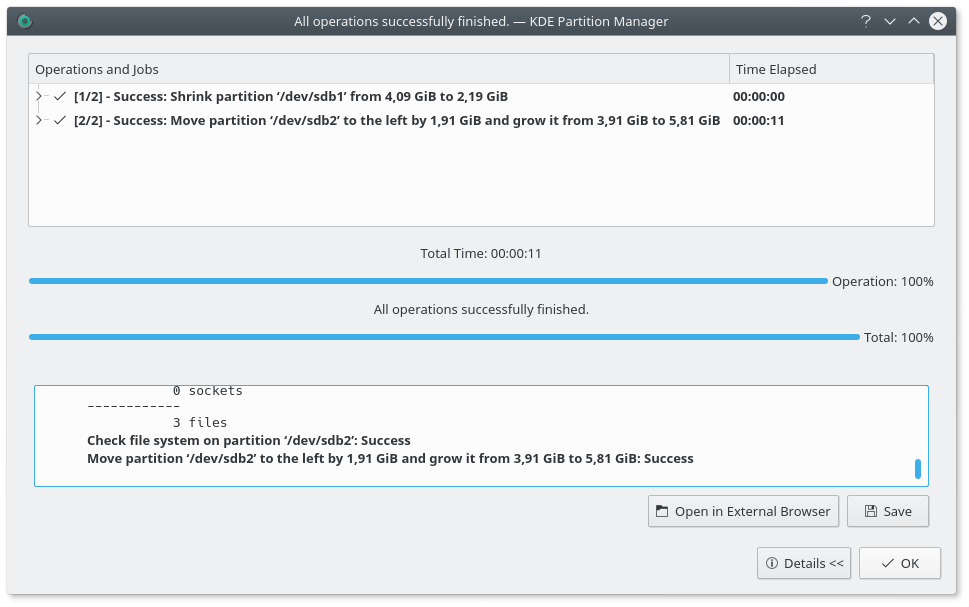

Click **OK** to close the progress dialog and return to the main window. Partition Manager rescans your devices at this point, which might take a few seconds.

For more detail about the operations that just ran, click **Details**. You'll see the report that's always generated, and updated as it goes, while Partition Manager runs operations:

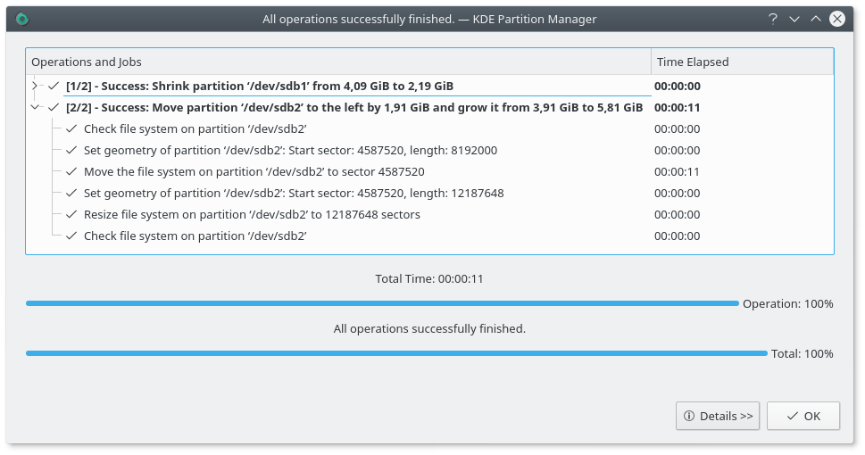

This report is especially useful if an error occurs. It shows each operation, each job and each external command that runs, which helps track down problems.

You can save the report as HTML with **Save** or view it with **Open in External Browser**.

> [!TIP]
> Always save the report as HTML when operations fail with errors or warnings, for later reference. You might also want to include it in a bug report.

To hide the details click **Details** again, and to close the progress dialog click **OK**.

## How-to: copying a partition

This how-to copies a partition from one device to another, overwriting an existing target partition. The procedure isn't much different when copying to the same device or to an unallocated area.

Here's the source device:

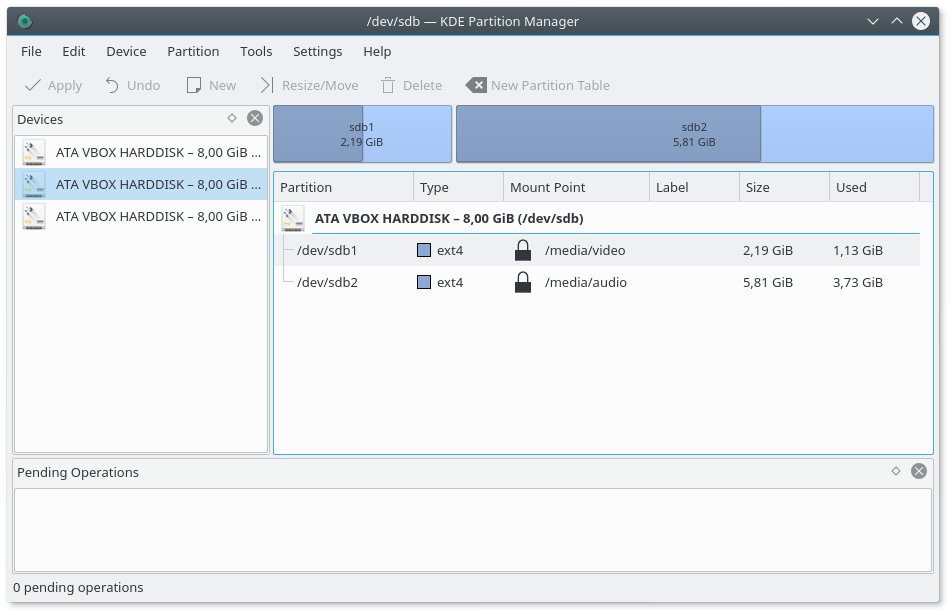

The source partition here is “sdb1”, which is mounted, as shown by the lock icon next to its mount point. A mounted partition can't be copied, so unmount it first: click it and select [Partition > Unmount](#the-partition-menu).

After unmounting, the lock icon has gone and you can select [Partition > Copy](#the-partition-menu). This puts “sdb1” in Partition Manager's clipboard: it's now the partition that will be inserted when you select [Partition > Paste](#the-partition-menu).

The destination device in this how-to is “/dev/sdc”, and the partition to overwrite is “sdc5”. Click the device in the Devices panel, click “sdc5” and select [Partition > Paste](#the-partition-menu). Partition Manager warns you that all data on “sdc5” will be lost. After you confirm, the copy operation is added to the list of pending operations. The insert dialog you'd see when pasting into an unallocated area isn't needed, because the start and end of the pasted partition are set by the overwritten partition.

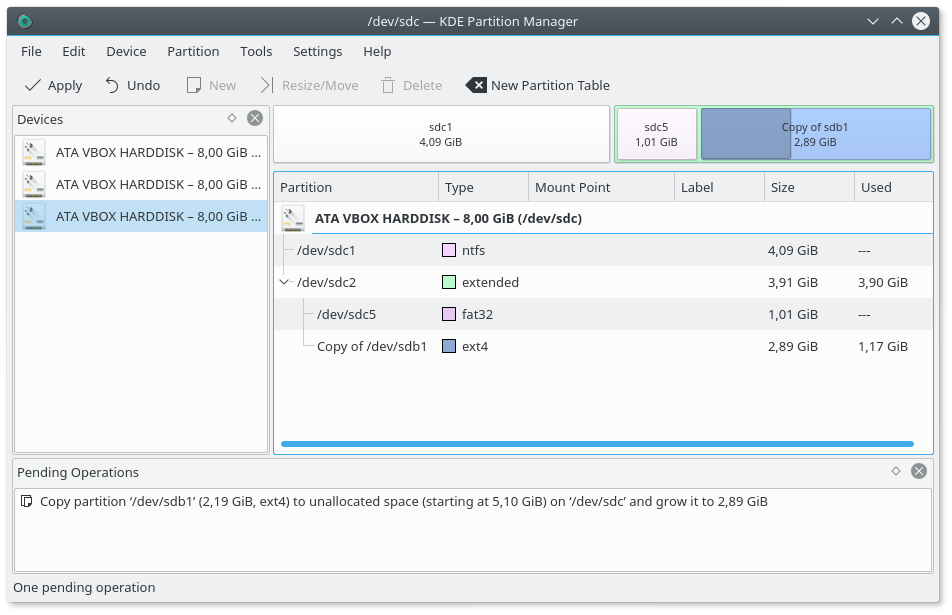

Now select [Edit > Apply](#the-edit-menu) and the partition is copied. See the [how-to on resizing partitions](#how-to-resizing-a-partition) for details about applying operations.

## How-to: installing a new operating system

This how-to prepares a new hard disk for installing an operating system. Suppose you bought a new disk to replace the old one that holds your system and data partitions, and you'd also like to install a new operating system. It takes several steps to move from the old system and drive to the new ones.

Here, “/dev/sdb” is the old disk and “/dev/sdc” is the new one. This is the source device:

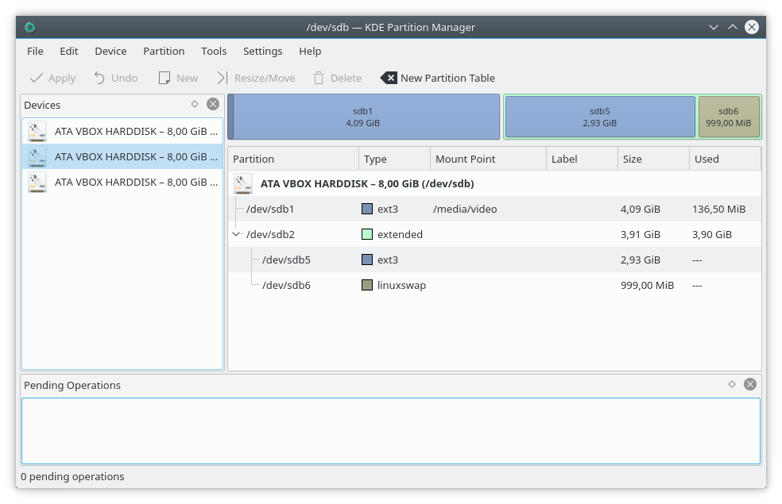

The new device looks like this. It doesn't have a valid partition table yet, so the first step is to create one with [Device > New Partition Table](#the-device-menu):

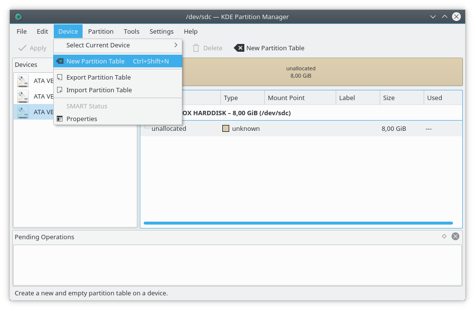

After confirming the warning you can start creating partitions by clicking the unallocated area and selecting [Partition > New](#the-partition-menu). Begin with an extended partition at the end of the device, to later hold the home and swap partitions:

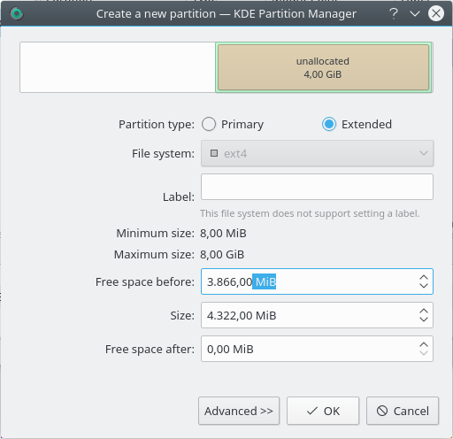

Click **OK** and the operation to create this extended partition is added to the list.

Now create a primary partition on the rest of the device, where the new system will be installed. Make it as large as the unallocated area in front of the extended partition:

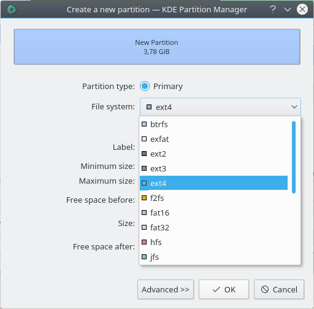

Click **OK** to accept your choice. The operation to create the primary partition is added to the list.

Now it's time to copy the home partition from the old device to the extended partition on the new device. Select the old device in the Devices panel, click partition “sdb5” and pick [Partition > Copy](#the-partition-menu).

Then go back to the new device and click the unallocated area inside the extended partition. Select [Partition > Paste](#the-partition-menu). This dialog comes up:

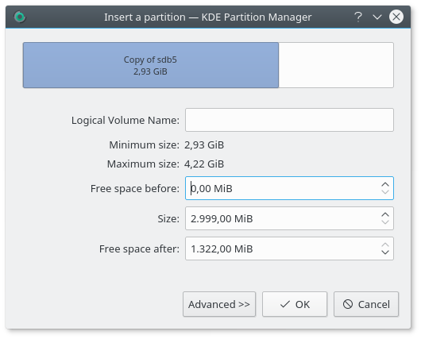

This is mostly fine, but you won't need that much free space after the home partition, because you'll create a swap partition there later.

Grab the right handle in the dialog and move it to the right until the free space after the pasted partition is a more suitable size for a swap partition:

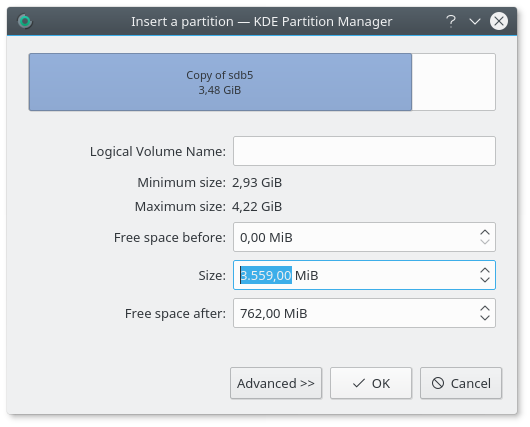

Click **OK** to accept and close the dialog. A new operation to paste the copied partition into the extended partition on “sdc” is added to the list. This operation also sets the new size.

Finally, create a new swap partition at the end of the extended partition on “sdc”. There's no need to copy the existing swap partition from “sdb”, because swap holds nothing permanent worth keeping. Create a new partition of type linuxswap that fills the whole unallocated area after the new home partition.

The main window, with all operations and a preview of how “sdc” will look once they're applied, now looks like this:

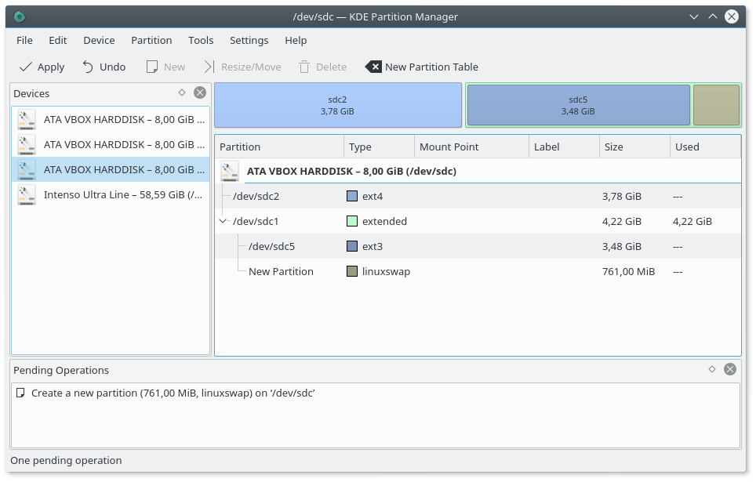

Select [Edit > Apply](#the-edit-menu), confirm the warning and wait until the operations have all run. For details see [the how-to on resizing partitions](#how-to-resizing-a-partition).

Your new disk is now ready for installing your new operating system.

## Command reference

This chapter explains all commands available in Partition Manager.

### The File menu

- **File > Quit:** Quits without applying any pending operations. If there are pending operations, it asks you to confirm.

### The Edit menu

These commands are only enabled if the list of operations isn't empty.

- **Edit > Undo:** Undoes the last operation added to the list.
- **Edit > Clear:** Clears the list of operations without applying any of them.
- **Edit > Apply:** Applies all operations in the list, so that all changes are permanently written to your disks. Afterwards the list is cleared and there's no way to undo any operation.

### The Device menu

- **Device > Select Current Device:** Selects a device from a submenu of all available devices.
- **Device > Refresh Devices:** Scans and reads the devices on your computer again. This is useful, for example, if you plugged in an external USB disk after starting Partition Manager. If operations are pending, it asks you first, because rescanning also clears the list.
- **Device > New Partition Table:** Creates a new, empty GPT or MS-DOS partition table on the selected device. This deletes all partitions on the device and all data on them, so be careful with this command. It's only enabled if no partition on the device is mounted, and it's only available for disks and software RAID devices.
- **Device > Export Partition Table:** Exports a list of all partitions on the selected device to a file. It's only enabled if the device has a partition table and no operations are pending.
- **Device > Import Partition Table:** Imports a partition table from a previously exported file. This deletes all partitions on the device and all data on them, so be careful with this command. It's only enabled if a device is selected and no partition on it is mounted. Importing into logical devices such as LVM Volume Groups isn't supported.
- **Device > Resize Volume Group:** Extends or reduces the selected [LVM](#lvm) Volume Group.
- **Device > Deactivate Volume Group:** Deactivates the selected Volume Group, for example before unplugging a removable device. It's only enabled if none of the group's logical volumes is mounted.
- **Device > Remove Volume Group:** Removes the selected Volume Group. It's only enabled if the group has no logical volumes.
- **Device > SMART Status:** Shows a SMART report. SMART is a monitoring system included in hard disks and solid-state drives that detects and reports on various indicators of drive reliability, with the aim of anticipating hardware failures. It's only available for disks, and enabled if the disk's SMART status can be read.
- **Device > Properties:** Shows information about the selected device, including capacity, sector sizes, partition table type and the used and maximum number of primary partitions.

The three Volume Group commands only appear when an LVM device is selected.

### The Partition menu

New, Resize/Move, Delete, Shred, Paste and Check are unavailable on a read-only [partition table](#partition-table).

- **Partition > New:** Opens the dialog to create a new partition, where you set its type, size, position and file system. You can also encrypt it with LUKS. It's only enabled if an unallocated area is selected. The partition table may limit how many partitions you can create: MS-DOS partition tables, for example, allow only four primary partitions.
- **Partition > Resize/Move:** Opens the dialog to resize or move an existing partition. Depending on the partition's file system and the external tools installed, not all of moving, shrinking and growing may be available. See [Tools > File System Support](#the-tools-menu). A mounted partition can't be moved. It can be grown if it has ext3, ext4, Btrfs, XFS, JFS, ReiserFS, NILFS2 or bcachefs, and shrunk if it has Btrfs or NILFS2. An extended partition can't be moved while it contains logical partitions.
- **Partition > Delete:** Deletes the selected partition. It's only enabled if the partition isn't mounted and, for an encrypted one, is locked. For an extended partition, it's only enabled if it doesn't contain any logical partitions.

  > [!WARNING]
  > Deleting a partition means that all data on the partition is destroyed.

- **Partition > Shred:** Shreds the selected partition, overwriting it so its contents can't be restored. Choose between random data and zeros in the [settings](#general). It's enabled in the same cases as Delete.

  > [!WARNING]
  > Shredding a partition means that all data on the partition is destroyed.

- **Partition > Copy:** Copies the selected partition to Partition Manager's clipboard. It's only enabled if the partition isn't mounted and its file system can be copied. Extended partitions and LVM logical volumes can't be copied.
- **Partition > Paste:** Pastes the partition from the clipboard to the selected partition or unallocated area. When pasting to an unallocated area, a dialog lets you move or grow the inserted copy. When overwriting an existing partition you're asked to confirm instead. It's only enabled if a partition is in the clipboard and a valid target is selected. The target must be large enough to hold the source and can't be mounted. You can't paste a partition onto itself, onto an extended partition or onto an LVM logical volume.

  > [!WARNING]
  > Pasting onto an existing partition means that all data on it is destroyed and replaced with the data from the pasted partition.

- **Partition > Edit Mount Point:** Opens a dialog to edit the mount point and mount options. It's only enabled if the partition is unmounted and its file system can be mounted.
- **Partition > Mount or Unmount:** Mounts or unmounts the selected partition, depending on its state. For swap, the command reads **Activate swap** or **Deactivate swap**. It's only enabled if the partition can be mounted or unmounted. If the operating system doesn't know a mount point for the partition, you can't mount it from Partition Manager.
- **Partition > Unlock or Lock:** Unlocks or locks an encrypted partition. It only appears for LUKS partitions, and is disabled while operations involving the partition are pending.
- **Partition > Check:** Checks the selected partition and its file system for errors and tries to correct any problems it finds. The file system is also resized to fill the partition completely. It's only enabled if the file system can be checked and the partition isn't mounted, unless it's an LVM physical volume, which can be checked while mounted.
- **Partition > Backup:** Backs up the file system on the selected partition to a file. You're asked where to store the image file. The file is a sector-for-sector copy of the file system on the partition. It isn't compressed and has no extra metadata or header, so it can be mounted directly using a loop device outside Partition Manager if the operating system supports that. It's only enabled if the file system can be backed up and the partition isn't mounted.
- **Partition > Restore:** Restores a file system from an image file to a partition. You're asked for the image file. The target must be large enough for it. It's only enabled if an unallocated area or an unmounted partition is selected, but not an extended partition or an unlocked encrypted one.

  > [!WARNING]
  > Restoring onto an existing partition means that all data on it is destroyed and replaced with the data from the image file.

- **Partition > Properties:** Shows information about the selected partition or unallocated space. What's displayed and what can be changed depends on the type of partition, its file system and whether it's mounted. Not all file systems support setting a label, for example, and it's generally not possible to change properties while the partition is mounted.

  In general, this dialog can:

  - Set or change a file system's label.
  - Change the partition's file system.

    > [!WARNING]
    > Changing the file system always means that all data on the partition is destroyed.

  - Recreate the file system on the partition.

    > [!WARNING]
    > Recreating a file system always means that all data on the partition is destroyed. Only do this as a last resort, if the file system can't be repaired anymore.

  - Change the partition's flags. The available flags depend on the partition table type. In most cases changing them isn't necessary, and you should treat it as an advanced feature.

### The Tools menu

- **Tools > New Volume Group:** Creates a new logical device, an [LVM](#lvm) Volume Group.
- **Tools > File System Support:** Shows which operations can be performed on each supported file system, and which support tools provide them.

  Here's how the dialog might look with most external tools installed:

  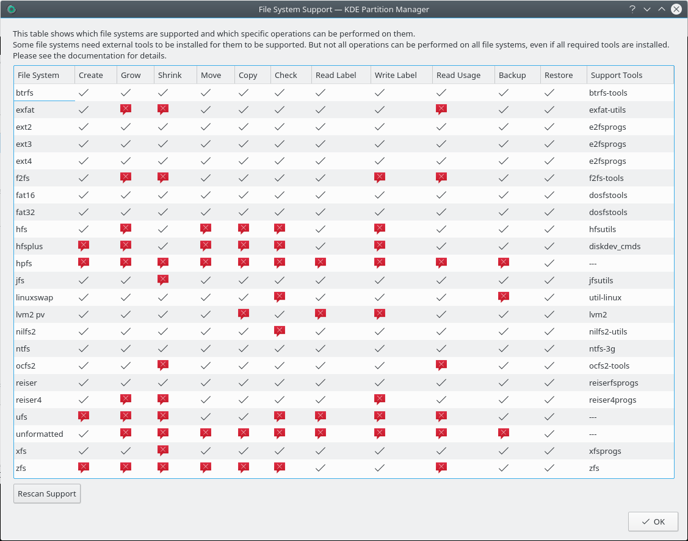

  A check mark means “supported” and a cross means “not supported”. Some combinations are never supported because they're inherently impossible, for example checking a linuxswap file system. Others can't be supported because the external tools lack the functionality.

  If you installed new tools while Partition Manager is running, click **Rescan Support** to check for them again.

### The Settings and Help menus

Partition Manager has the common **Settings** and **Help** menus, including the toolbar and shortcut configuration, with an extra **Panels Shown** submenu to turn the Devices, Pending Operations, Information and Log Output panels on and off. The Help menu also has **About KPMcore Library**, which shows information about the library Partition Manager uses for its disk operations.

## Settings

**Settings > Configure KDE Partition Manager…** opens the settings dialog.

### General

- **Partition Alignment:** **Align partitions per default** aligns new and changed partitions, and **Sector alignment** sets the boundary in sectors, 2048 by default.
- **Logging:** **Hide messages below** sets the lowest level shown in the Log Output panel.
- **File Systems:** **Default file system** is the one preselected for new partitions, Btrfs by default.
- **Shredding:** **Overwrite with** chooses random data, the default, or zeros.

### File System Colors

Sets the color used for each file system in the graphical and tree views.

### Advanced

**Active backend** chooses the backend Partition Manager uses to access your disks, and **Preferred unit** chooses the unit for sizes, MiB by default.

## Questions and answers

### How dangerous is Partition Manager for my data?

First of all, you should never perform any destructive operation (delete, move, resize) without first making a complete backup of everything affected.

Having said that, Partition Manager is safe to use. It performs extensive checks before and after every operation, it calls external tools written and supported by the file system authors, and it has been tested extensively.

There's always the risk of data loss due to an unknown bug. The authors try to minimize this risk, but there are no guarantees.

### Why don't I get support for all operations on all file systems, even with all the external tools installed?

Not everything Partition Manager can do in principle can be done with all file systems.

One example is checking linuxswap: it just isn't possible. There are other limitations like that in some file systems. You can't shrink JFS or XFS file systems because neither of them supports shrinking at all, with or without Partition Manager.

### Why can't I see any meaningful progress information when resizing a partition?

Partition Manager can only show progress when it knows how long the jobs in an operation will take. This is usually not the case when resizing, because by far the longest job is resizing the file system. That's mostly done by an external tool, and these tools don't provide useful progress information, so there's nothing to report while they run.

### Why can't I resize the root partition? How can I resize the partition /home is on?

Most changes need the partition to be unmounted, and you can't unmount the root partition. You also can't unmount the home partition if the home folder of the logged in user is on it.

Some file systems can be grown while mounted, as long as there's free space directly after the partition. See [Partition > Resize/Move](#the-partition-menu). For anything else, the solution is to boot from a live system that includes Partition Manager and change these partitions from there.

### I'm getting a warning in the log output that a partition is not properly aligned. What happened?

Partition Manager aligns partitions to a boundary, 2048 sectors by default, which you can change in the [settings](#general). The warning means a partition's first or last sector isn't on that boundary. The message itself only informs you and doesn't change anything on your disk.

### How many operations can I add to the list of pending operations?

There's no limit.

It's still not recommended to add too many. There's always a small chance an operation might fail with an error, in which case Partition Manager stops running operations. It's a lot easier to find out what happened, and to re-add the operations that didn't run, if the list wasn't very long.

### Resizing an ext2, ext3 or ext4 file system failed with “no space left on device” in the report. What happened? Is my data corrupted now?

This is a problem of the `resize2fs` command and the underlying file system. If a file system is nearly full, `resize2fs` can't make it any smaller, even though the number of free sectors left suggests it should be possible. Partition Manager can't know beforehand if `resize2fs` will abort with this error for a given file system. If it happens, nothing is done at all and your data isn't affected.

There's no real workaround for this right now.

### Why can't I format my floppy disk with Partition Manager? Why is there no support for CD writing or DVD burning?

Partition Manager isn't designed to do any of this. It deals with partitions and the file systems on them. Floppy disks, CDs and DVDs don't need or use partitions.

### Why can't I modify partitions on a device with an amiga or bsd partition table?

Partition Manager only allows read-only access to partition table types such as aix, amiga, bsd, mac, pc98 and sun. It can change MS-DOS and GPT partition tables. The Information panel marks a read-only table as “(read only)”.

You can still create a new GPT or MS-DOS partition table on the device, but that's probably not what you want, because it deletes all partitions on it.

### Why does Partition Manager hang for a couple of minutes on startup while it apparently scans the floppy drive?

This happens if you have a floppy drive configured in your computer's BIOS settings but haven't actually connected one. If you don't have a floppy drive, check your BIOS settings and disable any floppy drives configured there to see if this makes the problem go away.

## Glossary

### Alignment

Placing the start and end of a [partition](#partition) on a boundary of a set number of [sectors](#sector). Partition Manager uses 2048 sectors by default, which is 1 MiB with 512-byte sectors.

### Command

Commands are what [jobs](#job) are made up of. These are low-level steps, often run by an external tool, and only visible in the detailed progress report. You normally don't have to bother with commands at all.

### Device

A physical disk device. Physical disk devices are divided into logical sections called [partitions](#partition) with the use of [partition tables](#partition-table).

### Disk label

Another name for a [partition table](#partition-table), from the SUN/BSD world. See [this Wikipedia entry](https://en.wikipedia.org/wiki/BSD_disklabel) for details on the name.

> [!NOTE]
> They're easy to mix up, but a disk label has nothing to do with a [file system label](#file-system-label).

### Extended partition

A [partition](#partition) that contains other partitions. Extended partitions can only be [primary partitions](#primary-partition) themselves. Whether they're available depends on the [partition table](#partition-table) type. MS-DOS partition tables allow one extended partition per [device](#device).

### File system

A file system defines how the storage of data (files with their metadata, folders with their metadata, free space) is organized within a [partition](#partition). There are many types of file systems, some originally from the Unix/Linux world, some not. Commonly used ones on Unix/Linux are Btrfs, ext4 and XFS.

### File system label

A title for a file system. Some file systems (among them Btrfs, ext2/3/4, FAT16/32 and NTFS) support setting a label so the file system can be identified in tools like Partition Manager or other applications.

> [!NOTE]
> They're easy to mix up, but a file system label has nothing to do with a [disk label](#disk-label).

### Flag

See [partition flag](#partition-flag).

### GPT

A modern partition table format supported by most modern computers and operating systems. Unlike the older MS-DOS partition table, it supports more than 4 [primary partitions](#primary-partition).

### Job

Jobs are what [operations](#operation) are made up of. You normally don't have to bother with them. They only become apparent when applying the list of pending operations: the progress dialog shows all operations and their jobs, and which of them is running.

### Label

Either a [disk label](#disk-label) or a [file system label](#file-system-label).

### Logical partition

A [partition](#partition) inside an [extended partition](#extended-partition).

### LUKS

Linux Unified Key Setup is the standard encryption format for Linux.

### LVM

A system for managing logical partitions that's more flexible than normal partitions. It has three main components:

- **LVM physical volumes** are partitions on the disk whose space is managed by LVM.
- **An LVM volume group** is a collection of LVM physical volumes that can be divided into logical partitions. It might be used to create file systems spanning multiple devices, or to split an encrypted [LUKS](#luks) volume into smaller partitions.
- **LVM logical volumes** are similar to normal partitions, except that they're in an LVM volume group. Their location doesn't matter and they don't have to be physically contiguous. So Partition Manager doesn't allow moving LVM logical volumes, and displays the remaining free space at the end of the device.

### Operation

Partition Manager divides its work into operations, [jobs](#job) and [commands](#command).

Operations are the most visible of the three. If you pick an action in the interface, it will likely add a new operation to the list of pending operations. The idea is that you'll probably want to set up several steps to take your disks from their current state to the state you have in mind, and some of these steps may take a long time (like copying a large file system, or resizing one that's nearly full). To save you from sitting at your computer waiting for each step to finish, operations let you specify exactly how the devices should look once everything is finished. Partition Manager then applies them, and you can come back when it's done.

Operations are kept in a list of pending operations. Until an operation has been applied it can easily be [taken back](#the-edit-menu), and nothing will have been changed.

### Partition

A section of a [hard disk device](#device) that can hold a [file system](#file-system) or other partitions.

### Partition flag

A marker for a [partition](#partition). The availability of flags depends on the type of [partition table](#partition-table) used.

### Partition table

A small section at the beginning of a [device](#device) that stores information about the layout of the device's [partitions](#partition). There are different types of partition tables, each with their own limitations. It's sometimes also called a “disk label”.

### Primary partition

A [partition](#partition) directly inside a [partition table](#partition-table), as opposed to [logical partitions](#logical-partition), which are in [extended partitions](#extended-partition).

[Partition tables](#partition-table) usually limit the number of primary partitions that can be created on a [device](#device). For MS-DOS type partition tables, for example, the limit is four.

### Sector

A unit used to divide up a [device](#device). [Partitions](#partition) must always begin and end on a sector.

### Sector size

The number of bytes per [sector](#sector) on a [device](#device). The sector size of most devices in use today is 512 bytes.
