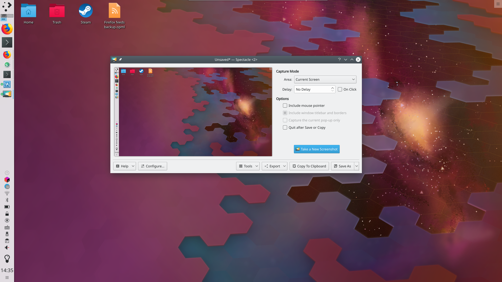

# Screenies overview

Ever wanted to show the world your desktop, the final level you just beat in your game, or your virtual fish aquarium? Screenies captures these moments and lets you choose how the final image is saved. The [Screenies](screenies.md) page describes every command and setting.

## Launching

Press the Print Screen key, often labeled PrtSc, on your keyboard. You can also start Screenies from the application launcher or [KRunner](../desktop/krunner.md), or change its global shortcut in System Settings' [Shortcuts](../settings/shortcuts.md) module.

## Features

### Take another screenshot

If you don't like the image you took, take another with the **New Screenshot** button.

### Save the image

Screenies can save your picture in many file formats, depending on the image plugins installed on your system. These may include:

- PNG image (.png)
- JPEG image (.jpeg)
- JPEG-2000 image (.jp2)
- Windows BMP image (.bmp)
- EPS image (.eps)
- MNG animation (.mng)
- PBM image (.pbm)
- PCX image (.pcx)
- Softimage PIC image (.pic)
- PGM image (.pgm)
- PPM image (.ppm)
- RGB image (.rgb)
- TGA image (.tga)
- TIFF image (.tif)
- WBMP image (.wbmp)
- XBM image (.xbm)
- XPM image (.xpm)

Which format to use depends on your needs. The most common image formats today are PNG and JPEG.

### Export the image

**Export** opens the image in an external application, which is useful if you want to edit it or add something. The image can also be printed or shared through the services the menu offers.

### Copy to clipboard

This lets you paste the image, generally with Ctrl+V, into another program or document that supports pasting images.

### Capture mode

The capture mode decides what ends up in the image. Options include:

- **All Screens:** Everything is captured.
- **Current Screen:** Everything on the current screen is captured.
- **Active Window:** The active window's contents.
- **Window Under Cursor:** The contents of the window under the mouse pointer.
- **Rectangular Region:** A rectangular region that you select.

With only one monitor attached, the first two are replaced by a single option, **Full Screen**, which captures everything on your screen.

### Screenshot delay

Set a timer here, in seconds. For example, set to 10 seconds, Screenies waits that long before taking the screenshot. This is particularly useful for capturing drop-down menus or anything else that only responds to a mouse action.

## Tutorials

- [Saving screenshots with a shortcut](screenies-shortcuts.md)
