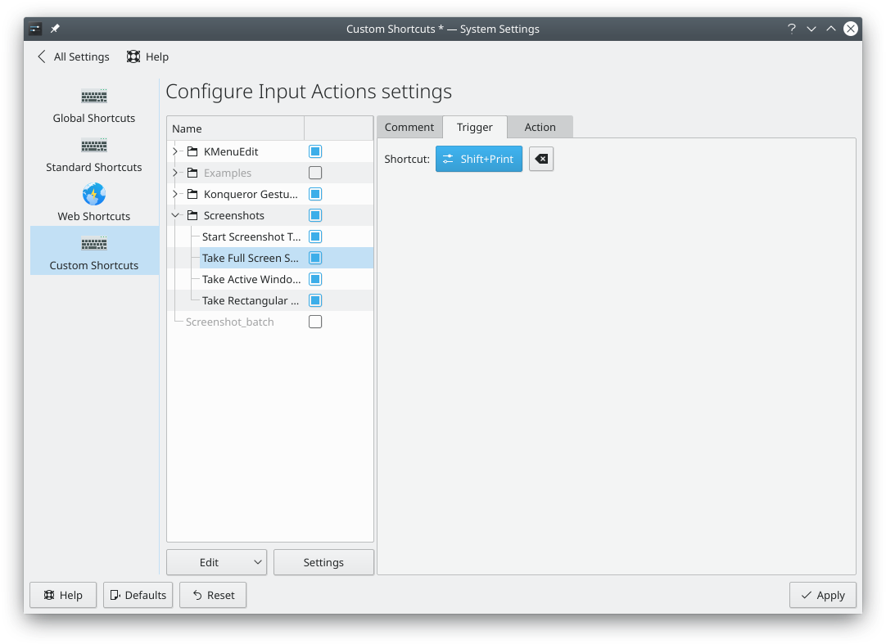

# Saving screenshots with a shortcut

The usual way to capture your screen is to press the Print Screen key. [Screenies](screenies.md) then pops up, and lets you capture:

- the complete screen
- single windows
- a rectangular region on the screen

Some people want their screenshots stored without any further steps. This is useful during documentation work, when you want to take a lot of screenshots without interrupting your work.

Shift+Print Screen already captures your entire desktop. To store the result without further steps, set up these two things:

1. In Screenies' settings, go to **General** and turn on **Save file to default folder** under **After taking a screenshot**.
2. If you'd like a different key, open the [Shortcuts](../settings/shortcuts.md) module in System Settings, select Screenies under **Applications**, and change the shortcut of its full screen capture action. Then click **Apply**.

The older screenshot below shows the same idea in a module that no longer exists.

Now whenever you press Shift+Print Screen, your screen is saved to your Pictures folder with a timestamp in its name, for example `Screenshot_20190107_224731.png`.

To take screenshots from your own command without opening a window at all, use `sonic-screenies --background --fullscreen`. Add it in the [Shortcuts](../settings/shortcuts.md) module under **Commands** to give it a key.
