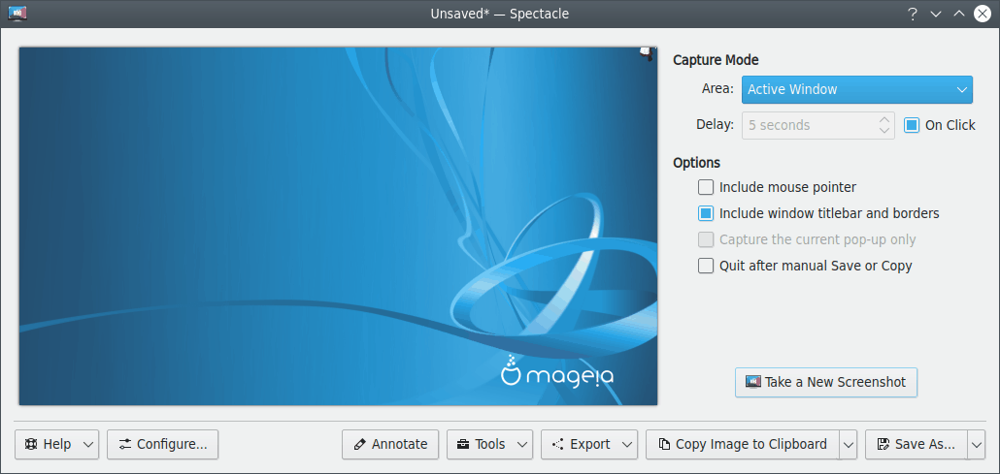
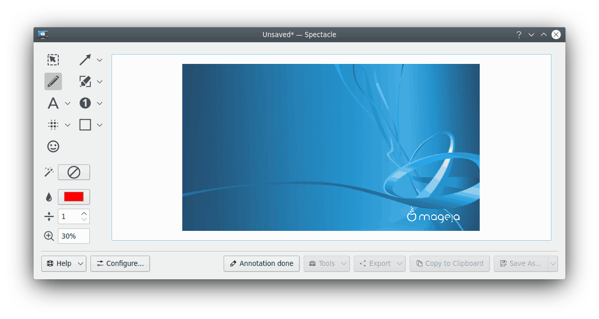
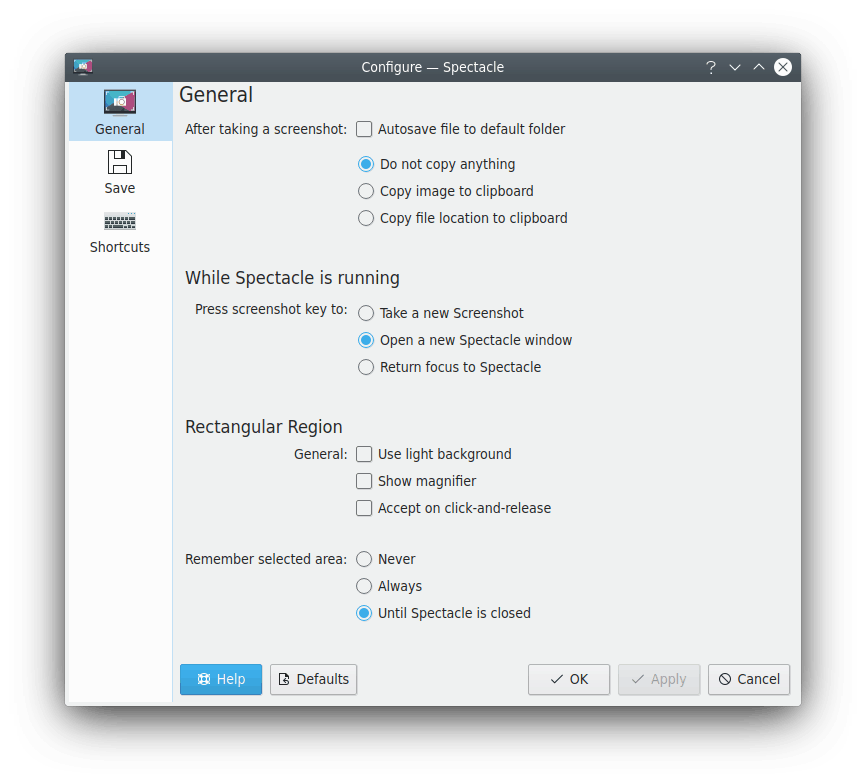
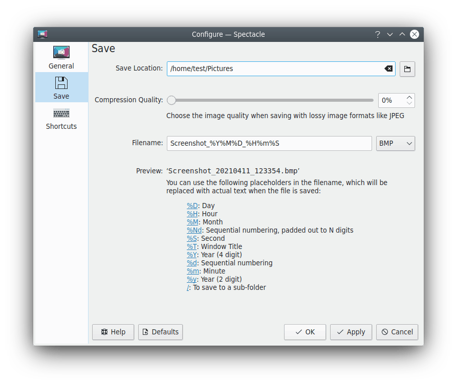

# Screenies

Screenies is SonicDE's application for capturing and editing screenshots and recording the screen. It can capture the entire desktop, a single monitor, the active window, the window under the mouse, or a rectangular region of the screen. The images can then be annotated, printed, sent to other applications, or quickly saved as they are.

Please report problems and feature requests in the [Screenies issue tracker](https://github.com/Sonic-DE/sonic-screenies/issues).

## Starting Screenies

- Find Screenies in the application launcher.
- Press the Print Screen key (often labeled PrtSc or PrtScn) or Meta+Shift+S.
- Use one of the shortcuts that take a screenshot and save it in your default folder without showing the main window:
  - Meta+Print Screen captures the active window.
  - Meta+Ctrl+Print Screen captures the window under the mouse.
  - Shift+Print Screen captures your entire desktop, on all monitors.
  - Meta+Shift+Print Screen captures a rectangular region.
- Run `sonic-screenies` from the command line. Its options include a background mode for scripting screenshots without showing the window or requiring user interaction. See the full list with `sonic-screenies --help`.

You can change these shortcuts on the [Shortcuts](#shortcuts) page of the settings. Shortcuts also exist for capturing the current monitor and for starting Screenies without taking a screenshot, but they're unassigned by default.

## Taking a screenshot

By default, starting Screenies shows the rectangular region selector. The [General](#general) settings can make it capture the full screen, repeat the last capture mode, or not capture anything at first.

Without a capture, Screenies shows its main window, where you choose how to take a screenshot:

- **Rectangular Region:** Select a rectangular region of your desktop with your mouse. It may spread across several screens. See [Selecting a region](#selecting-a-region).
- **All Screens:** Captures your entire desktop across all outputs, including all monitors and projectors.
- **All Screens (Scaled to same size):** Captures all screens as above, scaling them to the same size.
- **Full Screen:** The mode shown instead of **All Screens** when you have one screen.
- **Current Screen:** Captures the output that contains the mouse pointer.
- **Active Window:** Captures the window that has focus. Use a delay with this mode to give yourself time to select and activate a window.
- **Window Under Cursor:** Captures the window under the mouse. If the cursor is on top of a popup menu, Screenies tries to capture the menu as well as its parent window. If it can't find the parent window, it captures only the menu. To force that, enable **Capture the current pop-up only**.

### Options

The options for a screenshot are in the main window and in the **Options** menu.

- **Include mouse pointer:** Includes an image of the mouse pointer.
- **Include window titlebar and borders:** Includes the window's decoration when capturing a single window. Otherwise you get only the window contents.
- **Include window shadow:** Includes the window's shadow when capturing a single window.
- **Capture the current pop-up only:** With **Window Under Cursor**, captures only the popup menu under the cursor, without its parent window.
- **Quit after manual Save or Copy:** Quits Screenies after you save or copy. A copied screenshot is only retained if you're running a clipboard manager that accepts images. The [Clipboard](clipboard.md) can do this.
- **Capture on click:** Hides the window and waits for a mouse click before capturing.
- **Delay:** Sets the delay before capturing, from **No Delay** upward in seconds.

During a delay, Screenies shows the remaining time in its window title and a progress bar on its Task Manager entry. If you bring the window back, you can cancel the countdown.

### Selecting a region

In **Rectangular Region** mode, draw a rectangle on the screen, which can be moved and resized. To capture it, double-click or press Enter. Press Esc to cancel.

- The arrow keys move the rectangle.
- Holding Shift while pressing the arrow keys moves it slowly, for fine-tuning.
- Holding Alt while pressing the arrow keys adjusts its size.

## Working with a screenshot

After capturing, Screenies shows the image with these actions:

- **Save** (Ctrl+S): Saves to the default location with the default file name.
- **Save As…** (Ctrl+Shift+S): Opens the standard save dialog, where you choose the file name, folder and format.
- **Copy** (Ctrl+C): Copies the image to the clipboard. **Copy Location** copies the path of the saved file instead.
- **Export:** Opens the image in another application, opens the default screenshots folder, shares the image, or [extracts text](#extracting-text).
- **Print** (Ctrl+P): Opens the print dialog.
- **Edit…:** Opens the [annotation tools](#annotating).
- **New Screenshot** (Ctrl+N): Discards the current screenshot and takes another.

After saving, Screenies shows a message with a link to the file, and offers **Open Containing Folder**.

### Annotating

The annotation tools are **Select**, **Crop**, **Freehand**, **Highlighter**, **Line**, **Arrow**, **Rectangle**, **Ellipse**, **Pixelate**, **Blur**, **Text** and **Number**. Depending on the tool, the options toolbar sets the stroke width and color, fill color, strength of the effect, font, font color, number, and shadow.

With **Freehand**, holding Shift snaps to straight lines. With **Line**, it snaps to 45 degree increments.

Undo and Redo work with their usual shortcuts.

### Extracting text

**Export > Extract Text** recognizes text in the image with Tesseract OCR, in the languages set in the [General](#general) settings. Language data needs to be installed for each language you want to use.

### Drag and drop

A captured image can be dragged to another application or document. If the application can handle images, a copy of the full image is inserted.

If you drag a screenshot into a file manager window, a dialog lets you edit the file name and select the image format, and the file is put in that folder.

If you drag the screenshot to a text box, the path to a temporarily saved file is inserted. This is useful for example to upload a screenshot through web forms. It works with all clients that don't pick up the image data but only look for a URL.

## Recording the screen

The main window's **Recording** section records the **Full Screen**, a **Window**, or a **Rectangular Region**. Its options include the mouse pointer, the microphone and system audio. The shortcuts are:

- Meta+Alt+R starts and stops recording the screen.
- Meta+Ctrl+R starts and stops recording a window.
- Recording a region has its own shortcut on the [Shortcuts](#shortcuts) page.

Recording needs an encoder for one of the supported formats, WebM with VP9 or MP4 with H.264. Without one, the recording options aren't available.

## Settings

Open them with **Configure Screenies…** (Ctrl+Shift+,).

### General

- **When launching Screenies:** Choose between taking a rectangular screenshot (the default), taking a full screen screenshot, using the last-used capture mode, or not taking a screenshot automatically.
- **After taking a screenshot:** **Save file to default folder** saves automatically. Then choose between **Do not copy anything**, **Copy image to clipboard** and **Copy file location to clipboard**. You must be running a clipboard manager to keep the path or image in the clipboard after Screenies quits.
- **Press screenshot key to:** When a screenshot shortcut is pressed while Screenies is running, choose between taking a new screenshot, opening a new Screenies window, and returning focus to the existing window.
- **Use light background:** Uses a light background color to mask the cropped-out area in the region selector. This may make dark cursors easier to see.
- **Show magnifier:** Shows a magnifier in the region selector: never, always, or while holding Shift (the default).
- **Accept on click-and-release:** Accepts the selected region as soon as the mouse button is released. When selecting a new region without a saved one available, clicking, dragging and releasing captures the region immediately. When a saved region is shown, it can be manipulated further, and accepting it requires Enter or a double click. Clicking and dragging outside of it captures the new region immediately.
- **Remember selected area:** Screenies remembers a selection until you close it, by default. You can also choose never or always.
- **Languages for OCR:** Chooses the languages for text extraction. **Close after extraction** closes Screenies after extracting text.

### Image Saving

- **Save Location:** The folder used when you press **Save**. By default, it's your Pictures folder.
- **Compression Quality:** The image quality when saving with lossy image formats like JPEG. Higher values give better quality but increase the file size.
- **Filename:** The default file name, and beside it the default image format, PNG unless you change it.

The default file name is `Screenshot_<yyyy><MM><dd>_<HH><mm><ss>`. These placeholders are replaced when the file is saved, and you can click one in the dialog to insert it:

- `<yyyy>`, `<yy>`: Year, 4 or 2 digits
- `<MM>`, `<MMM>`, `<MMMM>`: Month as a number, a short name or a long name
- `<dd>`: Day
- `<HH>`, `<hh>`: Hour, from 00 to 23 or from 01 to 12
- `<mm>`: Minute
- `<ss>`: Second
- `<Ap>`: AM/PM or am/pm, localized
- `<tt>`: Timezone offset
- `<title>`: Window title
- `<#>`: Sequential number

If a file with this name already exists, a serial number is appended. For example, if the file name is `Screenshot` and `Screenshot.png` already exists, the image is saved as `Screenshot-1.png`.

### Video Saving

This page sets the save location, file name and format of recordings. The default file name is `Screencast_<yyyy><MM><dd>_<HH><mm><ss>`.

### Shortcuts

This page changes the shortcuts for starting Screenies and capturing or recording different parts of your desktop.
