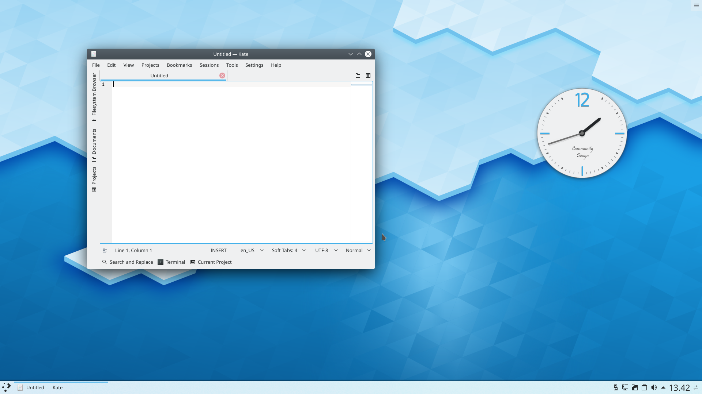
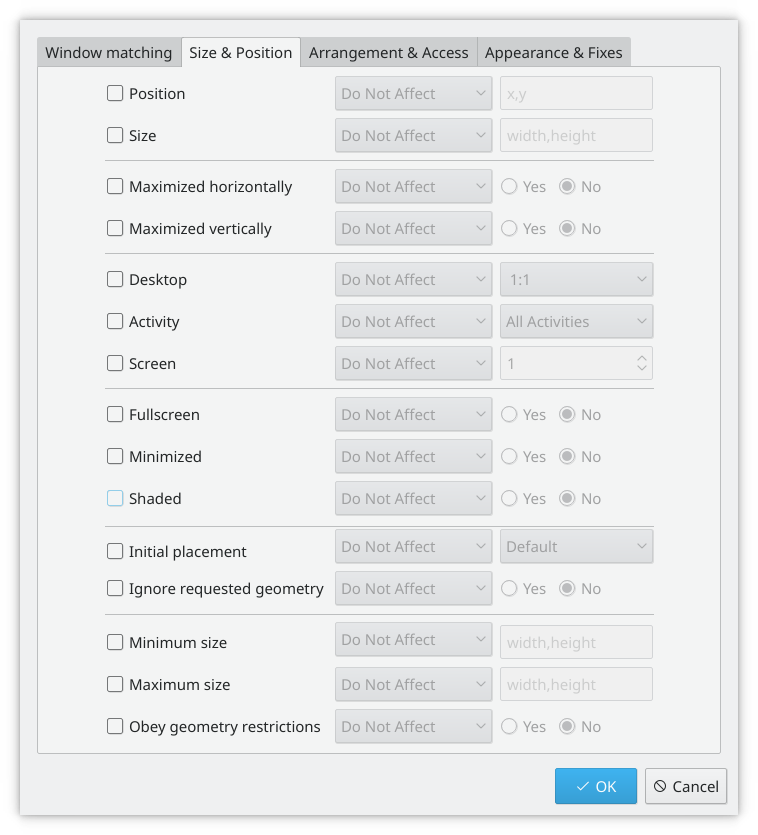
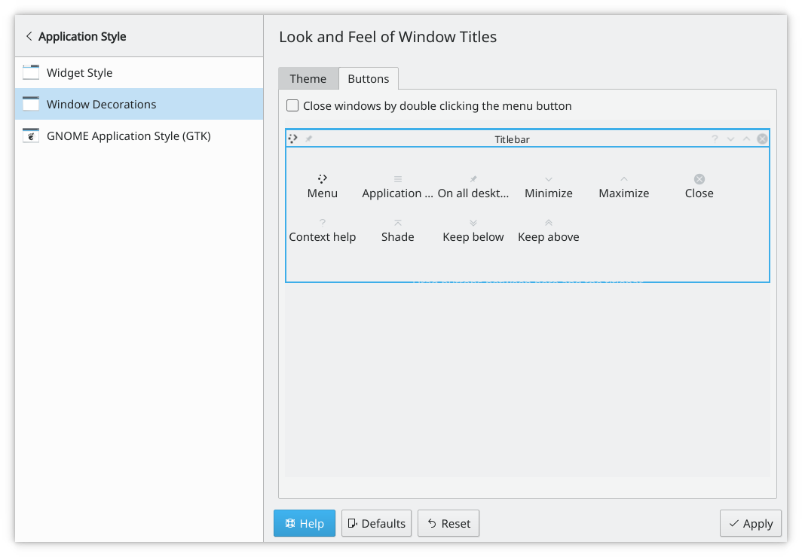
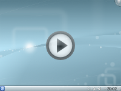
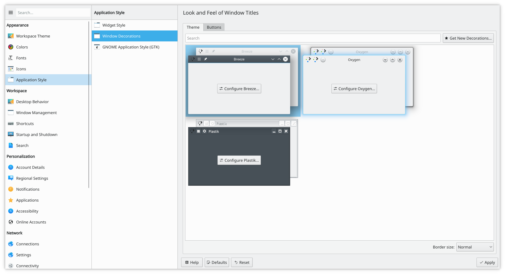
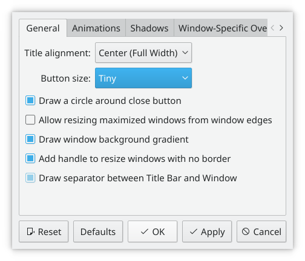

# SonicWin window manager

SonicWin is SonicDE's window manager. It gives you complete control over your windows, making sure they aid you in your task and don't get in the way. It paints the window decoration, the bar on top of every window with configurable buttons such as close, maximize and minimize. It also handles placing windows and switching between them.

SonicWin supports *compositing*, which uses the graphics hardware for effects when handling your windows. This can make window management smoother, easier, more efficient and more natural.

## Practical features

Right-click a window's titlebar, or use [System Settings](../settings/index.md), to configure SonicWin. For example, the [Task Switcher](../settings/task-switcher.md) module changes how the window list looks when you switch windows. Press Alt+Tab and keep Alt pressed. You can then press Tab to move through the windows, or activate the one you want with the mouse. Pressing Alt+Tab quickly takes you to the next window in the queue.

Choose the effects you want in the [Desktop Effects](../settings/desktop-effects.md) module. The [Compositor](../settings/compositor.md) module has the compositing options, such as **Enable on startup**, and the [Animations](../settings/animations.md) module sets the animation speed and which animation plays for each window event.

Effects such as the Magic Lamp minimize animation give your windows a more natural feel. SonicWin checks the capabilities of your hardware so that people with low-end hardware aren't given an unusable setup, and if needed it scales its effects down. You can change settings like the animation speed in the [Animations](../settings/animations.md) module to fine-tune your experience. To turn compositing off or back on, press Shift+Alt+F12.

## Tutorials

### An application that opens in the same size and position every time

Sometimes the position of an application on the screen is vital to your comfort, so you can make sure it's always where you want it.

Place the window where you want it to open, then right-click the titlebar and choose **More Actions > Configure Special Window Settings…**. A settings window opens with the right matching details already filled in. Add the **Position** and **Size** properties, and you are finished. See [Window Rules](../settings/window-rules.md) for more about this.

### Change the position of titlebar buttons

Open System Settings' [Window Decorations](../settings/window-decorations.md) module and choose **Configure Titlebar…**.

To move things around, drag the icons on the sample titlebar to where you want them.

You may find other buttons available to you. A circle sets the window on all desktops. Another useful one is Shade, which toggles between rolled up, with only the titlebar visible, and the normal view. Add these by dragging them from the list onto the sample titlebar, and place them where you want to use them.

### A classic desktop

Right-click your desktop and choose **Desktop and Wallpaper**. Change the **Layout** to **Folder View**. The whole desktop is now a folder view. Set it to the folder you want to use as your desktop in its settings.

### Open applications directly on another desktop

Use a [window rule](../settings/window-rules.md) with the **Virtual desktop** property. See [the example that pins a window to a desktop](../settings/window-rules.md#pin-a-window-to-a-desktop-and-set-other-properties).

## Using small screens

### Make the window decorations smaller

Open the [Window Decorations](../settings/window-decorations.md) module. There are two good options:

- With the default style, Silver, open its settings and set **Icon size:** on the **Buttons** tab to **8 - Tiny** or **14 - Small**. See [Silver Settings](../settings/silver-settings.md#buttons).
- Use another style with smaller window decorations.

Both give you slim, functional window titles and borders.

### Change the base fonts

On many small screens the display is very clear, so reading fonts much smaller than you expect is feasible. 8 point can be a good base setting. Change it in the [Fonts](../settings/fonts.md) module.

## Defining window rules

The [Window Rules](../settings/window-rules.md) page shows how to define your own rules for the behavior of specific windows.

## More information

- [Window manager on the Arch Linux wiki](https://wiki.archlinux.org/title/Window_manager)
