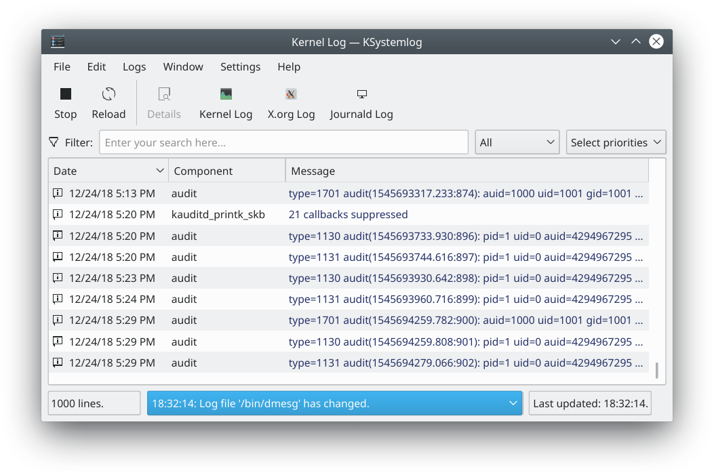

# System Log overview

System Log is a log viewer developed for beginners, who may not know how to find information about their system or where the log files are. The [System Log](system-log.md) page describes it in full.

System Log has the following features:

- Shows all the logs of your system, grouped into general ones (the default system log, authentication, kernel, X.org and so on) and optional services (Apache, CUPS and so on)
- Colors log lines according to their severity
- Tabs, to display several logs at the same time
- Shows new lines automatically as they are logged
- Fast parsing and reading (more than 10,000 lines every 5 seconds)
- Detailed information for each log line
- A quick filter
- Sends a log message to the system by hand
- Saving, copying to the clipboard and printing

It can read these logs on your system: Acpid, Apache, Audit, authentication, Cron, CUPS, daemon, Journald, kernel, Postfix, Samba, system, X.org and X session logs.
