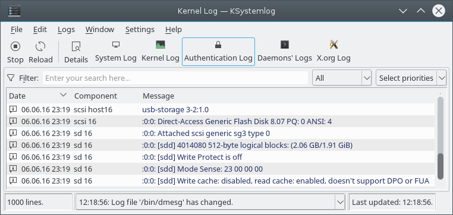
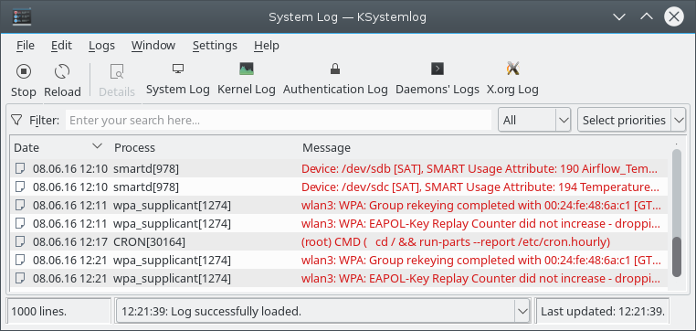
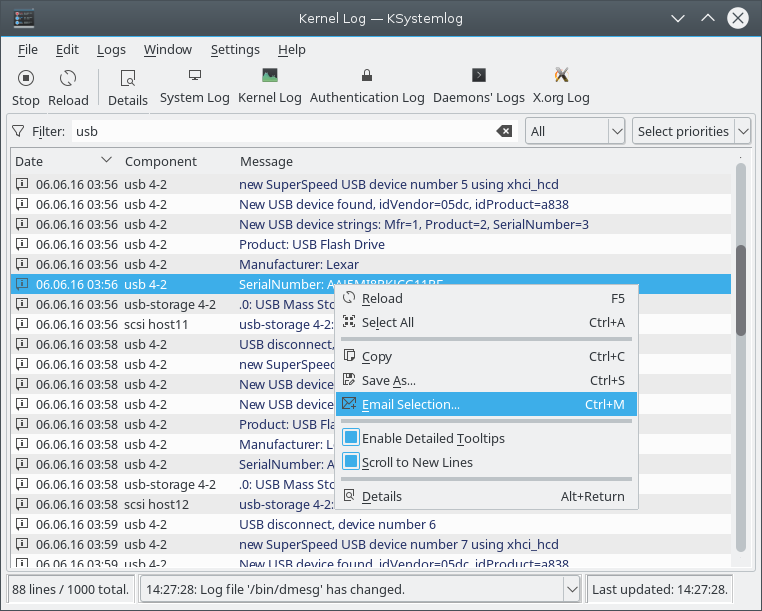

# System Log

System Log is a viewer for your computer's logs. Its command is `ksystemlog`.

It helps you understand what your machine does in the background, and makes log files easier to read. It's meant for beginners who don't know how to find information about their system or where its log files are. It's also meant for advanced users who want to see problems on a server quickly, with features for sorting logs and reading them by program.

Please report problems and feature requests in the [sonic-system-log issue tracker](https://github.com/Sonic-DE/sonic-system-log/issues).

## Features

- Support for many log file types, including Syslog server formatting and Samba
- Tabs to display several logs at the same time
- Reading one log mode from multiple files
- Newly logged lines displayed in bold
- Detailed information for each log line
- Adding a log entry manually
- Filtering by priority

It supports these logs from your system:

- Journald (the systemd journal, local or remote), if System Log was built with it
- Audit logs, if System Log was built with them
- System logs (system messages)
- X.org logs
- Kernel logs
- Authentication logs
- ACPID logs
- CUPS logs
- Postfix logs
- Apache logs
- Samba logs
- Daemon logs
- Cron logs
- X session logs

You can also open any other log file with **File > Open**, or by passing its address when starting `ksystemlog`.

## Reading logs

### Getting started

When you start System Log, it opens the Journald log by default, if that's available. If the files of the startup log don't exist, the tab stays empty. You can choose another log from the **Logs** menu, where less common ones are under **Services** and **Others**, or from the toolbar. You can choose which log opens at startup [in the settings](#general).

Log files are usually in the `/var/log` folder, which is often protected against normal users. If a message says you don't have sufficient permissions to read a file, you need to run System Log as an administrator (commonly named root).

### Sorting log lines

Log lines are displayed in a list, which you can sort by clicking a column. Another click sorts it in the other order. To get back the order from when the log was first loaded, use **Edit > Reload**, or click the first column of the list, usually named Date, to sort in ascending order. Even if your log doesn't use a time for each line, the X.org log for example, the list is still sorted correctly, because System Log keeps an internal order.

Right-click the list's header to show or hide columns.

### Filtering log lines

You can use the filter bar to filter by the selected column and the text you type. Type something in the filter and the list immediately shows only the lines that match. By default the box next to the filter is set to **All**, which means a line is displayed if any of its columns contains the text.

You can select another column to filter only that one. For example, in the System Log, select the **Process** column and type a process name to display all the lines sent by that process.

**Select priorities** lets you choose which log levels to show. **Settings > Show Filter Bar** hides or shows the bar.

To find text without hiding other lines, use **Edit > Find**. The find bar has **Next** and **Previous**, **Match case** for a case-sensitive search, and **Highlight all** to mark every match.

## Other features

### Colored log lines

This option is on by default and helps you see which lines have a higher level than others. For example, the Error level is highlighted in a different color from Notice. You can turn it off [in the settings](#general).

### Hiding the process identifier

If you're only interested in a specific process, for example in the System Log or the Cron log, you can hide its PID in the Process column with **Remove identifier from process name** [in the settings](#general). This can be useful if you're analyzing the output of a specific command, like a Samba server. In that case, also use the [filter bar](#filtering-log-lines).

### Line details

**Edit > Details** shows the selected line in a dialog, where **Back** and **Forward** move through the log. Hovering over a line shows the same information in a tooltip, unless you've turned off **Enable Detailed Tooltips** in the list's context menu.

### Saving, printing and sending by email

Select the lines you want, then choose **Save As…**, **Print Selection…**, **Print Preview Selection…** or **Email Selection…** from the **File** menu. **Email Selection…** is also in the list's context menu, and opens the composer window of your default email client with the selection filled in.

### Adding a log entry

**File > Add Log Entry…** opens a dialog for sending a message to the log system, with a priority, facility and tag you can choose. Type the **Message:**, or choose **File content:** to log the contents of a file instead. **Log process identifier** adds the process ID to the entry. It uses the `logger` command.

## Monitoring

System Log gives you an easy way to control the monitoring of log files. Sometimes you only need to analyze existing lines, and new ones appearing would get in the way. Click **Stop** to stop the open log files updating in the window, while other processes keep writing to them. Click **Resume** to turn monitoring back on, which displays the lines added since the pause.

To follow newly appeared lines, toggle the **Scroll to New Lines** option in the list's context menu.

## Working with several tabs

You can open several logs at once in multiple tabs. Use the **Window** menu to open new tabs and duplicate, close and move them. Once you've selected the right tab, choose the log you want from the **Logs** menu. A background tab's title shows how many new lines have arrived.

## Settings

**Settings > Configure KSystemLog…** opens the settings dialog.

### General

- **Startup:** **Load this log mode at startup** sets the log to open when System Log starts, or none. It's the Journald log by default.
- **Log Lines List:** **Maximum lines displayed** is 1000 by default. **Remove duplicate log lines** can slow reading.
- **Options:** **Remove identifier from process name** and **Colored log lines**.
- **Date Format:** **Short date format**, **Long date format** or **Precise date format**.

### Log pages

Most logs have their own page with the list of files to read. Files are read in the order of the list. Compressed and plain text files are accepted, and you can use the `*` wildcard to select several files when adding them.

The X Session Log page reads a single file, chosen with **Log file:**. **Ignore Xorg errors** leaves out the common X.org error lines listed on the page.

The Journald page has its own options instead:

- Whether to show entries from the current boot only.
- Whether to show all entries, those of the current user's processes, or those of system services and the kernel.
- A list of remote journals, each with an address and port. They're then offered in the **Logs** menu.
