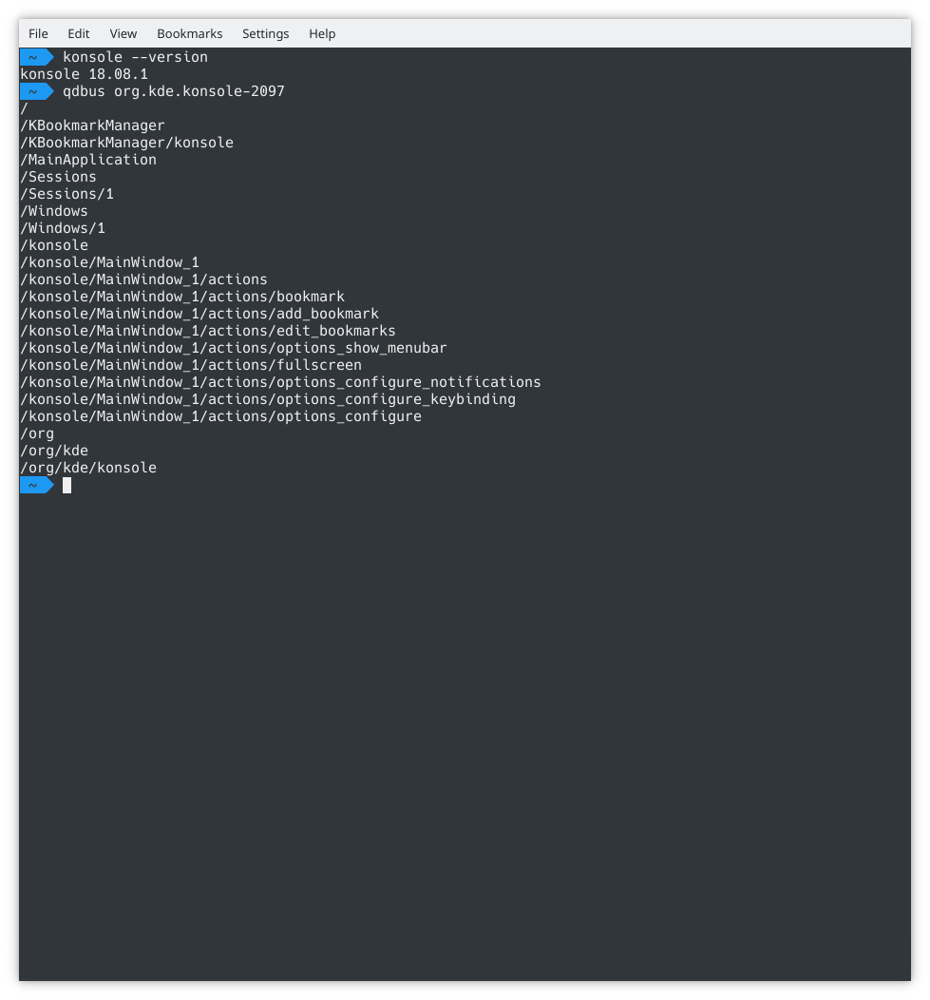
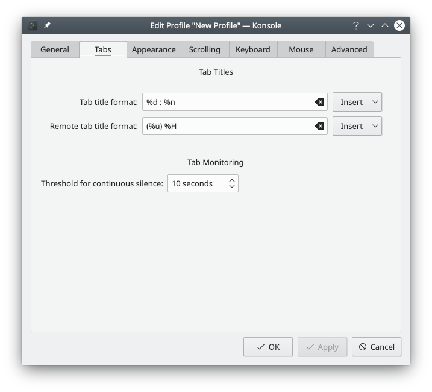
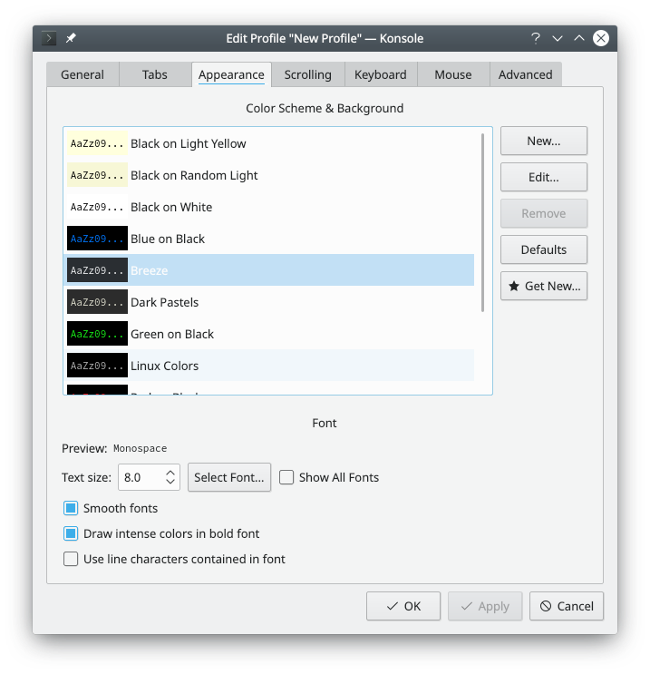

# Terminal tips



Terminal gives you a convenient way to use the command line. Besides a powerful shell, it offers features that make working on the command line easier and more pleasant, such as profile management, scrollback and color schemes, including translucency. The [Terminal](terminal.md) page describes every command and setting.

Terminal also provides an embedded terminal that other applications use, such as the Terminal panel in [Ecco](ecco.md), so the command line looks and works the same there.

## Features

- A terminal emulator for X11 that makes using the command line easier
- Different profiles for different tasks
- A scrollback limit, and saving its contents to a file
- Opening links in your default web browser with a right-click
- Opening the current path in your file manager
- A translucent background when desktop effects are enabled
- The environment variable `SHELL_SESSION_ID`, whose unique value persists across desktop sessions

## Language

To change Terminal's language to plain English, for example to read error messages when reporting a bug, run:

```sh
export LANG=en_US.UTF-8
```

## Shortcuts

- **Switch tab:** Shift+Left and Shift+Right. These have the advantage of being reachable with one hand on virtually all keyboard layouts, while some layouts only have an Alt key on the left.
- **New tab:** Ctrl+Shift+T.

## Label your tabs



If you regularly use a lot of tabs, it can be convenient to label them. Double-click a tab to open a dialog where you can rename it.

## Profile management

- To add a new profile, go to **Settings > Manage Profiles…** and click **New…**.
- On the **General** tab, enter the new profile's name and change the icon if you want.
- For a root terminal, enter the command `/bin/su -`.

> **Tip:** This command won't work on any distribution that relies on sudo. On those, use `sudo su`, or put `sudo` in front of each command that needs superuser privileges.

- The font size can be changed on the **Appearance** tab.



## Padding

You can change the padding between the window border and the text, sometimes called the margin or gutter. It's the **Margins** setting on the **Appearance** tab of your profile.

You can also edit your profile file, `~/.local/share/konsole/<profile name>.profile`, and set this in its `[General]` group:

```ini
TerminalMargin=7
```

Change the number to whatever size you prefer.

## Per-tab Bash history

If you want each tab to remember its own Bash history, and restore it with the session after a reboot or when you log out and back in, add this line to your `~/.bashrc`:

```sh
HISTFILE="$HOME/.bash_history.${KONSOLE_DBUS_SESSION##*/}"
```
