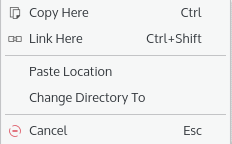

# Terminal

Terminal is SonicDE's terminal emulator, often referred to as a terminal or a shell. It emulates a command line interface in a text only window. Its command is `konsole`, and you'll also see that name in its settings files and in its D-Bus names.

Terminal typically runs a command shell, an application that executes commands that you type. The shell it runs depends on your account settings. Consult your operating system documentation to find out what the shell is, how to configure it and how to use it.

Please report problems and feature requests in the [Terminal issue tracker](https://github.com/Sonic-DE/sonic-terminal/issues).

## Scrollback

Scrollback lets you view previously displayed output. By default, it's on and saves 1000 lines of output in addition to what's currently displayed on the screen.

As lines of text scroll off the top of the screen, they can be reviewed by moving the scroll bar upwards, scrolling with a mouse wheel, or with Shift+Page Up (to move back), Shift+Page Down (to move forward), Shift+Up Arrow (to move up a line) and Shift+Down Arrow (to move down a line).

The amount of scrolling with Shift+Page Up and Shift+Page Down can be switched between half and full page on the Scrolling page of the profile configuration window (**Settings > Edit Current Profile…**).

## Selection mode

Selection mode lets you move around the scrollback and select text without the mouse.

Enter and leave this mode with Ctrl+Shift+D by default. Esc also leaves it.

- Move the cursor with the arrows, Page Up, Page Down, Home and End.
- Move the cursor vi style with h, j, k and l to move one character, and Ctrl+b, f, u and d for a page up or down or half a page up or down.
- Select text by using Ctrl or Shift with the arrows, or by using V to start the selection, moving the cursor and then using V again to end it. Shift+V selects whole lines instead of characters.

## Profiles

Profiles let you quickly and easily automate the running of common commands. Examples could include:

- ssh into another machine
- starting an IRC session
- using tail to watch a file

All new and changed profiles are saved in `$XDG_DATA_HOME/konsole`.

To create a new profile:

1. Choose **Settings > Manage Profiles…**.
2. Switch to the Profiles page.
3. Click **New…**.
4. Fill in the first entry with a name. This is the name that shows in the menu, and it's the default label instead of Shell when you start a session of this type.
5. Enter a command just as you normally would if you opened a new shell and were going to issue that command. For the first example above, you might type `ssh administration`.
6. On the other pages of the dialog, configure this session's appearance. You can configure a different font, color scheme, `$TERM` type and many other settings for each session.
7. Press **OK**. The new profile is now available.

## Mouse buttons

This section is written for the common right-handed mouse button order. For the left-handed order, swap left and right below.

### Left

All left mouse button clicks are sent to a mouse-aware application running in Terminal. If an application reacts to mouse clicks, Terminal shows an arrow cursor. If not, it shows an I-beam (bar) cursor.

Holding the left mouse button down and dragging the mouse over the screen with a mouse-unaware application running marks a region of the text, displayed in reversed color. Select **Copy** from the Edit menu to copy the marked text to the clipboard. The selected text can also be dragged into compatible applications: hold the Ctrl key and drag the selected text to the desired location.

Normally, new-line characters are inserted at the end of each line selected. This is best for cut and paste of source code, or the output of a particular command. For ordinary text, you might prefer a stream of characters that's automatically re-formatted when pasted into another application. To select in text-stream mode, hold down the Ctrl key while selecting normally.

Pressing the Ctrl and Alt keys along with the left mouse button selects text in columns.

Double-click with the left mouse button to select a word; triple-click to select an entire line. Continuing to hold the mouse button and moving the mouse extends the selection.

If the upper or lower edge of the text area is touched while marking, Terminal scrolls up or down, eventually exposing text within the history buffer. The scrolling stops when the mouse stops moving.

After the mouse is released, Terminal keeps the marked area reversed to show the text in the clipboard. The marked area reverts to normal as soon as the contents of the clipboard change, the text within the marked area is altered, or the left mouse button is clicked.

To mark text in a mouse-aware application (Midnight Commander, for example), press the Shift key when clicking.

### Middle

Pressing the middle mouse button pastes text currently in the clipboard. Holding down the Ctrl key as you press it pastes the text and appends a new-line. That's convenient for executing a pasted command quickly, but it can be dangerous, so use it with caution.

> **Note:** If you have a mouse with only two buttons, pressing both the left and right buttons together emulates the middle button of a three button mouse.

If you have a wheel as the middle button, rolling it in a mouse-unaware program moves the scrollbar.

### Right

These items appear in the menu when the right mouse button is pressed:

- Copy, and with semantic shell integration **Copy user input**, **Copy command output** and **Copy except prompts**
- Paste
- With a text selection, a **Search for** submenu with a list of your preferred web shortcuts and an option to configure them
- Open File Manager
- Split View
- Set Encoding
- Clear Scrollback
- Adjust Scrollback…
- Read-only and the option that allows applications to use the mouse
- Switch Profile
- Edit Current Profile…
- Show Menu Bar, only when the menu bar is hidden
- Close Tab

In a mouse-aware application, press the Shift key along with the right mouse button to get the menu.

## Drag and drop

If you drop a file, folder or URL on a Terminal window, a context menu appears with these actions:



- **Move Here:** Moves the dropped item into the current folder. This only appears if you have the rights to delete the dropped file or folder.
- **Copy Here:** Copies the dropped item into the current folder.
- **Link Here:** Inserts a symbolic link to the dropped item.
- **Paste Location:** Inserts the full file path of the dropped item at the cursor.
- **Change Directory To:** If a folder is dropped, changes the working folder of the session.
- **Cancel:** Stops the drag and drop action.

If you press the shortcuts before releasing the left mouse button during drag and drop, no context menu appears and the action is executed immediately.

To use the Ctrl key for drag and drop, or to disable the context menu and insert URLs as text by default, enable the corresponding options on the Mouse page of the profile settings dialog.

## Semantic shell integration

A shell program running in Terminal may emit escape sequences that partition the text displayed into three types: shell prompt, user input and command output. This enables various enhancements:

- Ctrl+Shift+Page Up and Ctrl+Shift+Page Down scroll to the previous and next command prompt.
- Visual hints:
  - A line is displayed above each prompt, prompt colors are less intense, and output colors are more intense.
  - A red bar is displayed to the left of input and output lines of commands that resulted in an error.
  - A red background is displayed for input and output lines of commands that resulted in an error.
  - A gray bar is displayed to the left of the input and output lines of every other command.
  - A gray background is displayed for the input and output lines of every other command.

  Each of those can be set to never show, always show, or show only when URL hints are shown. The configuration is on the Semantic Integration tab of the General page of the profile configuration window.
- The context menu options **Copy user input**, **Copy command output** and **Copy except prompts** filter the selection when it's copied to the clipboard.
- When the selection is empty, copying to the clipboard copies the current input line if it isn't empty, or the last output if there's no current input.
- With **Up/Down Arrows emulation**, pressing the Up or Down arrow when editing a long input places the cursor one line up or down by sending the appropriate number of Left or Right key events to the shell.
- With **Mouse click in input line moves cursor**, clicking on text input places the cursor at that location.
- Pressing the Ctrl key while triple-clicking on the output of a command selects the whole output of that command.

Semantic shell integration needs to be set up in the shell. Pressing Ctrl+Alt+] pastes the commands needed in bash. For other shells, such as fish, zsh or python, consult the relevant program's documentation.

## Complex text layout

The Complex Text Layout tab of the Appearance page in the Edit Profile dialog has options that control the rendering of text.

- **Word mode:** Some strings are displayed on the screen as a whole, instead of a character at a time. This allows Qt to render text correctly when the shape of a character depends on the characters before or after it. This might result in incorrect position of some characters. Spaces always break strings, so they're always in the correct positions, which ensures that characters are never too far from their correct position.
- **Use the same attributes for each whole word:** Words are rendered with the same attributes (text color, bold, italic, etc.). If an attribute changes mid-word, it only takes effect after the end of the word. When this is disabled, a new word starts when attributes change, which results in characters changing shape and position when moving the cursor or selecting text.
- **ASCII characters:** Groups ASCII characters into words as described above. The most noticeable effect is that this shows programming ligatures, for fonts that support them. For example, the string `<=` may be displayed as ⩽.
- **Brahmic scripts characters:** Groups Brahmic characters as described above. Without this option (depending on the font) some words may not be connected as they should. With it, Brahmic characters may appear out of position.
- **Emoji Font:** Specifies the font to use for Unicode emoji characters. If not set, the default profile font is used, or the system may use a fallback font if the glyphs are missing from this font.
- **Bi-Directional text rendering:** Reorders right-to-left characters so Arabic and Hebrew texts appear correctly.
- **Force LTR line direction:** Lines are always left to right. Without this, each line's direction is determined by the first character with strong directionality.
- **Table characters BiDi mode override:** Considers graphic table characters as strong LTR characters. This allows tables containing RTL characters to display correctly, but might cause incorrect order if those characters are used in RTL texts.
- **Override wcwidth:** Problematic characters follow the Unicode standard, rather than glibc's `wcwidth()`. Currently only the soft hyphen (Unicode 0x00AD), which has a wcwidth of 1 and a Unicode width of 0, is affected. Generally, disable this when mainly using those characters on the command line, and enable it when they are only displayed.

## Visual hints

In addition to the hints described in [Semantic shell integration](#semantic-shell-integration), Terminal has these:

- A vertical line at column 80 (or another). Configure it on the Miscellaneous tab of the Appearance page in the Edit Profile dialog.
- Line numbers, displayed as an overlay of the terminal text. They appear in red at the right end of each line, numbered consecutively from the first (top) line in the scrollback. Configure them under **Line Numbers** on the Advanced page in the Edit Profile dialog, or cycle between the three modes with Ctrl+Alt+\\.

## Command reference

The menu bar is at the top of the Terminal window. If it's hidden, **Show Menu Bar** can be reached by right clicking in the window (as long as no full screen application such as vi or minicom is running in that window). You can also use Ctrl+Shift+M to show or hide it.

### File menu

- **New Window** (Ctrl+Shift+N): Opens a new window with the default profile.
- **New Tab** (Ctrl+Shift+T): Opens a new tab with the default profile. The first profile in the submenu is always “Default”, the built-in profile. All other profiles are listed below it in alphabetical order, and your default profile is in bold.
- **Clone Tab:** Attempts to clone the current tab in a new tab.
- **Save Output As…** (Ctrl+S): Saves the current scrollback as a text or HTML file.
- **Auto Save Output As…**, **Stop Auto Save:** Starts and stops saving the session's output to a file as it appears.
- **Print Screen…** (Ctrl+Shift+P): Prints the current screen. By default the output is scaled to fit the paper with black text and no background. These options can be changed on the Output Options tab of the print dialog.
- **Open File Manager:** Opens the file manager at the current directory. By default, that's [Ecco](ecco.md).
- **Close Session** (Ctrl+Shift+W): Closes the current session.
- **Close Window** (Ctrl+Shift+Q): Closes the window.

> **Note:** Terminal displays a confirmation dialog if there is more than one session open or if certain programs are running in any session. These dialogs can be disabled by clicking the **Do not ask again** checkbox.

### Edit menu

- **Copy** (Ctrl+Shift+C): Copies the selected text to the clipboard.
- **Paste** (Ctrl+Shift+V): Pastes text from the clipboard at the cursor location.
- **Select All:** Selects all the text in the current window.
- **Select Mode** (Ctrl+Shift+D): Enters [selection mode](#selection-mode).
- **Copy Input To > All Tabs in Current Window:** Sends input from the current session to all sessions in the current window at the same time.
- **Copy Input To > Select Tabs…** (Ctrl+Shift+.): Sends input from the current session to sessions you pick.
- **Copy Input To > None** (Ctrl+Shift+/): Stops sending input from the current session into other sessions.
- **Send Signal:** Sends the specified signal to the shell process, or other process, that was launched when the session was started. The available signals are:

  | Signal | Meaning |
  | --- | --- |
  | STOP | to stop process |
  | CONT | continue if stopped |
  | HUP | hangup detected on controlling terminal, or death of controlling process |
  | INT | interrupt from keyboard |
  | TERM | termination signal |
  | KILL | kill signal |
  | USR1 | user signal 1 |
  | USR2 | user signal 2 |

  For further details, see `man 7 signal`.
- **Configure or Rename Tab…** (Ctrl+Alt+S): Opens the [tab settings dialog](#configure-tab-settings-dialog).
- **Find…** (Ctrl+Shift+F): Opens a search bar at the bottom of the window, for case sensitive, forward or backward, and regular expression searches.
- **Find Next** (F3): Moves to the next match. If the search bar has the focus, Enter works too.
- **Find Previous** (Shift+F3): Moves to the previous match. If the search bar has the focus, Shift+Enter works too.

### View menu

- **Split View > Split View Left/Right** (Ctrl+( ): Splits the current tab into left and right views. Any output on one view is duplicated in the other view.
- **Split View > Split View Top/Bottom** (Ctrl+) ): Splits the current tab into top and bottom views. Any output on one view is duplicated in the other view.
- **Split View > Expand View** (Ctrl+Shift+]): Makes the current view larger.
- **Split View > Shrink View** (Ctrl+Shift+[): Makes the current view smaller.
- **Split View > Toggle maximize current view** (Ctrl+Shift+E): Toggles the current view between its current size and the maximum size.
- **Split View > Equal size to all views:** Sets the same size for all views.
- **Detach Current Tab:** Opens the current tab in a separate window. Quitting the previous window doesn't affect the new one.
- **Detach Current View** (Ctrl+Shift+H): Opens the current split view in a separate window.
- **Save Tab Layout…:** Saves the tab layout of the current view to a layout file which can be loaded later.
- **Load Tab Layout…:** Loads a layout saved with the item above. The default layouts (2x2, 2x1 and 1x2) can be loaded via the toolbar.
- **One-Shot Monitors:** The monitors below notify only once, and are then disabled.
- **Monitor for Prompt:** Toggles monitoring the current tab for a shell prompt, and shows a notification when one is displayed. Only shown when semantic integration is enabled in the shell.
- **Monitor for Silence:** Toggles monitoring the current tab for lack of activity. By default, after 10 seconds of inactivity, an info icon appears on the tab. Change the type of alert in **Settings > Configure Notifications**.
- **Monitor for Activity:** Toggles monitoring the current tab for activity. Upon any activity, an info icon appears on the tab. Change the type of alert in **Settings > Configure Notifications**.
- **Monitor for Process Finishing:** Toggles monitoring the current tab for the process finishing. When it does, Terminal shows the notification “The process '\<name\>' has finished running in session '\<session\>'.”
- **Read-only:** Toggles the session to be read-only: no input is accepted, and drag and drop is disabled.
- **Enlarge Font** (Ctrl++): Increases the text font size.
- **Reset Font Size** (Ctrl+Alt+0): Resets the text font size to the profile default.
- **Shrink Font** (Ctrl+-): Decreases the text font size.
- **Set Encoding:** Sets the character encoding.
- **Clear Scrollback:** Clears the text in the scrollback.
- **Clear Scrollback and Reset** (Ctrl+Shift+K): Clears the text in the current tab and scrollback and resets the terminal.

### Bookmarks menu

- **Add Bookmark:** Adds the current location.
- **Bookmark Tabs as Folder…:** Adds all tabs to a bookmark folder. A dialog asks for the folder name.
- **New Bookmark Folder…:** Adds a new folder to the bookmark list. A dialog asks for the folder name.
- **Edit Bookmarks:** Opens the bookmark editor.

> **Note:** The `keditbookmarks` program must be installed for **Edit Bookmarks** to appear.
>
> You can use the bookmark editor to manually add URLs. Terminal accepts `ssh://user@host:port` and `telnet://user@host:port`.

### Plugins menu

This lists the installed plugins, which include **Quick Commands** and **SSH Manager**, or “No plugins available”. Plugins are shown as panels in the window.

### Settings menu

- **Edit Current Profile…:** Opens a dialog to configure the current profile.
- **Switch Profile:** Switches the current profile to a listed profile.
- **Manage Profiles…:** Opens an editor for managing profiles.
- **Show Menu Bar** (Ctrl+Shift+M): Toggles the menu bar.
- **Window Color Scheme:** Changes the color scheme of the window.
- **Full Screen Mode** (F11): Toggles filling the entire screen.
- **Toolbars Shown:** Toggles the toolbars.
- **Configure Language…:** Chooses an interface translation.
- **Configure Keyboard Shortcuts…:** Opens the keyboard shortcut editor.

  Terminal has a few special shortcuts with no menu item:

  | Shortcut | Description |
  | --- | --- |
  | Shift+Right | Next tab |
  | Shift+Left | Previous tab |
  | Ctrl+Alt+Left | Move tab left |
  | Ctrl+Alt+Right | Move tab right |
  | Ctrl+Shift+Insert | Paste selection |

- **Configure Toolbars…:** Opens the toolbar configuration window.
- **Configure Notifications…:** Opens the notifications editor.
- **Configure Terminal…:** Opens the settings dialog, which has these pages:
  - **General:** Remembering the window size, running all windows in a single process, re-using an existing process, enabling menu accelerators, showing the window title on the titlebar, removing the window titlebar and frame, focusing terminals when the mouse pointer moves over them, enabling the security sensitive parts of the D-Bus API, forcing new tabs, and showing progress in the taskbar. It also configures search: case sensitivity, regular expressions, highlighting all matches, searching backwards and not wrapping. You can also enable all “Don't Ask Again” messages again here.
  - **Profiles:** Creating and handling [profiles](#profiles).
  - **Tab Bar / Splitters:**
    - The Appearance tab configures the tab bar's visibility and position, the Close Tab and Search Tabs buttons, **Show 'New Tab' button** and **Expand individual tab widths to full window**.
    - The Behavior tab chooses where new tabs go (at the end or after the current tab) and whether a middle mouse button click closes a tab.
    - The Splits tab configures the split headers (when needed, always or never) and the drag handle size (small, medium or large).
  - **Memory:** Monitors the memory use of terminals, with a limit.
  - **Temporary Files:** Defines the [scrollback](#scrollback) file location.
  - **Thumbnails:** Enables thumbnails and defines their size and activation (the Shift, Alt or Ctrl key).

    > **Note:** To show image thumbnails in popups when hovering over image items, enable file underlining for your current profile: **Settings > Edit Current Profile… > Mouse > Miscellaneous > Underline files**.

### Help menu

Terminal has some of the usual Help menu items.

## Dialogs

### Configure tab settings dialog

This dialog changes the name format, the remote tab title format and the color of the current tab. Open it through the menu, with Ctrl+Alt+S, or by double-clicking the tab in the tab bar. These changes are temporary and can be made permanent by editing the current profile.

Terminal substitutes these tokens for local tabs:

- `%n`: program name
- `%d`: current directory (short)
- `%D`: current directory (long)
- `%h`: local host (short)
- `%u`: user name
- `%B`: user's Bourne prompt sigil (`$` = normal user, `#` = superuser)
- `%w`: window title set by shell
- `%#`: session number

It substitutes these tokens for remote tabs:

- `%c`: current program
- `%h`: remote host (short)
- `%H`: remote host (long)
- `%u`: user name
- `%U`: user name@ (if given)
- `%w`: window title set by shell
- `%#`: session number

Examples:

- `%d : %n` with `/usr/src` as the current directory and running bash displays `src : bash`.
- `%D : %n` with `/usr/src` as the current directory and running top displays `/usr/src : top`.
- `%w (%#)` with `~` as the current directory and running vim in the first tab displays `[No Name] (~) - VIM(1)`.

### Copy input dialog

The text entered in one tab can simultaneously be sent to other tabs. This dialog selects which tabs get that input. The current tab is greyed out.

### Adjust scrollback dialog

This dialog changes the [scrollback](#scrollback) options for the history size. Any changes are for the current tab only and aren't saved to the profile.

## Command-line options

When Terminal is started from the command line, these options modify its behavior:

- `--help`: Lists the options.
- `--profile file`: Starts using the specified profile instead of the default profile.
- `--layout file`: Starts using a saved JSON layout file.
- `--builtin-profile`: Uses the built-in profile instead of the current default profile.
- `--workdir dir`: Opens with `dir` as the initial working directory.
- `--hold`, `--noclose`: Doesn't close the initial session automatically when it ends.
- `--new-tab`: Creates a new tab in an existing window rather than creating a new window.
- `--tabs-from-file file`: Creates tabs as specified in the given tabs configuration file.

  The file has one tab per line. Each line specifies a tab using up to 4 fields, delimited with `;;`, and a field name must have a `:` appended. Empty lines and lines beginning with `#` are ignored.

  - `title:` a name for this tab, the tab default if blank or not specified
  - `workdir:` the working directory, `~` if blank or not specified
  - `profile:` a profile to use, the default if blank or not specified
  - `command:` a command to run

  Each line should contain at least one of the `command` or `profile` fields. For example: `title: %n;; command: /usr/bin/top ;; profile: Shell`
- `--background-mode`: Starts in the background, and comes to the front when Ctrl+Shift+F12 (by default) is pressed.
- `--separate`, `--nofork`: Runs the new instance in a separate process.
- `--force-reuse`: Forces re-using the existing instance even if it breaks functionality.
- `--show-menubar`, `--hide-menubar`: Show or hide the menu bar, overriding the default behavior.
- `--show-toolbars`, `--hide-toolbars`: Show or hide all the toolbars, overriding the default behavior.
- `--show-tabbar`, `--hide-tabbar`: Show or hide the tab bar, overriding the default behavior.
- `--fullscreen`: Starts in fullscreen mode.
- `--notransparency`: Disables transparent backgrounds, even if the system supports them.
- `--list-profiles`: Lists all available profiles.
- `--list-profile-properties`: Lists all possible properties with name and type. See the `-p` option.
- `-p property=value`: Changes the value of a profile property.
- `-e command`: Executes `command` instead of the normal shell. This option catches all following arguments and executes them as `command`, so it should always be the last option.

Terminal also accepts generic Qt and KDE Frameworks 6 options; see the `qt6options` and `kf6options` man pages.

## Scripting Terminal

Terminal supports numerous methods that can be used with D-Bus, through Qt's `qdbusviewer` or the `qdbus6` command. Each window and session sets environment variables with its own names.

Examples:

- `qdbus6` displays all services available.
- `qdbus6 org.kde.konsole` displays the D-Bus interface for Terminal.
- `qdbus6 org.kde.konsole /Windows/1` displays methods for controlling window 1.
- `qdbus6 org.kde.konsole $KONSOLE_DBUS_WINDOW` displays methods for controlling the current window.
- `qdbus6 org.kde.konsole /Sessions/1` displays methods for controlling session 1.
- `qdbus6 org.kde.konsole $KONSOLE_DBUS_SESSION` displays methods for controlling the current session.
- `qdbus6 $KONSOLE_DBUS_SERVICE $KONSOLE_DBUS_SESSION` displays methods for controlling the current Terminal's session.

If any of the above commands report that the service `org.kde.konsole` doesn't exist, change it to one of the following:

- ``org.kde.konsole-`pidof -s konsole` `` (selects the first process)
- `$KONSOLE_DBUS_SERVICE` (can be used from within Terminal)
- one from the output of `qdbus6 | grep konsole`

The same objects are also available under the SonicDE name `org.sonicde.terminal-<process id>`.

For more information, see the [D-Bus tutorial](../../developer/dbus/introduction.md).

## Terminal key bindings

### Introduction

Terminal uses `*.keytab` files to translate key combinations into control characters and escape sequences that are sent to the shell or to interactive programs (typically programs that use the Alternate Screen buffer, such as vim, less and screen) running in the shell.

You can customize the key bindings using the Key Bindings Editor. A key combination can be configured to send a specific control or escape sequence to the terminal.

To open the editor, choose **Settings > Edit Current Profile…** and go to the Keyboard page. Listed there are the key binding schemas that come with Terminal.

### Key combinations and modes

Key combinations follow the pattern:

```text
Key (+|-) Modes
```

for example:

```text
Up+Shift+AppScreen
Down+Shift-AppScreen
Space+Ctrl
```

Key names are those in the [Qt::Key enumeration](https://doc.qt.io/qt-6/qt.html#Key-enum), with the `Qt::Key_` prefix removed.

A “+” preceding a mode name means that mode is *set*. For a modifier key, that means it's pressed, whereas for all other modes it means that mode is active. For example, “+Ctrl” means the key combination works only if the Ctrl key is pressed.

A “-” preceding a mode name means that mode is *reset*: for a modifier key, that means the key isn't pressed, and for all other modes that the mode is inactive. For example, “-Ctrl” means the key combination works only if the Ctrl key is *not* pressed.

> **Note:** If a mode name isn't present in a key combination, its state is ignored.

The supported modes are:

- **Alt, Ctrl, Shift:** One or more of these can be used in a key combination. If any of them is set, the key combination uses that modifier key, and vice versa if it's reset.
- **AnyModifier:** If set, the key combination uses any of the three modifier keys above, and vice versa if it's reset.
- **Ansi:** If set, Terminal sends ANSI escape and control sequences. If reset, it sends VT52 ones.
- **AppScreen:** If set, the key combination only affects interactive programs that use the Alternate Screen buffer. If reset, it only affects the terminal when it's using the Normal Screen buffer.

  > **Note:** Terminal has two screen buffers. The Normal Screen buffer, the default, lets you scroll back to view previous lines of output. The terminal switches to the Alternate Screen buffer when you run an interactive program such as less, vim, screen or tmux.
- **KeyPad:** If set, the key combination uses a key on the keypad. This distinguishes keys on the keyboard from keys on the keypad. For example, when Num Lock is *on* you can configure two separate key combinations, one using the key labelled “1” on the keyboard and the other using the key labelled “1” on the keypad. The same applies when Num Lock is *off* for End, Home, the cursor keys and so on.
- **AppCursorKeys:** This implements the VT100 [Cursor Keys Mode (DECCKM)](https://www.vt100.net/docs/vt100-ug/chapter3.html#DECCKM). It controls the escape sequences each cursor key (Up, Down, Right, Left) sends. By default Terminal follows the XTerm behavior of treating the Home and End keys as cursor keys with respect to DECCKM.
- **AppKeyPad:** If set, the key combination only works when the keypad is in Application Mode (DECKPAM). If reset, it only works when the keypad is in Numeric Mode (DECKPNM).
- **NewLine:** If set, the Return key on the keyboard, and the Enter key on the keypad, send both Carriage Return `\r` and New Line `\n`. If reset, they send only a Carriage Return. This emulates [LNM, Line Feed/New Line Mode](https://www.vt100.net/docs/vt100-ug/chapter3.html#LNM).

Each combination of key and modes (set or reset) must be unique. For example, consider these two rules:

- `A+Shift : "A"`
- `a : "a"`

Terminal won't accept the small letter “a” rule. Add `-Shift` to that rule to make it work.

### The output field

In the Output field, add the escape sequences or control characters that you want Terminal to send to the terminal when the key combination is pressed.

You can also use these keywords, each with a special meaning:

- `scrollUpLine`: scroll up one line in the history scrollback buffer
- `scrollUpPage`: scroll up one page
- `scrollDownLine`: scroll down one line
- `scrollDownPage`: scroll down one page
- `scrollUpToTop`: scroll up to the beginning of the buffer
- `scrollDownToBottom`: scroll down to the end of the buffer
- `scrollPromptUp`, `scrollPromptDown`: scroll to the previous or next command prompt

You can also use strings with C-string syntax, with these escape sequences:

- `\E`: Escape
- `\\`: Backslash
- `\"`: Double quote
- `\t`: Tab
- `\r`: Carriage Return
- `\n`: New line
- `\b`: Backspace
- `\xHH`: where HH are two hex digits. This can send ASCII control characters, such as `\x00`, the NUL character.

### Other system resources

Other system resources can affect terminal key bindings:

- Consult the `terminfo(5)` or `termcap(5)` database for the expected escape sequences and control characters that each key combination is supposed to send.
- Your system probably has other keyboard databases which have to be in sync too, such as `/etc/inputrc` and readline for the bash shell, as they affect the operations bound to key combinations.

### Further reading

For more information on escape sequences and control characters:

- [The VT100 user guide](https://www.vt100.net/docs/vt100-ug/)
- [The VT102 user guide](https://vt100.net/docs/vt102-ug/)
- The comprehensive and indispensable [XTerm Control Sequences](https://invisible-island.net/xterm/ctlseqs/ctlseqs.html) documentation

## Did you know?

- Pressing Ctrl while selecting text converts line breaks to spaces when pasted.
- Pressing Ctrl+Alt while selecting text selects columns.
- Ctrl+Wheel zooms the text size.
- When a program uses either mouse button, pressing the Shift key lets the menu appear.
- Ctrl+Shift+F10 activates the menu.
- Shift+Insert inserts the clipboard.
- There's a hidden feature for the `%d` formatter in tab titles: you can abbreviate a directory name to its first character. For example, `/path/to/konsole/src` can be abbreviated to `konsole/s`. To enable it, open `konsolerc` in `~/.config` and add:

  ```ini
  [ProcessInfo]
  CommonDirNames=name1,name2,name3...
  ```

## Common issues

- Some fonts might be unavailable in Terminal, although they're available in other applications. Terminal requires monospaced fonts for the best visual result, so it asks Qt to list only monospaced fonts. To select any font, enable **Show all fonts** in the font dialog, with the caveat that the display may not be correct.
- All tabs use the same process ID. If one tab's process has issues, all the other tabs may experience issues as well. This is most noticeable when a command that connects to an external device or system (ssh, nfs) has issues.
- Terminal treats arguments after the `-e` option as one command and runs it directly, instead of parsing it and possibly dividing it into sub-commands. This is different from xterm.
  - `konsole -e "command1 ; command2"` does not work.
  - `konsole -e $SHELL -c "command1 ; command2"` works.
- Terminal doesn't provide a convenience for running a login shell. If you need one, edit the profile in use and change its command to start a login shell explicitly, such as `bash -l` or `zsh -l`.
- The `--new-tab` option sometimes behaves strangely. It may create a new window, or a new tab in another existing Terminal window instead of the current one. This isn't necessarily a bug: the option tries to reuse existing windows, but not all windows are reusable. All windows opened through KRunner are reusable, while most windows opened from the command line are not.
