# The SonicDE desktop

SonicDE provides a modern and customizable environment for running your favorite applications and accessing your information wherever it may be. It offers advanced window management and desktop effects, widgets, integrated search, hardware management and a high degree of customizability.

## Widgets and containments

The desktop revolves around two basic concepts:

- **Widgets:** Small applications that live on the desktop or a panel.
- **Containments:** Widgets that act as containers for other widgets.

On a default desktop, there are two main elements, the panel and the desktop itself. Both are containments.

## The default desktop

> [!NOTE]
> The desktop can be configured in countless ways, and some distributions customize it extensively, so yours may look different. The screenshots here are older ones with the Breeze style, and they'll be replaced.

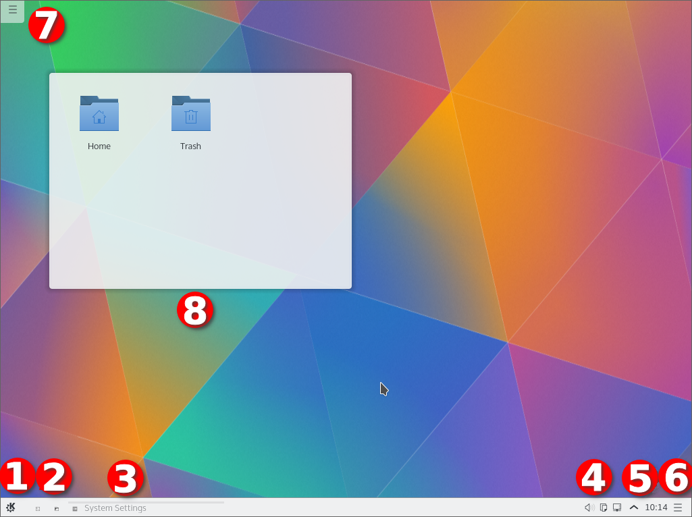

1. The program starter, usually the [Application Launcher](#application-launcher).
2. A couple of icons giving easy access to often used applications.
3. The [Task Manager](#task-manager), which shows the windows of the applications currently running. No window was open when this screenshot was taken.
4. The [System Tray](#system-tray).
5. The [Digital Clock](#digital-clock).
6. The [panel toolbox](#panel-settings), now replaced by Edit Mode.
7. The [desktop](#the-desktop-itself) toolbox, now replaced by Edit Mode.
8. A Folder View widget, showing the content of the Desktop folder.

## Edit Mode

To change the desktop or a panel, right-click it and choose **Enter Edit Mode**. Your widgets stay in place at other times, and **Exit Edit Mode** returns to normal use.

## The panel

The default panel holds a few widgets, starting from the left with the application launcher. The launcher opens with Meta or Alt+F1.

### Application Launcher

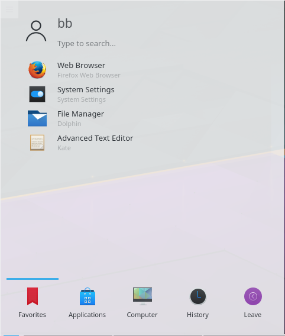

You can use it to start applications, open recent files and use the logout and shutdown options, which can open the [logout screen](desktop/logout-screen.md). The layout is optimized for the most common use, starting an application.

Its sidebar lists your **Favorites**, **All Applications** and the application categories, and the tabs at the bottom switch between **Applications** and **Places**. To add an application to your favorites, right-click it and select **Add to Favorites**, or add it directly to the panel or desktop. Right-clicking the launcher button also offers **Edit Applications…**, which opens the [SonicDE Menu Editor](applications/menu-editor.md).

### Application Menu

If you prefer a traditional menu-style launcher, right-click the launcher button and select **Show Alternatives…**.

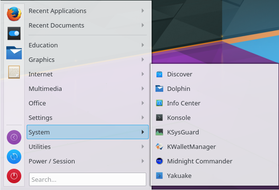

### Application Launcher settings

To configure the launcher, right-click its button and select **Configure Application Launcher…**.

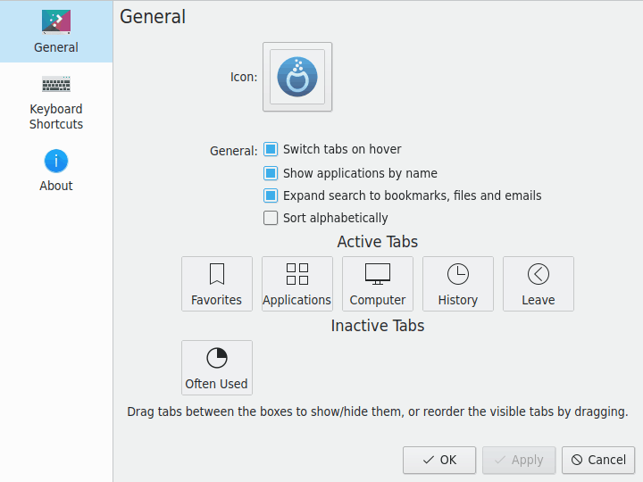

- **Icon** and **Text label:** Change how the button looks. A text label can't be set when the panel is vertical.
- **Show applications as:** **Name only**, **Description only**, **Name (Description)** or **Description (Name)**.
- **General:** **Sort applications alphabetically**, **Use compact list item style**, **Highlight newly-installed applications** and **Switch sidebar categories when hovering over them**. **Configure Search Plugins…** chooses what the search covers.
- **Sidebar position:** Left or right.
- **Show favorites** and **Show other applications:** **In a grid** or **In a list**.
- **Show buttons for:** **Power**, **Session** or **Power and session**, with **Show action button captions**.

### Task Manager

The Task Manager is another widget on the panel. It shows an entry for your open windows. Right-click it and choose **Configure Task Manager…** to customize it. Meta and a number activate its entries.

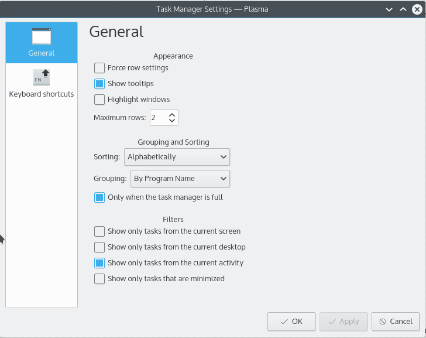

Its behavior settings include:

- **Group:** **Do not group** or **By program name**, what **Clicking grouped task** does, **Combine into single button** and **Group only when the Task Manager is full**.
- **Sort:** **Do not sort**, **Manually**, **Alphabetically**, **By desktop**, **By activity** or **By horizontal window position**, and how to treat launchers.
- **Clicking active task**, **Middle-clicking any task** and **Scrolling behavior:** What each of these does.

The size of the text on its entries follows [Fonts](settings/fonts.md).

### System Tray

Another default panel item is the System Tray, which traditional applications and widgets use as a dock. Right-click it to open its settings, where you can choose the entries to display and their visibility.

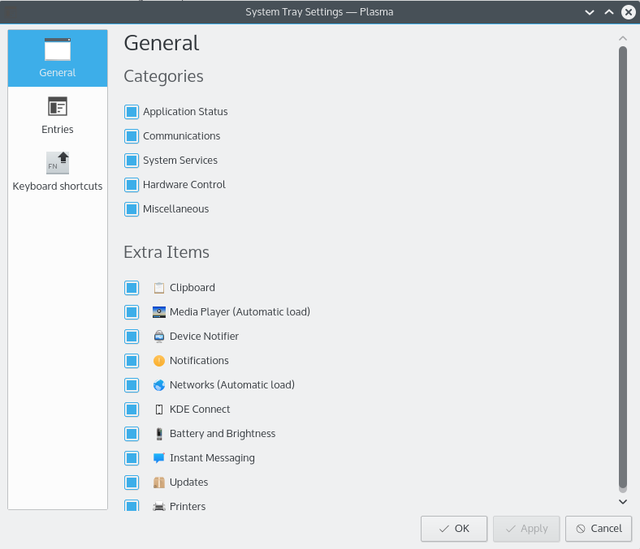

Each entry can be set to **Show when relevant**, **Always show**, **Show only in popup** or **Never show (disabled)**.

### Device Notifier

The Device Notifier, an icon usually located in the system tray, handles pluggable devices such as USB flash drives, digital cameras and external hard drives. It also comes into play when a medium such as a CD or DVD is loaded into an optical drive. Plug in a USB disk, and a dialog opens that lets you open the device in [Ecco](applications/ecco.md) or another associated application.

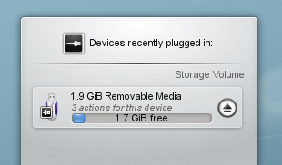

When you plug in an external device or load a new medium, the Notifier's window pops up. You can also open it by clicking its panel icon. **Show popup when new device is plugged in** in its menu controls this, along with whether it lists **Removable Devices**, **Non Removable Devices** or **All Devices**.

The window lists all the devices it currently knows about. Clicking a device expands its entry to show the possible actions, which depend on the device. You can configure these with [Device Actions](settings/device-actions.md) and [Device Auto-Mount](settings/device-automount.md). Select one with the mouse or keyboard to launch that action.

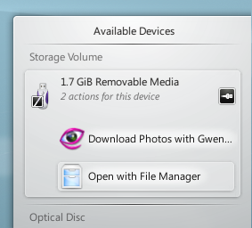

A small icon to the right of each entry shows whether the device is currently accessible, or *mounted*. Only when a device isn't mounted is it safe to physically disconnect it from the computer. Clicking the icon unmounts the device or ejects the medium if it's mounted, and mounts it if it isn't. **Remove All** safely removes all devices. Unmounting or ejecting might fail if the device still has open files, for example if a large file copy hasn't finished. The Notifier warns you not to unplug yet while files are being transferred. In most cases you can just wait a while and try again.

### Hidden items

The System Tray normally holds more entries, such as the [Clipboard](applications/clipboard.md).

Some entries are hidden to save space. To show them, click the small arrow in the tray. Then click an entry to open it, or right-click it to open its settings.

### Digital Clock

Near the right end of the default panel, just before Peek at Desktop, is the Digital Clock. It can show the time in different time zones, and adjusts its font size to the area it's given by the panel. Its settings choose what's shown, such as the date, seconds and time zone. If you want to display more information, make the panel larger or put the clock on the desktop, where it can grow freely.

### Pager

An optional item on your panel is the Pager, which lets you switch between your [virtual desktops](settings/virtual-desktops.md). Its settings include **Show window outlines**, **Show application icons on window outlines**, **Show only current screen**, **Navigation wraps around**, **Text display** and what **Selecting current virtual desktop** does. See [Pager](desktop/pager.md).

## Panel settings

In Edit Mode, click the panel to open **Panel Settings**, or right-click it and choose **Show Panel Configuration**.

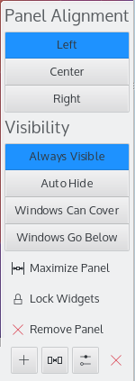

These settings let you reposition, resize and realign the panel. The widgets on it adjust their size automatically.

- **Position:** **Top**, **Right**, **Left** or **Bottom** of the screen, and **Set Position…** chooses by dragging.
- **Alignment:** The side of the screen the panel sits against, if it doesn't fill it.
- **Width** or **Height:** **Fill width** or **Fill height**, **Fit content**, or **Custom**.
- **Visibility:** **Always visible**, **Auto hide**, **Dodge windows** or **Windows go below**.
- **Opacity:** **Adaptive**, **Opaque** or **Translucent**, where the [Desktop Style](settings/desktop-style.md) supports it.
- **Floating:** **Disabled**, **Applets only** or **Panel and applets**: whether the widgets, or the panel and its widgets, float away from the screen edge.
- **Panel Height:** or **Panel Width:** The thickness of the panel.
- **Focus shortcut:** A keyboard shortcut to move focus to the panel. Meta+Alt+P moves focus between panels.

**Add New** adds **Widgets…**, a **Spacer** or a **Margins Separator**. **Delete Panel** removes the panel, and **Clone Panel** makes a copy of it with the same settings and widgets. **Manage Desktops and Panels…** gives an overview of all of them. See [Panels](desktop/panels.md) for more.

## Adding widgets

In Edit Mode, you can add and remove widgets on a panel or the desktop. Open **Add Widgets**, and drag a widget to where you want it.

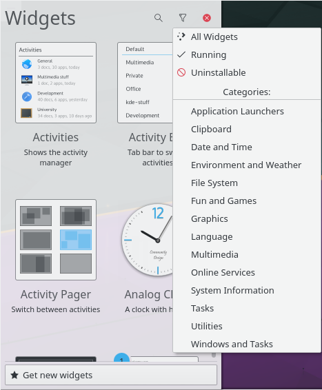

**Get New…** lets you install widgets you've downloaded, or download new ones. Widgets you install this way work just like preinstalled ones. To create your own, see [Desktop widget tutorial](../developer/plasma/widget/index.md).

## The desktop itself

The desktop is another containment, one that doesn't put size limits on its widgets, so they can be moved and sized freely. In Edit Mode, a widget shows a frame when you move the mouse over it, with buttons to resize, configure and remove it.

Right-clicking the desktop also lets you configure the [wallpaper](desktop/wallpapers.md), the layout and the [mouse actions](desktop/mouse-actions.md), and download new wallpapers.

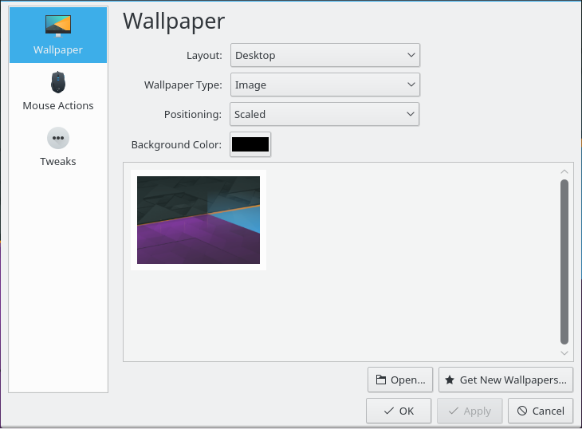

The desktop settings have two pages:

- **Wallpaper:**
  - **Layout:** The kind of desktop, for example **Desktop** or **Folder View**. A changed layout has to be applied with **Apply Now** before you can change anything else.
  - **Wallpaper type:** How the wallpaper is drawn, for example a single image, a slideshow or a plain color. The settings below change with the type. **Get New Plugins…** downloads more wallpaper types. See [Wallpapers](desktop/wallpapers.md).
- **Mouse Actions:** What mouse buttons and the scroll wheel do on the empty desktop. **Add Action** adds a new one. See [Mouse actions](desktop/mouse-actions.md).

To change the style or download a new one, use [Desktop Style](settings/desktop-style.md) in System Settings.

With applications open, it quickly gets hard to see your widgets. Ctrl+F12 shows the desktop in front of them, and Meta+D is **Peek at Desktop**. The [Peek at Desktop and Minimize All Windows](desktop/desktop-buttons.md) widgets do the same from a panel.

## Folder View

Folder View shows entries such as files and folders from a folder, by default from `$HOME/Desktop`.

You can show all files, or filter them by a file name pattern (for example all files with a certain extension) or by file type (for example just images).

It also supports basic file management, such as moving, copying, cutting and pasting.

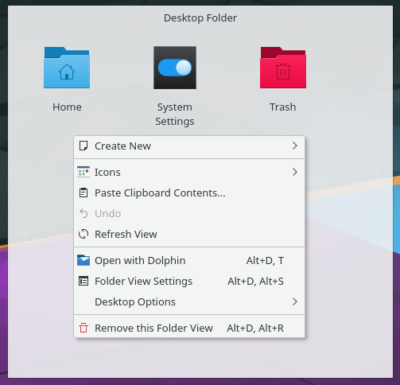

If you select the Folder View layout in the desktop settings, the whole desktop is one Folder View, like a traditional desktop. Its settings have **Location**, **Icons** and **Filter** pages. Some settings only appear for a Folder View widget, and some only for the Folder View desktop.

**Location:**

- **Show:** **Desktop folder**, **Files linked to the current activity**, a **Places panel item:** chosen from your places, or a **Custom location:** where you type a path or URL.
- **Title:** (widget only) **None**, **Default**, **Full path** or **Custom**, with a title you type.

**Icons:**

- **Panel button:** (widget in a panel only) **Use a custom icon** for the button that opens the folder. Click the icon to **Choose…** one, or **Clear Icon**.
- **View mode:** (widget in a panel only) **List** or **Grid**.
- **Arrangement:** **In Rows** or **In Columns**. **Sort Alignment:** **Left-to-Right** or **Right-to-Left**.
- **Lock in place:** (desktop only) Stops icons from being moved.
- **Sort by:** **Manual**, **Name**, **Size**, **Type** or **Date**, with **Descending** and **Folders first**.
- **Icon size:** A slider from **Small** to **Large**.
- **Label width:** **Narrow**, **Medium** or **Wide**. **Text lines:** How many lines of the name are shown under each icon.
- **When hovering over icons:** **Show tooltips**, **Show selection markers** (only when a single click opens files) and **Show folder preview popups** (not in a panel).
- **Typing on the desktop:** (not in a panel) **Selects items**, or **Activates KRunner** to search for what you type.
- **Rename:** **Rename inline by clicking selected item's text** (only when a double click opens files).
- **Previews:** **Show preview thumbnails** shows small previews of file contents. **Configure Preview Plugins…** chooses which kinds of files get them.

**Filter:**

- **Files:** **Show all**, **Show matching** or **Hide matching**. With the last two, **File name pattern:** and **File types:** choose which files match.
- **Show hidden files:** Shows files whose names start with a dot.

## KRunner

KRunner is a versatile mini command line. You can use it to start applications, open web pages, access bookmarks, search through your desktop data, calculate short equations and much more. Alt+Space or Alt+F2 opens it, and Alt+Shift+F2 runs a command from the clipboard's contents. Start typing, and KRunner searches for matches. You can move through them with the Tab and arrow keys.

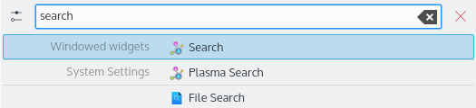

The configure button opens its System Settings module, where you can set its **Position on screen**, its **History**, with **Enable suggestions**, **Enable auto-complete** and **Clear History…**, and its plugins with **Configure Enabled Search Plugins…**.

KRunner supports desktop actions, which are additional actions an application offers to jump directly to a certain task from the Task Manager. Common examples are opening your browser directly in private mode, composing an email without first launching the full email client, or the actions provided by [Screenies](applications/screenies.md):

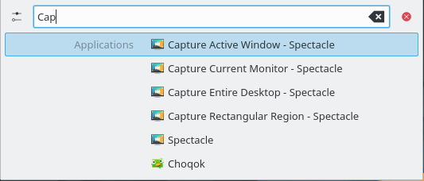

Pressing the Down key in an empty KRunner shows a history of recent searches. After you use a search result, its query moves to the top, so repeatedly used commands never fall out of the list. You can remove single entries with their button, or clear the whole history in the settings.

To see what's going on in your system, Meta+Esc opens [System Monitor](applications/system-monitor.md), which lists running processes with options to monitor and kill them.

## Activities

Meta+Q shows the activity switcher, and you can have more than one activity. An activity holds its own set of desktop widgets. Select one from the bar, or use its button to create and configure one in [Activities](settings/activities.md).

Activities and [virtual desktops](settings/virtual-desktops.md) differ in a fundamental way. Virtual desktops group and organize windows, while activities group and organize your work and its widgets. So you can have a “Free time” activity with comic strips and a puzzle, and a “Work” activity with relevant feeds, a calculator and a calendar.

Delete an activity in the [Activities](settings/activities.md) module.

## Shortcuts

Much of the desktop's functionality is available through keyboard shortcuts. You can change them in [Shortcuts](settings/shortcuts.md). These are the defaults:

- **Meta** or **Alt+F1:** Open the application launcher.
- **Meta+1** and so on: Activate a Task Manager entry.
- **Meta+Alt+P:** Move keyboard focus between panels.
- **Alt+Space** or **Alt+F2:** Open KRunner.
- **Alt+Shift+F2:** Run a command from the clipboard's contents.
- **Meta+Q:** Show the activity switcher.
- **Ctrl+F12:** Show the desktop.
- **Meta+D:** Peek at desktop.
- **Meta+Esc:** Open System Monitor.

Switching to the next and previous activity have shortcuts you can assign, with none by default.
