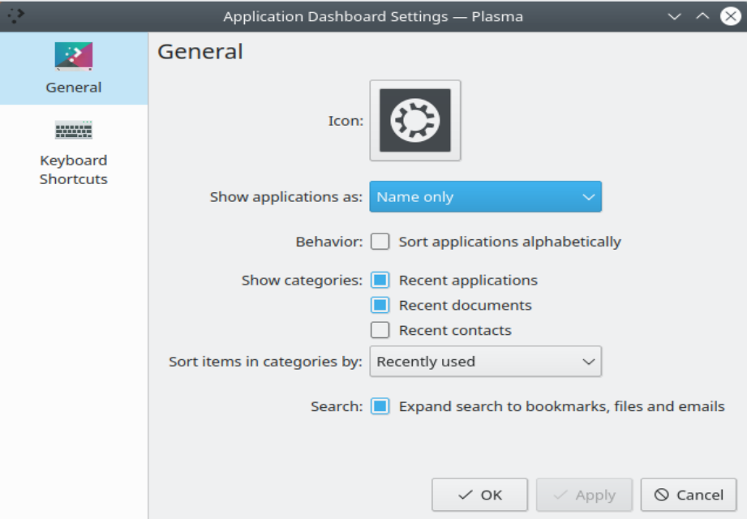

# Application Dashboard

The Application Dashboard is an alternative [launcher](launchers.md) that fills the whole screen. This is useful on smaller screens and with touch screens.

It has all the features of the [Application Menu](application-menu.md), with scaling to the screen's size and full spatial keyboard navigation. It lets you quickly find applications, as well as recent or favorite files.

## Using the Application Dashboard

The top of the screen shows your search term. To search, just type. You don't need to click the search line, which isn't clickable anyway. In general, clicking anywhere that isn't clickable closes the Application Dashboard. So if you don't know how to get out, just click an empty area.

Icons appear in groups below that. The first group from the left is **Favorites**, which shows your favorite applications. Change their order by dragging them with the left mouse button, and add new favorites by dragging them into the group.

Below the favorites are the buttons for logging out, shutting down and restarting.

The middle section shows the icons of the application group selected on the right. The right section lists the application groups. Select a group to show its applications in the middle section. You can also select **All Applications**, or **Recent Applications** to show those you've used recently.

To see a list of recently used files, select **Recent Files**.

## Configuring the Application Dashboard

To open the settings dialog, right-click the Application Dashboard's icon in the panel and choose **Configure Application Dashboard…**. You can set:

- Whether applications are shown by name, by description or both
- Whether lists are sorted alphabetically
- Whether to show the recent or often used applications, files and places
- Whether items in categories are sorted by recently used or often used
- Whether search includes bookmarks, files and emails
