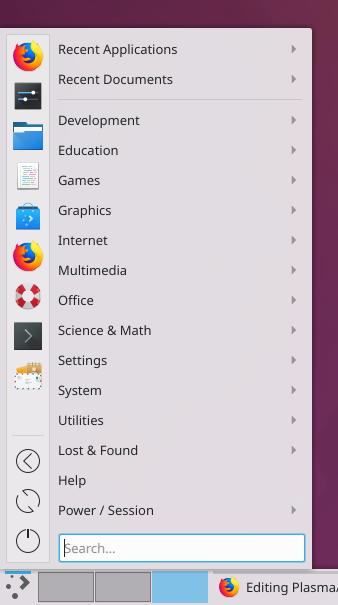
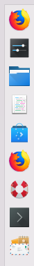
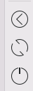
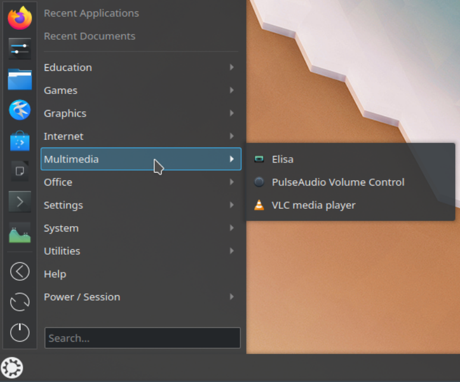
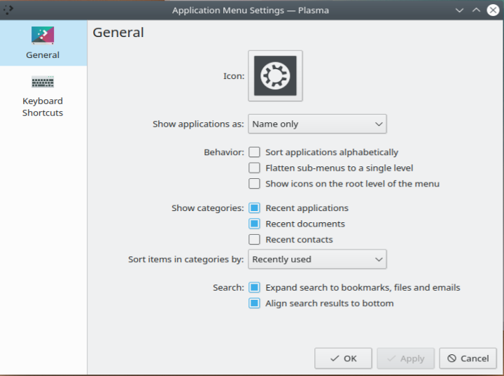

# Application Menu

The Application Menu is a [launcher](launchers.md) with fewer features than the others, and a tightly arranged interface. These screenshots are older, so it may look different now.

Unlike the [Application Launcher](kickoff.md), it has no tabs, and most options are together in one place. You have a favorites section, direct buttons for shutting down, restarting and logging out, a section with recently opened applications and files, and all your applications sorted by category. A search field completes it.

Because you don't have to switch between tabs, you can reach all of these much faster.

The favorites section is at the top left of the window, where your favorite applications appear as icons. Right-click one to get a context menu, where you can add its icon to the desktop or a panel, pin it to the task manager or remove it from the favorites.

To add an application to the favorites, find it in the menu by category on the right and right-click it. Choose **Add to Favorites** and you're done.

To move an application in the favorites, click and hold it, drag it up or down the list to the position you want, and release the mouse button.

Strictly speaking, the buttons for shutting down, restarting and logging out are just favorites too. They come from the **Power / Session** category of the menu on the right. You add, move or remove them in the same way as all other favorites.

At the top right of the window, you'll find your recently opened applications and files when you click the matching category.

Below that are all your applications, sorted by category. Clicking a category opens a list of applications or subcategories. Right-click an application to get a context menu, where you can add its icon to the desktop or a panel, pin it to the task manager, add it to your favorites or hide it from the menu.

The search field lets you search for applications, and also for files, bookmarks and emails unless you've turned that off in the settings.

In the settings you can choose:

- **Icon:** Click the icon to open a menu: **Choose…** picks another icon for the launcher button, and **Reset to default icon** goes back to the standard one.
- **Show applications as:** The name, the description, or both.
- **Behavior:** Sort applications alphabetically, flatten sub-menus to a single level, show icons on the root level of the menu, and highlight newly installed applications.
- **Show categories:** Which recent or often used applications, files and places to show.
- **Sort items in categories by:** Recently used or often used.
- **Search:** Expand the search to bookmarks, files and emails, and align the results to the bottom.

## History

Eike Hein wrote this widget as a complete rewrite of the old Homerun widget from the KDE 4 era.
