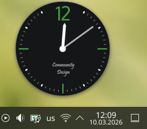
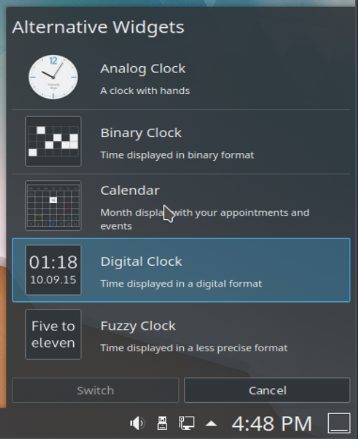

# Clocks

Several widgets let you display the time on your desktop or in a panel.

See [Widgets](overview.md#widgets) for how to add a widget to the desktop or a panel, and how to move it or change its size.

All the clock widgets display the system time unless you tell them to use another time zone. To change the system time, use the [Date & Time](../settings/date-time.md) module. Click any clock widget and a calendar pops up. Click anywhere outside the calendar to make it disappear.

By default, there is one clock widget on the right of the panel. This page concentrates on that clock, but everything here also applies to clock widgets on the desktop.

Right-click for a context menu. **Show Alternatives…** lets you pick another clock widget, and **Configure** lets you configure the current one.

You can choose between an analog clock, a binary clock, a digital clock, a calendar and a fuzzy clock.

**Analog clock:** A classic clock with hands. Its settings can add a second hand and show the time zone.

**Binary clock:** Shows the time in binary, by lighting up LEDs. Its settings choose whether to show a grid, whether inactive LEDs light up too in a different color, and whether to show seconds. The LED color can also be changed.

**Digital clock:** Shows the time as on a digital watch. It has more settings than the others, on several tabs:

- **Appearance:** Whether to show the date, seconds and time zone. The clock can be switched between 12-hour and 24-hour mode, and the font can be changed.
- **Calendar:** Lets you add week numbers to the calendar.
- **Time Zones:** Changes the time zone shown.

**Fuzzy clock:** Shows the time as a spoken expression, like "Twenty to six". Its settings can make the font bold or italic and adjust the fuzziness. At maximum accuracy it changes every five minutes, and as fuzziness increases the changes get further apart. At maximum fuzziness it may only say "Weekend".

**Calendar:** Doesn't display a clock, but a calendar view instead. Its settings can show week numbers.
