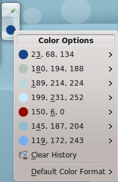
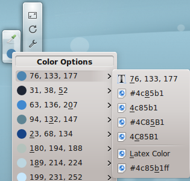

# Color Picker

Use this widget to capture the color of something on your screen.

When you work in a graphics editor, there is usually a tool for picking a color from the image you have open. But if you're working in a browser and want to know about a color on a web page, you need the Color Picker widget.

> **Tip:** See [Installing widgets](installing-widgets.md) for how to add it, if it's not in your **Add Widgets** list.

Like all widgets, you can make it bigger or smaller, though it doesn't shrink below the size of its icons.

To choose a color, click the upper icon, which shows a small dropper. Crosshairs appear on the screen. Move them with your mouse or touchpad until they center on the color you want, then click the left mouse button.

The color you clicked appears in the lower circle icon as a visible patch. It's also added to the widget's history, which you can see by clicking the color circle.

If you move the pointer over a color in the list, you can see it in a variety of formats. For most people, the default decimal values are the most useful. You can change the default format to your preference.

For example, say you want to pick a color on the screen to use in an image editor. Pick the color, then click the color circle and click the HTML format `#bac4bd`, which also puts the color on the clipboard. Then switch to your image editor, click its foreground color tool, and paste the color into the dialog. The application you use may need a different format. In the worst case, you can type the numbers yourself when it gives you a separate field for each decimal value of red, green and blue (RGB), here 186, 196, 189.

You can set the Color Picker to use the format you need most often as the default. That's the last option in the history list.
