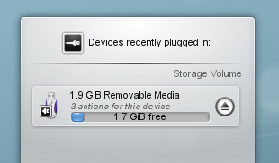
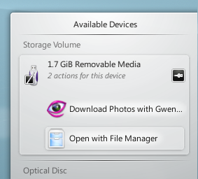

# Disks & Devices

The Disks & Devices widget, once called the Device Notifier, handles pluggable devices such as USB sticks, digital cameras and external USB hard drives. It also comes into play when a medium such as a CD or DVD is loaded into an optical drive.

When you plug in an external device or load a new medium, its window pops up. You can also open it by clicking its panel icon. It stays open while the pointer is over it, and otherwise hides itself after a few seconds. Its context menu can turn off **Show popup when new device is plugged in** and choose which devices to list.

The window lists all the devices it currently knows about. Moving the pointer over a device highlights the actions available for it.

Clicking anywhere in the box around the device name, but not on the eject or unmount icon if there is one, expands the entry to show its possible actions. The actions depend on the device, and you can configure them in the [Device Actions](../settings/device-actions.md) module. Select one with the mouse or keyboard to start it. **Configure Removable Devices…** opens the [Device Auto-Mount](../settings/device-automount.md) module.

A small icon to the right of each entry shows whether that device is currently accessible, or *mounted*. It's only safe to physically disconnect a device when it isn't mounted. Clicking the icon unmounts the device or ejects the medium if it's mounted, and mounts it if it isn't. Unmounting or ejecting can fail if the device still has files open, for example if a large copy hasn't finished. In most cases you can just wait a while and try again.
