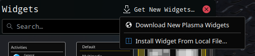
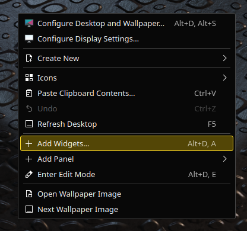
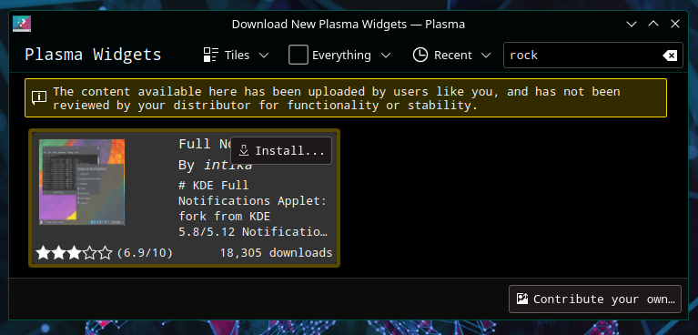
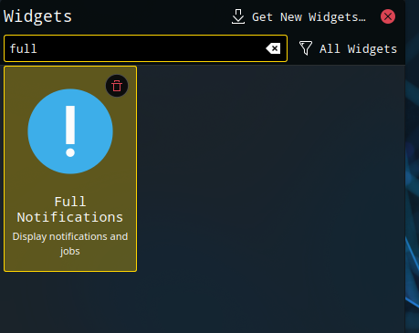
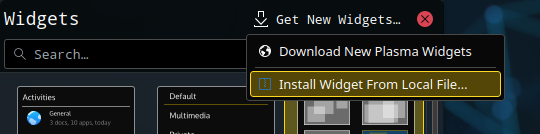
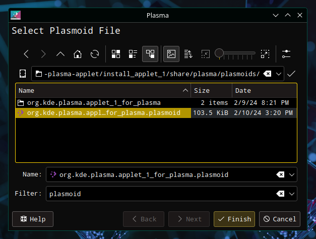

# Installing widgets

Found a new widget, but don't know how to install it? Here's how. These screenshots are older, so the dialogs look different now.



## Installing from the store

Right-click the desktop, choose **Enter Edit Mode**, then open **Add Widgets**.



Click **Get New Widgets…**, then **Download New Plasma Widgets**.

Search for the widget you want and click **Install**.



Drag the installed widget to the desktop or a panel as usual.



## Installing from a local file

Open **Add Widgets** as above, click **Get New Widgets…**, then **Install Widget From Local File…**.



Select a local file and click **Finish**.



## Installing from a terminal

To install a widget from [Terminal](../applications/terminal.md), type:

```sh
kpackagetool6 -t Plasma/Applet -i widget-file-name.plasmoid
```
