# Application Launcher

The Application Launcher is the default launcher of the desktop. In the default layout it sits at the far left of the bottom [panel](panels.md). Besides its main purpose, giving access to your applications, it gives you access to some places on your computer, your recently used documents and the options to end your session. These screenshots are older, so it may look different now.

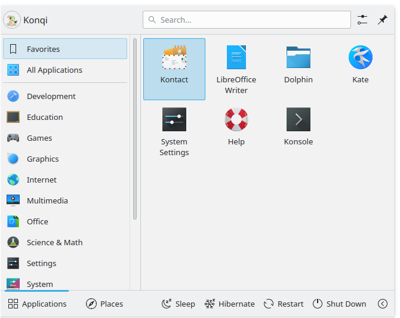

## Opening it

To open it, click its icon, usually at the far left of the panel at the bottom of the screen, or press Meta or Alt+F1. At the top you can see the search field, and at the bottom two tabs, **Applications** and **Places**, as well as power and session options.

## The Applications tab

This tab gives you access to your applications and favorites.

### Favorites

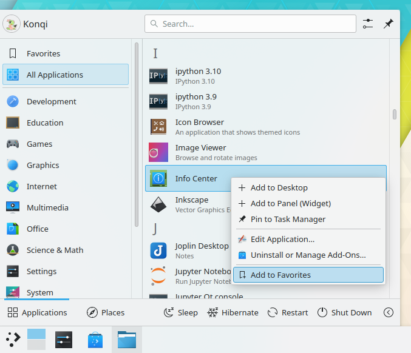

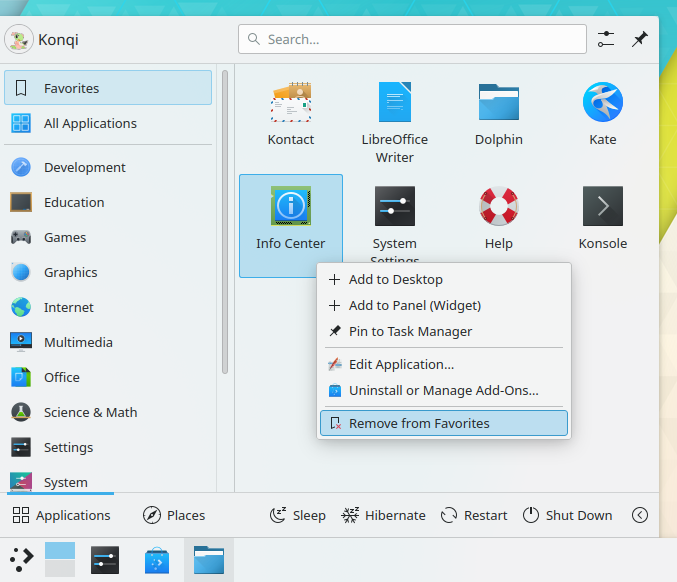

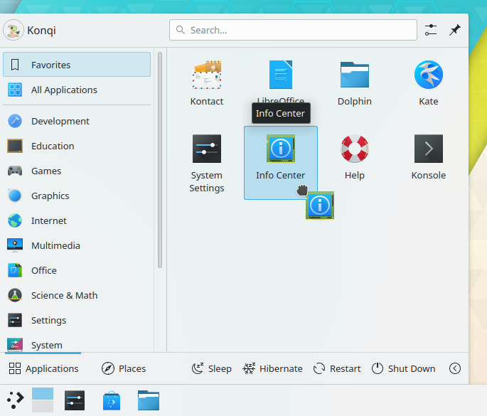

The favorites section is where you can pin your favorite applications. Drag and drop an entry to sort it your way. Right-clicking an entry gives you more options: you can remove it with **Remove from Favorites**, or copy it to the panel with **Add to Panel (Widget)** or to the desktop with **Add to Desktop**.

### Applications

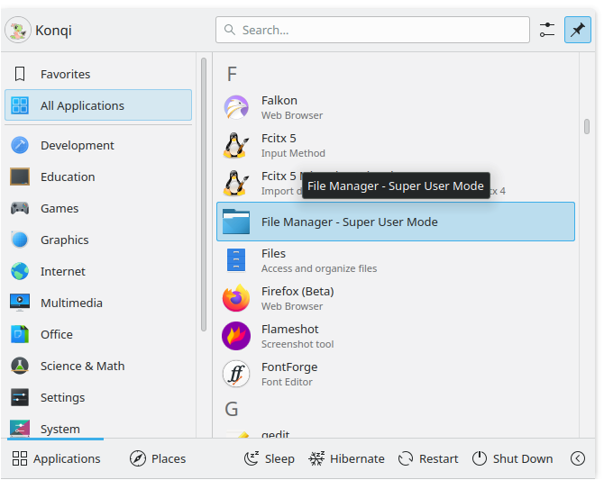

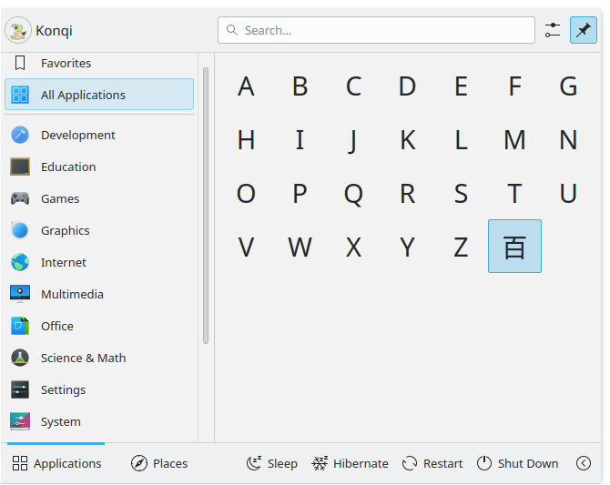

This section gives you access to all installed applications, divided into categories such as Office or Internet. There is also an **All Applications** section. Hover over a category to see the applications in it. Right-click an application to get options such as **Add to Favorites**, **Add to Panel (Widget)** and **Add to Desktop**.

## The Places tab

This tab gives you access to different places on your computer.

### Computer

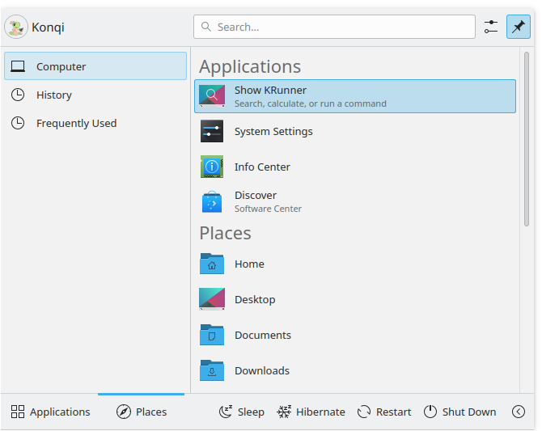

In the **Computer** section you'll find links to system applications such as [System Settings](../settings/index.md), your favorite places, configured through [Ecco](../applications/ecco.md), and available storage media. Right-clicking these entries offers to add them to the desktop or a panel.

### History

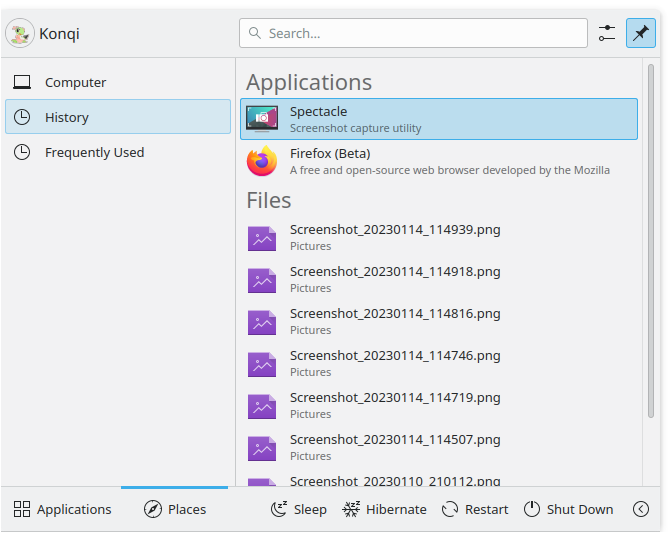

Your recently used applications and documents appear in this section. A right-click on an entry brings up the usual context menu, with options for clearing the history.

### Frequently Used

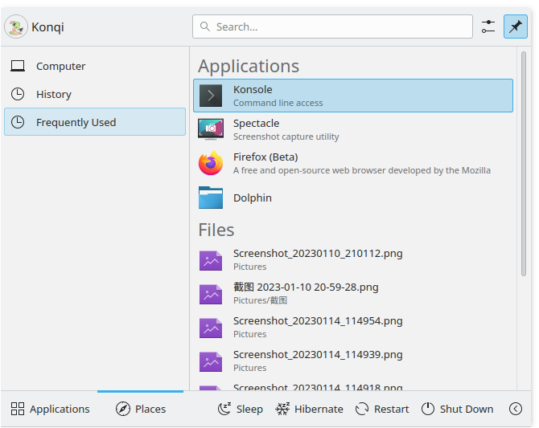

Your frequently used applications and documents appear in this section. A right-click on an entry brings up the usual context menu, with options for clearing the history.

## Search field

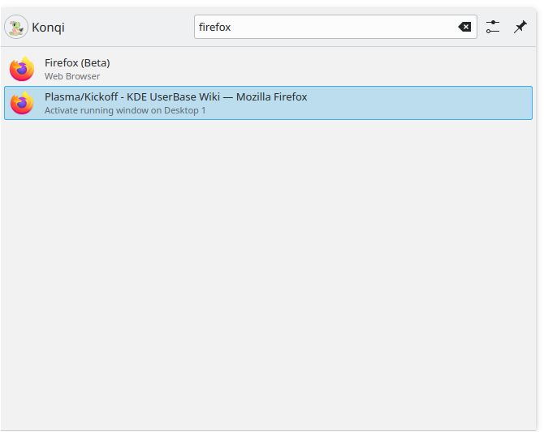

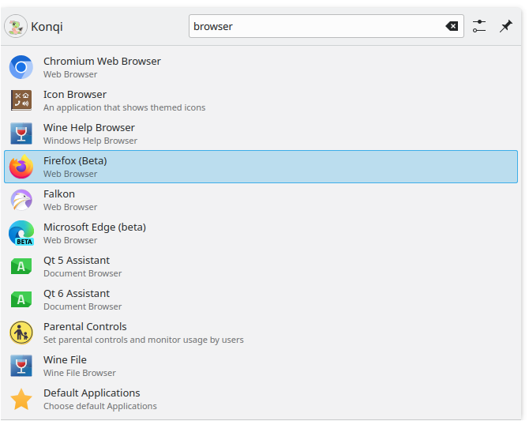

Instead of browsing through tabs and categories, you can simply enter a search term. The search field has focus when the menu opens, so you can just start typing. The search matches not only application names but also their descriptions. So if you need a browser but don't know the names of the installed ones, type "browser" to get a list of them.

## Adding to the desktop and panel

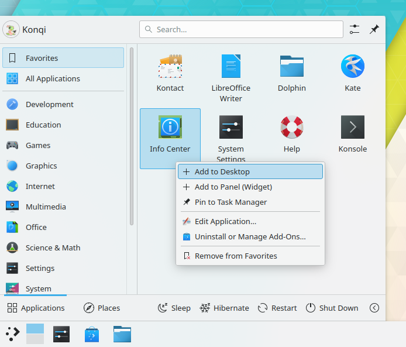

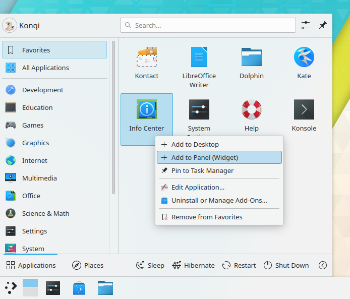

Applications can be added to the desktop and panels. Right-click one and choose **Add to Desktop** or **Add to Panel (Widget)**.

## Editing the menu

Right-click the launcher button and choose **Edit Applications…** to open the [SonicDE Menu Editor](../applications/menu-editor.md), where you can change the entries in the menu.

## The launcher button

To change how the launcher button looks, right-click it and choose **Configure Application Launcher…**. On the **General** page:

- **Icon:** Click the icon to open a menu: **Choose…** picks another icon, **Reset to default icon** goes back to the standard one, and **Remove icon** shows no icon, so the button only shows its text label. **Remove icon** is only available when the button has a text label and the panel isn't vertical.
- **Text label:** Type a label to show next to the icon. The clear button in the field, **Reset menu label**, removes the label again, and brings the default icon back if the button had none. A text label can't be set when the panel is vertical.

The other settings on this page are described in [The SonicDE desktop](../desktop.md#application-launcher-settings).

## Alternative launchers

Other launchers, such as [KRunner](krunner.md), may fit your needs better. See [Application launchers](launchers.md) for details.

To change your launcher, right-click the launcher icon and choose **Show Alternatives…**.

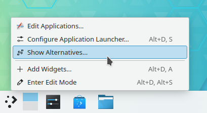

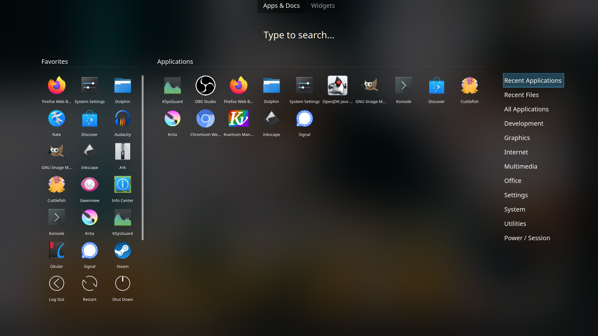
