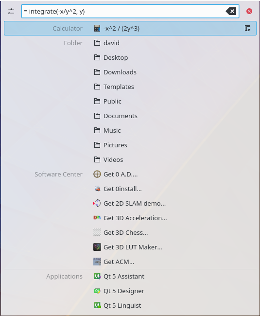
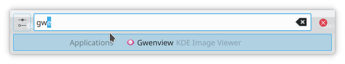
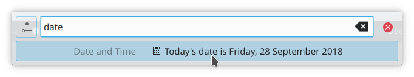
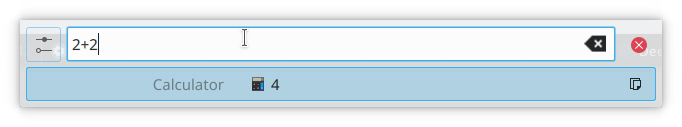

# KRunner

KRunner, opened with Alt+Space or Alt+F2, is the launcher built into the desktop. Its basic function is to start programs from a sort of mini command line, but plugins called *runners* extend it to help you with a lot of tasks.

> **Note:** Your distribution may package some runners separately, so you may need an additional package for some of what's listed here. A large number of active runners can slow down KRunner's start. Adjust them with the settings icon next to the text field.

## Features

This incomplete list gives some basic examples. Discover more by clicking the question mark icon in KRunner.

### Start and stop applications

*Runner: Applications*

You can start a program by typing its name.

You can type a single character and KRunner starts finding matches, from the applications in your application menu.

| Input | Output |
| --- | --- |
| `ter` | Starts [Terminal](../applications/terminal.md) |

You can use KRunner to stop applications too (*runner: Terminate Applications*). Type the keyword `kill` followed by a process name, and KRunner offers to close the application (**Send SIGTERM**) or force it to quit (**Send SIGKILL**). It matches partial process names to running processes.

The Terminate Applications plugin has its own settings, which you open from the [Search](../settings/search.md) module:

- **Use trigger word** and **Trigger word:** The keyword is `kill` unless you change it, for example to avoid confusion with the shell command `kill`, which takes process IDs. Turn **Use trigger word** off to find running applications by name without any keyword.
- **Sort by** Orders the matching processes by **CPU usage**, **inverted CPU usage** or **nothing**.

### Direct installation

*Runner: Software Center*

If you look for an application that isn't installed yet, KRunner can suggest matching applications. This needs a software center on your system that can handle them. SonicDE doesn't ship one.

### Issue shell commands

*Runner: Command Line*

As well as applications in the menu, KRunner can run shell commands, including starting binaries. When you enter shell commands, KRunner doesn't accept partial commands or offer auto-completion.

A command found this way also offers **Run in Terminal Window**, which runs it in a terminal so you can read its output.

| Input | Output |
| --- | --- |
| `ls ~/Documents` | Lists the contents of `~/Documents` (best in a terminal) |
| `cp ~/Documents/myFile ~/myFile` | Copies `myFile` from `~/Documents` to `~/` |

If you like the command line, you may appreciate the integration with man pages. Type a command name preceded by `#` or `man:/` to open its man page, formatted for easy reading.

| Input | Output |
| --- | --- |
| `#ls` | Opens the manual for `ls` |
| `man:/grep` | Opens the manual for `grep` |

### Browse websites

*Runners: Bookmarks, Locations, Web Search Keywords*

You can start typing a website's address to open it in your default browser. You can also type the name of a browser bookmark, or the keyword `bookmarks` to list all of them. With [browser integration](../applications/browser-integration.md), KRunner can also find your open tabs and your browser history.

| Input | Output |
| --- | --- |
| `myBookmark` | Opens the bookmark in a browser |
| `wikipedia.org` | Opens Wikipedia in a browser |

KRunner already knows your [web search keywords](../settings/web-shortcuts.md), so you can use them directly.

| Input | Output |
| --- | --- |
| `gg:SonicDE` | Searches Google for SonicDE |
| `wp:krunner` | Searches Wikipedia for KRunner |
| `!wp krunner` | Searches Wikipedia for KRunner, written in the DuckDuckGo "bang" style |

If your default browser has a private or incognito mode, a web search result also offers **Search in private window** or **Search in incognito window**.

### Open files, folders and devices

*Runner: Locations*

KRunner can open files and folders on your computer, and browse remote machines too, using [network and file protocols](../protocols/index.md) such as `fish:` for SSH and `smb:` for Samba.

| Input | Output |
| --- | --- |
| `file:/home/` | Opens `/home` in [Ecco](../applications/ecco.md) |
| `fish:you@server.com` | Opens `fish:/you@server.com/` through the fish protocol, file transfer over SSH |
| `smb:myWindowsBox` | Opens `smb:/myWindowsBox` through Samba |

If you don't know the path to a file, type its name. If it's a recently opened file, KRunner lists it. If you've turned on [File Search](../settings/file-search.md), it can also find the file by its indexed contents. Found files offer **Open Containing Folder**, which opens the folder the file is in. KRunner opens folders you've bookmarked in Ecco's Places panel if you type their name; the keyword `places` lists all of them. It can also reach devices on your system, whether mounted or not, and offers options specific to each device.

| Input | Output |
| --- | --- |
| `Home` | Opens your Home folder in Ecco |
| `myFlashDrive` | Shows options to mount or open the contents of `myFlashDrive` |

### Multitask with sessions, windows, desktops and activities

KRunner can start the saved Terminal profiles and Kate sessions on your system. Type the application's name, or the name of the profile or session.

If you have too many windows open, type a window's title and switch directly to it. You can do the same with the name of a virtual desktop or an activity. KRunner finds a match as soon as you've typed three characters.

KRunner can also switch desktop sessions. Type the whole keyword `switch user` or `new session` to get a **Switch User** result, which lets you log in as another user without closing your own session.

| Input | Output |
| --- | --- |
| `Desktop 1` | Switches to virtual desktop Desktop 1 |
| `myWorkActivity` | Switches to the activity myWorkActivity |
| `switch user` | Switches to a session as a different user |
| `new session` | The same as `switch user` |

### Be on time

You can get the current date or time by typing the keywords `date` or `time`. Selecting the result copies it to your clipboard, so you can paste it elsewhere. The format follows your system settings.

| Input | Output |
| --- | --- |
| `date` | Today's date is … |
| `time` | The current time is … |

You can also get the date and time elsewhere, by giving the time zone or a city listed in the time zone database.

| Input | Output |
| --- | --- |
| `time UTC` | The current time in UTC is … |
| `time oslo` | The current time in Europe/Oslo is … |
| `time kolkata` | The current time in Asia/Kolkata is … |

### Calculator

KRunner has a versatile calculator. It works out anything made only of numbers and symbols such as `+`, `-`, `/`, `*`, `!` and `^` as you type, as well as hexadecimal numbers like `0x1F` and expressions that start with a known function, like `sqrt(4)`. For anything else, such as calculations with units, start or end the calculation with an `=` sign. As well as basic arithmetic, you can use scientific functions like `sqrt()`, `sin()` and `log()`. There is a [list of the supported functions](https://qalculate.github.io/manual/qalculate-definitions-functions.html). Trigonometric functions like `sin()` and `cos()` expect the angle in radians. KRunner understands `pi` in expressions.

| Input | Output |
| --- | --- |
| `32*12 =` | 384 |
| `= sqrt(4) + 32*sin(30*pi/180)` | 18 |

Each result has a **Copy to Clipboard** button.

To see the result in another number base or format, put one of these words before the `=` sign: `bin`, `oct`, `dec`, `duo` (base 12), `hex`, `sexa` (base 60), `roman` or `time`. `base` followed by a number, such as `base7`, picks any other base.

| Input | Output |
| --- | --- |
| `hex=255` | 255 in hexadecimal |
| `roman=2024` | 2024 in Roman numerals |

It also supports combinatorics functions like `perm()` and `comb()`.

| Input | Output |
| --- | --- |
| `= perm(10,5)` | 30240 |
| `= comb(10,5)` | 252 |

It can handle symbolic mathematics, including integration and differentiation of expressions.

| Input | Output |
| --- | --- |
| `= integrate( -x/y^2, y )` | -x/y |
| `diff( log(x) ) =` | 1/x |

It can also find the roots of polynomial functions.

| Input | Output |
| --- | --- |
| `= solve( x^2 + 4*x - 21 = 0 )` | [3, -7] |

It handles units as part of calculations.

| Input | Output |
| --- | --- |
| `= 2.5 kg * 10 m/s^2` | 25 N |
| `220 V / 10 A =` | 22 ohms |

Since KRunner understands most units, you can use it to convert them quickly. Unit conversions don't need an `=` sign.

| Input | Output |
| --- | --- |
| `30 F` | -1.11111 degrees C (°C), 273.039 K, … |
| `27.8 km` | 1.09449e+06 inches (in), 17.2742 miles (mi), … |
| `5 gallons in liters` | 18.9271 liters (l) |

KRunner knows currencies too, using exchange rates fetched from the [European Central Bank](https://www.ecb.europa.eu/stats/policy_and_exchange_rates/euro_reference_exchange_rates/html/index.en.html). The amounts below are only examples.

| Input | Output |
| --- | --- |
| `1 dollar` | 0.657002 pounds sterling (GBP), 0.742501 euros (EUR), … |
| `125 euros` | 110.606 pounds sterling (GBP), 15,785 yen (JPY), … |
| `30 JPY in RUB` | 9.40731 rubles (RUB) |

### Spell checking and special characters

*Runners: Spell Checker, Special Characters, Dictionary, Colors*

KRunner can tell you whether your spelling is correct and suggest corrections. The default keyword to start the spell checker is `spell`. In the Spell Checker plugin's settings, **Trigger word:** changes the keyword, and turning off **Require trigger word** checks the spelling of anything you type. **Configure Dictionaries…** opens the [Spell Check](../settings/spell-check.md) settings.

| Input | Output |
| --- | --- |
| `spell linux` | Suggested words: Linux, lynx, … |

KRunner can also give you special characters if you enter the character's hexadecimal Unicode value, preceded by `#`. In the Special Characters plugin's settings, **Trigger word:** changes the `#`, and you can give characters names of your own: type a name in **Alias:** and the character's code in **Hex code:**, then click **Add Item**. **Delete Item** removes the selected name again. You can then type the trigger word followed by the name instead of the code.

| Input | Output |
| --- | --- |
| `#03b2` | β |
| `#00b1` | ± |

To look up what a word means, type `define` followed by the word. Selecting a definition copies it to the clipboard. The keyword can be changed with **Trigger word:** in the Dictionary plugin's settings.

| Input | Output |
| --- | --- |
| `define keyboard` | The definitions of "keyboard" |

KRunner also shows colors. Type a hexadecimal color such as `#FF00FF`, a color name such as `orange`, or `rgb(255,0,255)` or `rgba(255,0,255,128)`, and the result shows the color with its RGB and CMYK values.

### Manage your computer

You can open [System Settings](../settings/index.md) modules directly from KRunner. If you want to change something, type related terms and KRunner finds the module with the settings you want.

| Input | Output |
| --- | --- |
| `keyboard` | Opens the Keyboard module |
| `fonts` | Opens the Fonts module |

KRunner can also adjust the screen brightness with the keywords `screen brightness`. You can give a percentage or dim the screen halfway or fully. Other keywords suspend your computer, log out, shut down or restart.

| Input | Output |
| --- | --- |
| `screen brightness 100` | Sets the screen brightness to 100% |
| `sleep` | Suspends the computer to RAM |
| `lock` | Locks the screen |
| `restart` | Restarts the computer |
| `shutdown` | Shuts down the computer |
| `logout` | Logs out |
| `save session` | Saves the open applications, so they can be restored at the next login |

The session keywords must be typed in full. Each has alternatives: `log out`; `shut down`, `power`, `poweroff` or `power off`; `reboot`; `lock screen`; and `save`.

### Find global shortcuts

*Runner: Global Shortcuts*

Type what you want to do, and KRunner lists the global shortcuts whose names or descriptions match, together with the application they belong to and their key combination. Select a result to carry out its action straight away. This is also a quick way to find out which keys do something.

### Consoles for scripting and debugging

*Runners: Plasma Desktop Shell, KWin*

These are mostly useful for developers and people who write scripts:

- `desktop console` opens the interactive console for desktop scripts, and `wm console` the one for window manager scripts. Add the path to a script file, as in `desktop console ~/myscript.js`, to open the console with that script.
- `kwin debug console` offers **Open KWin debug console**, which opens the window manager's debug console window. Any query containing `kwin`, `debug` or `console` offers it too. Its **Effects** tab can turn on the [effects for finding problems](../settings/desktop-effects.md#effects-for-finding-problems).

## Usage

### Open KRunner

The easiest way to open KRunner is its global shortcut, Alt+Space or Alt+F2 by default. You can also start it from the command line by typing `krunner`.

### Use KRunner

Use Tab or Ctrl+J and Shift+Tab or Ctrl+K to move down and up the results. Use the arrow keys to move between a result's options, if it has any. Use Enter or a left click to select a result.

KRunner normally closes when you click somewhere else. Click the pin button, **Keep Open**, at the right of the search field to keep it open.

### Search history

KRunner remembers what you searched for, unless **History:** is set to **Disabled**. When the search field is empty, press the down arrow, or click the arrow at the right of the field, to see your **Recent Queries**. Select one to search for it again, or click **Remove** next to it to forget it.

Depending on the **History:** setting, KRunner can also suggest a past search while you type: with **Enable suggestions**, the rest of the suggestion is shown faded and Tab accepts it; with **Enable auto-complete**, it's filled in directly.

### Discover KRunner

The settings icon, **Configure KRunner…**, opens KRunner's own settings: where on the screen it appears, how it uses your search history, and **Clear History…**. **Configure Enabled Search Plugins…** there leads to the [Search](../settings/search.md) module, where you can enable, disable and configure the plugins that handle your searches.

Clicking the question mark icon, **Show Usage Help**, opens a scrollable list explaining the syntax of all the available plugins. Typing `help` or `?` shows the same list. Each entry has a **Configure plugin** button. This is a good way to discover new functionality.

## Tips

You can use KRunner in a special "single runner" mode, where only one active runner handles your searches. Not every runner supports this, but many do. Open the [Shortcuts](../settings/shortcuts.md) module and look under KRunner to see what's available. Set a global shortcut for the mode you want, and start KRunner in that mode with it.
