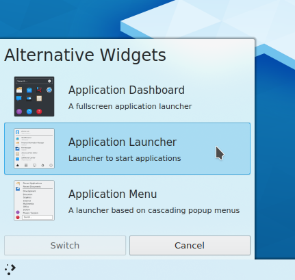
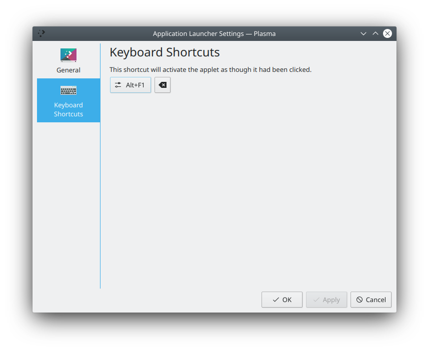
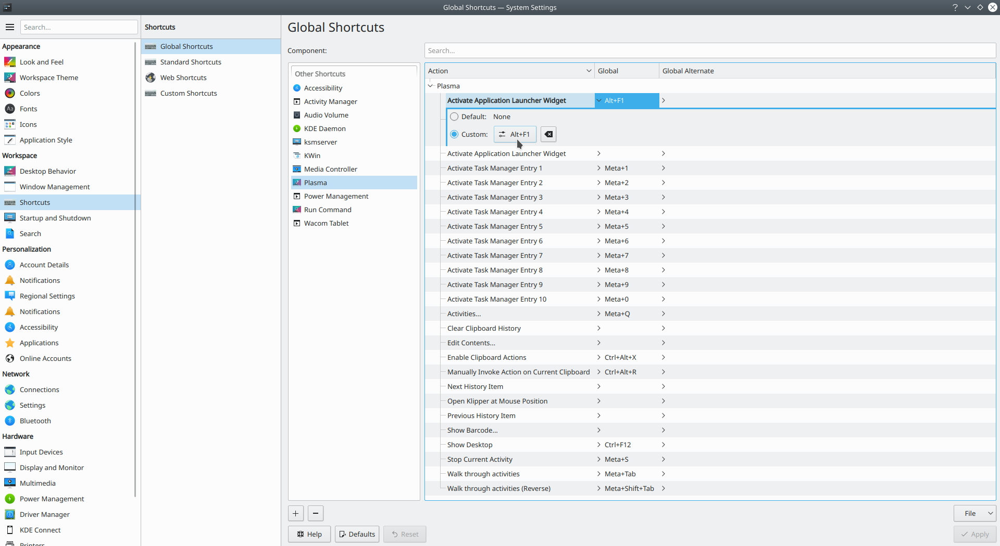

# Application launchers

SonicDE comes with several launchers:

- **[Application Launcher](kickoff.md):** The default launcher, with a click-through interface for finding and starting applications. It has a search facility, so you can type an application's name or description to find it.
- **[Application Dashboard](application-dashboard.md):** A fullscreen launcher with applications sorted into categories.
- **[Application Menu](application-menu.md):** A classic hierarchical menu that's easily customized to give quick access to useful applications and services.
- **[KRunner](krunner.md):** Replaces the "run command" dialog. It blurs the lines between task manager, desktop search, application launcher and command executor, and gives you a quick way to run applications or open documents, among other things.

Others, such as Excalibur and Tiled Menu, are available from the [KDE Store](https://store.kde.org/browse/cat/398/order/latest/).

## How to change the application launcher

To change the launcher, right-click your current one and choose **Show Alternatives…**, then choose the one you want to use.

> **Warning:** Some settings of the launcher you were using might be reset to defaults if you switch back.

If the launcher you want isn't in the list, you need to install it first. See [Installing widgets](installing-widgets.md).

## How do I change which key opens the launcher?

There are two ways. You can right-click your current launcher and choose **Configure Application Launcher…**, go to the **Keyboard Shortcuts** tab, click the button and type the combination you want.

You can also use System Settings' [Shortcuts](../settings/shortcuts.md) module, and find **Activate Application Launcher Widget** there.

If you ever want to restore the default Meta key, the combination Alt+F1 serves this purpose.

## I can't bind the Meta key to open the launcher any more

This can happen because of the way SonicWin binds keys. See [the section on the Meta key](tips.md#meta-key).
