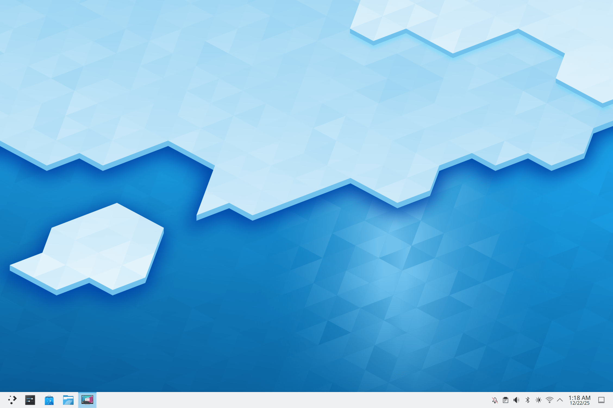
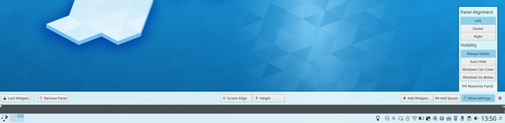
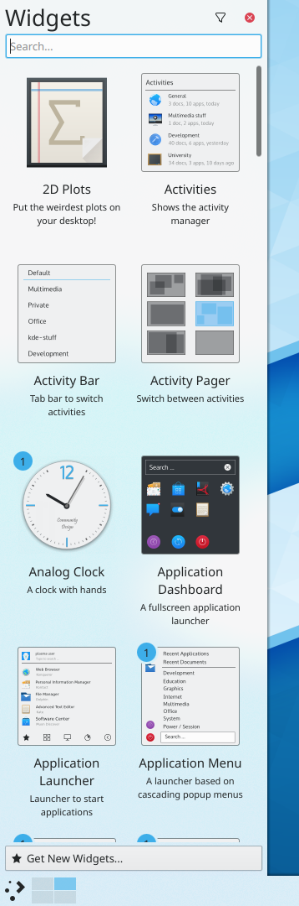
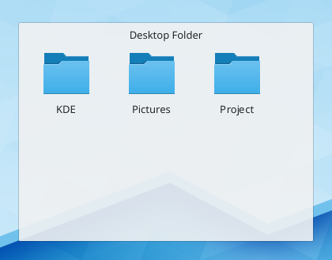
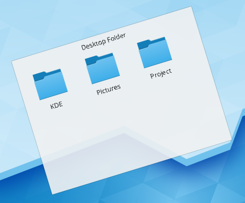
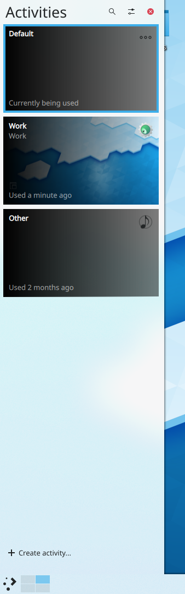

# Desktop overview

SonicDE's desktop can adapt to many types of devices. There is the desktop itself, which most of these pages are about, and the [mobile](../mobile.md) and [TV](../tv.md) interfaces.

A typical desktop looks like this:



The key parts of the default desktop are:

- **The [panel](panels.md)**, sometimes called the task bar, has room for the application launcher, the list of windows, the clock and the system tray.
- **The desktop**, the area where widgets and icons live.
- **The folder view**, which lists the contents of a folder on your computer and gives you quick access to basic file management.
- **Edit Mode**, which you enter by right-clicking the desktop or a panel and choosing **Enter Edit Mode**. It gives you quick access to configuration and other options.

All of these are fully configurable and can host a wide variety of tools and content. The [SonicDE desktop](../desktop.md) page explains each one in more detail.

## Finding your way around

You can use the desktop as you would that of any other operating system: open the [application launcher](kickoff.md), see your running programs in the [task manager](tasks.md), reach icons in the [system tray](system-tray.md), and so on.

An important part of the desktop is its *widgets*. Widgets are the individual units of the desktop, and they include the application menu, icons, the system tray and the clock. They can sit on the desktop itself or in a panel. Widgets exist for many tasks besides the usual desktop helpers, such as unit conversion, weather forecasts and more. Panels and desktops are special kinds of widgets themselves, made to contain other widgets.

## Folder views

Icons can be placed directly on the desktop or inside a Folder View widget. A Folder View shows a folder, by default the Desktop folder, and lets you drag files to it, open them, cut, copy, paste and rename them, and create new files and folders.

You can have more than one Folder View on the desktop, and they can also be placed in panels. A Folder View can show any folder you have access to, local or remote. Each one can be moved and resized independently.

Folder View can also be set as the layout of the whole desktop, for a more traditional layout with icons scattered on the desktop.

## Panels



Panels let you place widgets around the edges of the screen. They can be configured in various ways, including hiding automatically when not in use and being aligned to certain areas of the screen.

By default, there is one panel at the bottom of the screen. You can add more, move and configure the default one, and remove panels you no longer want. The widgets in all panels can be adjusted to your liking. For more, see [Panels](panels.md).

## Widgets



SonicDE supports widgets written for its desktop, also known as plasmoids. More can be found and installed with the **Get New…** button in **Add Widgets**. See [Installing widgets](installing-widgets.md).

To see the widgets installed on your system and ready to use, right-click the desktop or a panel, choose **Enter Edit Mode**, then open **Add Widgets**.

To place a widget on the desktop, drag it there from the list. To place one in a panel, drag it to the position you want in the panel.

To configure a widget, right-click it, or hover over it in Edit Mode. The screenshots below show the older handle, which had tools for resizing, rotating and configuring. Rotating widgets is no longer offered.





[Widgets](widgets.md) describes some useful ones.

## Activities



Activities give you multiple desktop setups, each with a different set of widgets. You manage them in the [Activities](../settings/activities.md) module.

For example, someone who likes web comics adds their favorites through the comic widget, so they have a whole activity dedicated to them. They then have to go to work, so they create an activity with Folder View widgets for the folders of their current projects. After work, they have a side project writing novels, so they create a third activity with pictures that inspire them and a Folder View of the novel's folder. Whatever they're doing, they have an activity tailored to it.

## Hints and tips

[Desktop tips](tips.md) lists a lot of useful tips.

### Restarting the shell

Sometimes you might want to restart the desktop shell, because of a problem with the desktop for example. Open a terminal or [KRunner](krunner.md) and run:

```sh
kstart sonicshell --replace
```

## More information

- [Glossary](../glossary.md)
- [Widgets](widgets.md)
- [Installing widgets](installing-widgets.md)
- [KRunner](krunner.md)
