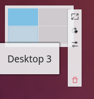
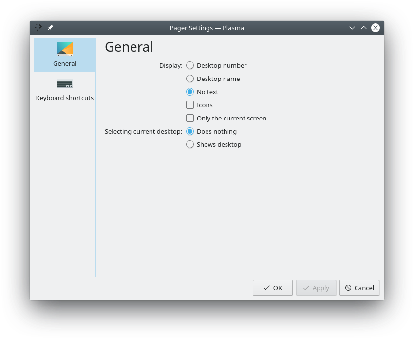

# Pager

The Pager is a widget that helps you organize [virtual desktops](../settings/virtual-desktops.md). It gives a small preview of each virtual desktop, with rectangles that represent the windows on that desktop. Click a preview to switch to that desktop. Hover over a preview to see a list of the applications on it. The context menu (right-click) can add a new virtual desktop or remove the last one.

The Pager also shows the arrangement of the virtual desktops, for example 2x2, 1x4 or 3x4. This arrangement influences the desktop switching animation.

## Configuration

Right-click the Pager and choose **Configure Pager…**.

You can configure:

- **General:** **Show window outlines**, **Show application icons on window outlines**, **Show only current screen** and **Navigation wraps around**.
- **Text display:** No text, the desktop number or the desktop name.
- **Selecting current virtual desktop:** What happens when you click the preview of the active desktop: it does nothing, or shows the desktop.

The Pager's context menu also has **Add Virtual Desktop**, **Remove Virtual Desktop** and **Configure Virtual Desktops…**, which opens the [Virtual Desktops](../settings/virtual-desktops.md) settings.

## Activity Pager

The **Activity Pager** widget works like the Pager, but for [activities](../settings/activities.md) instead of virtual desktops. It shows a small preview of each activity with the windows in it. Click a preview to switch to that activity, and hover over it to see the list of its windows. You can add it to a panel or the desktop like any other widget.

Right-click it for **Show Activity Manager** and **Configure Activities…**.

Its settings are the same as the Pager's, applied to activities:

- **General:** **Show window outlines**, **Show application icons on window outlines**, **Show only current screen** and **Navigation wraps around**.
- **Layout:** **Default**, **Horizontal** or **Vertical**: how the activity previews are arranged.
- **Text display:** **No text**, **Activity number** or **Activity name**.
- **Selecting current Activity:** **Does nothing**, or **Shows the desktop** when you click the preview of the activity you're already in.
